# Lab 04: Configure a dynamic P&L row model in Fabric Planning

## Scenario

Acme Beverages is a beverage manufacturer whose finance team builds its profit and loss (P&L) plans from account-level data in the P&L Data table. Analysts struggle to see how individual driver-level inputs, such as brewing materials, packaging, excise taxes, and marketing spend, roll up to the company's bottom line. This gap makes it difficult to explain changes in Net Profit and to plan with confidence.

To solve this problem, the finance team builds a row-based P&L model in the Acme_Beverages_Plan app by using the Row Model builder. The model connects every account to Net Profit through clearly defined relationships:

- **Data Source nodes** pull values directly from account rows in the P&L Data table, such as Gross Revenue, Brewing Materials, and Selling & Marketing.
- **Aggregate nodes** sum their child rows. COGS and Operating Expenses are aggregate nodes.
- **Formula nodes** calculate values from other nodes. For example, Net Revenue, Gross Profit, and Net Profit are formula nodes.

In this lab, you are a financial planning analyst at Acme Beverages. You create a planning sheet and configure a Row Model so that the team can trace how each driver-level input contributes to Net Profit.

## Introduction

In this lab, you build a row-based P&L model in the Acme_Beverages_Plan app by using the Row Model builder. You create a new planning sheet named Row Model from the P&L Data table, define Net Profit as the root node, and add Gross Profit, Net Revenue, COGS, and Operating Expenses as connected nodes. You then configure formula and aggregate relationships so that driver-level inputs roll up to Net Profit. This lab takes about 15 minutes to complete.

## Objectives

After completing this lab, you will be able to:

- Create a new planning sheet named Row Model with field assignments from the P&L Data table.
- Enable the Row Model in the Row Model builder and remove the default rows.
- Configure Net Profit as the root node by using the Formula type.
- Add data source rows for Net Revenue and configure a formula that deducts Returns and Breakage, Distribution Allowance & Rebates, and Federal & State Excise Taxes from Gross Revenue.
- Configure COGS and Operating Expenses as aggregate nodes of their contributing data source rows.
- Configure the Gross Profit and Net Profit formulas to complete the P&L hierarchy.
- View the full P&L hierarchy in the planning sheet.

## Architecture

You work in a Microsoft Fabric workspace and open the Acme_Beverages_Plan app. You create a Row Model planning sheet from the P&L Data table in the semantic model. In the Row Model builder, data source rows for revenue, COGS, and operating expense accounts roll up through aggregate and formula nodes to the Net Profit root node.

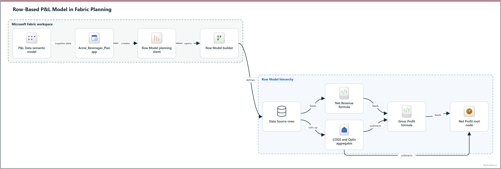

## Prerequisites

- Access to the **Acme_Beverages_Plan** app.
- The **P&L Data** table with the **Account**, **Date Hierarchy**, and **Value** fields available in the app.
- Basic familiarity with P&L concepts such as revenue, cost of goods sold (COGS), and operating expenses.

# Exercise 1: Build a row-based P&L model

In this exercise, you create the Row Model planning sheet and assign fields from the P&L Data table.

## Task 1: Set up a new planning sheet

In this task, you create the **Row Model** planning sheet in the Acme_Beverages_Plan app and assign fields from the P&L Data table. This sheet provides the account-level data that the Row Model builder uses to create the P&L nodes.

1. In your Microsoft Fabric workspace, select the **Day1-Plan** folder.
2. Select the **Acme_Beverages_Plan** item of type **Plan**.

   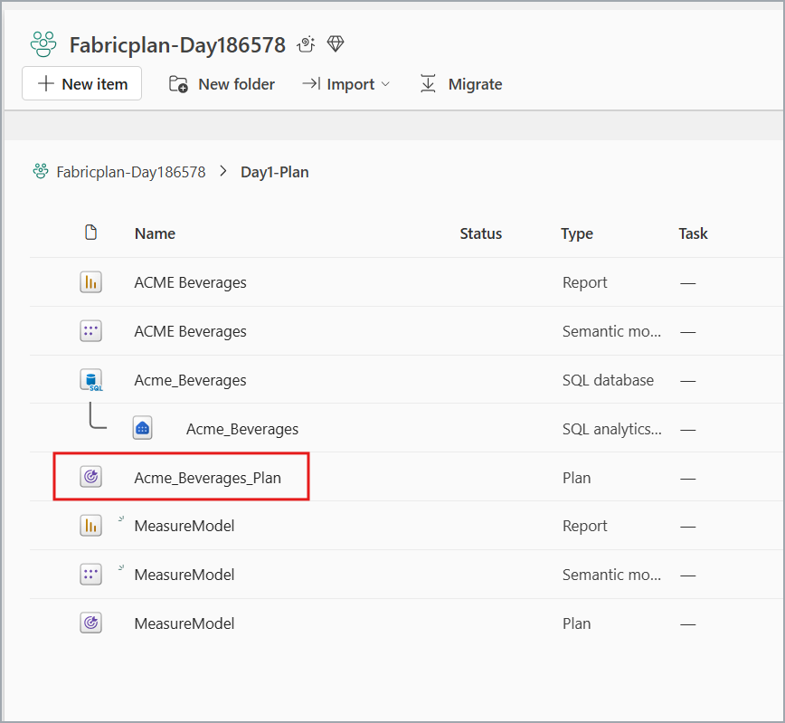

   The **Acme_Beverages_Plan** app opens.

3. On the **Home** tab, select **New Planning Sheet**.

   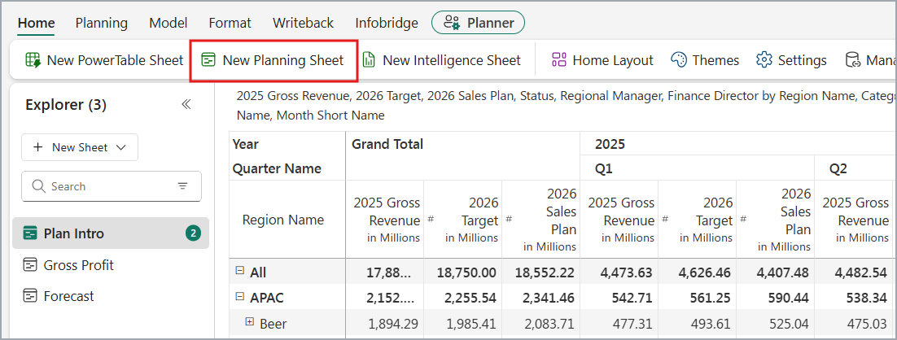

   The **New Planning Sheet** dialog opens.

4. In the **Name** box, enter the following name:

   +++Row Model+++

   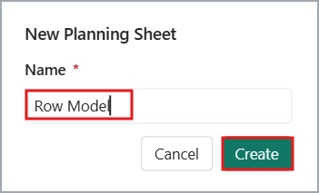

5. Select **Create**.

   The **Row Model** sheet opens, and the **Fields** and **Data** panes appear.

6. In the **Data** pane, expand **Semantic Model** > **P&L Data**.
7. Select the **Account** check box.

   **Account** appears under **Rows** in the **Fields** pane.

8. Select the **Date Hierarchy** check box.

   **Date Hierarchy** appears under **Columns** with the **Year**, **Quarter Name**, and **Month Name** levels.

9. Select the **Value** check box.

   **Sum of Value** appears under **Values**.

10. On the **Assign Data** tab of the **Fields** pane, verify the following field assignments:
    - Rows - **Account**
    - Columns - **Date Hierarchy**
    - Values - **Sum of Value**

    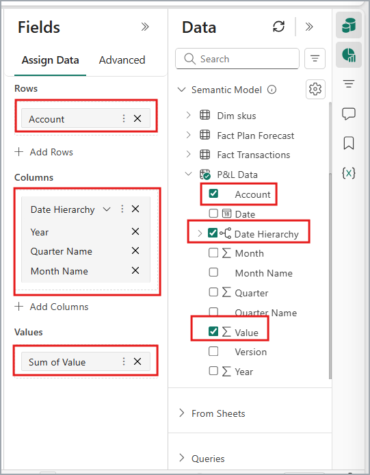

    > **Note:** If a field appears in the wrong area, select **X** next to the field to remove it. Then add the field to the correct area by using **+ Add Rows** or **+ Add Columns**.

# Exercise 2: Configure the Row Model

In this exercise, you configure the Row Model so that data source, aggregate, and formula rows roll up to Net Profit.

## Task 1: Open the Row Model builder

In this task, you open the Row Model builder, enable the Row Model, and delete the default account rows. The builder is where you define the type, configuration, and aggregation for each account row in the plan.

1. In the **Explorer** pane, select the **Row Model** sheet.

   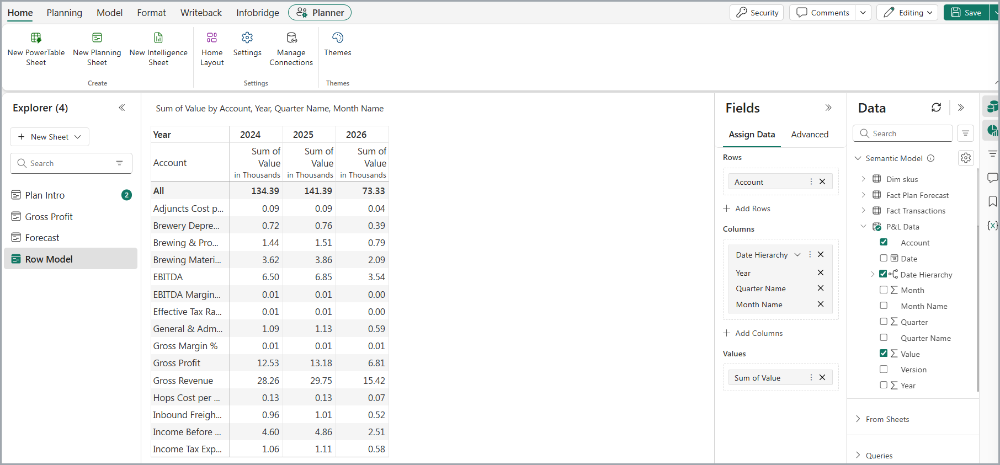

   The sheet displays **Sum of Value** by **Account**, **Year**, **Quarter Name**, and **Month Name**.

2. On the ribbon, select the **Model** tab.

3. In the **Driver-based** group, select **Row Model**.

   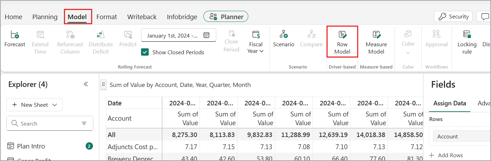

   The **Save changes to proceed** dialog opens.

   > **Note:** This dialog appears only when the sheet has unsaved changes. If it doesn't appear, the **Row Model** builder opens directly. Go to step 5.

4. Select **Save and continue**.

   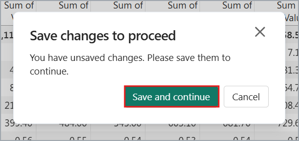

   The sheet is saved, and the **Row Model** builder opens with **Closed Period** selected.

5. In the **Row Model** builder, review the settings for the **All** row:
   - **Type** - **Aggregate**
   - **Configuration** - **Sum**
   - **Aggregation** - **Sum**

6. Review the settings for each account row under **All**, for example, **Gross Revenue**:
   - **Type** - **Data Source**
   - **Configuration** - **All > Gross Revenue**
   - **Aggregation** - **Sum**

   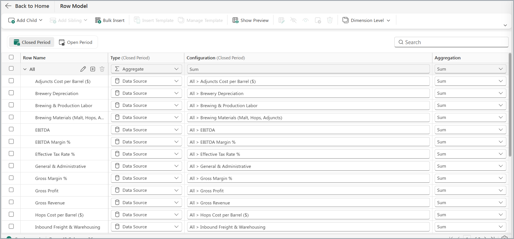

   Each account from the **P&L Data** table appears as a **Data Source** row under the **All** node.

7. In the **Row Model** builder, select **Enable**.

   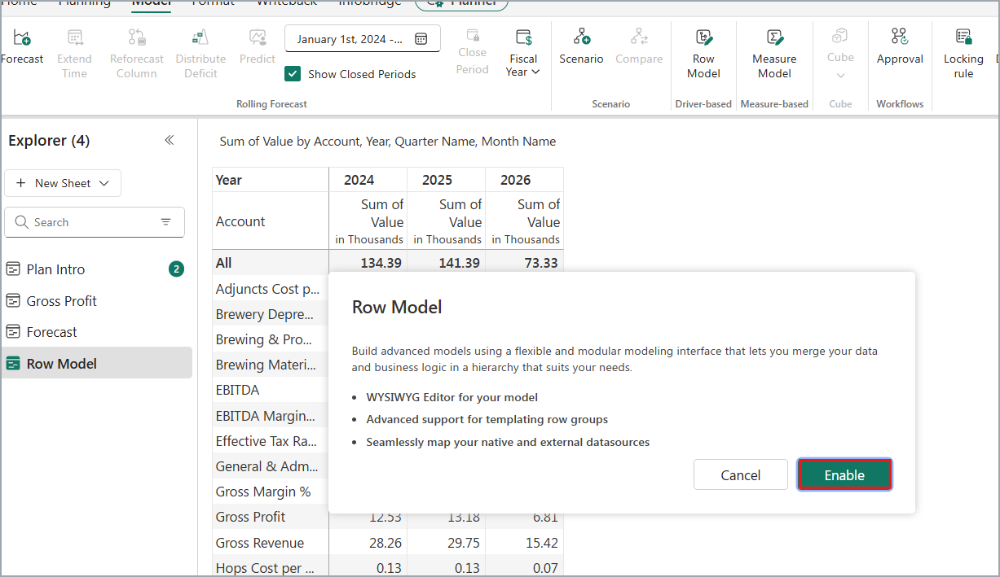

   The Row Model is enabled, and the **Model builder enabled, Please save the report** notification appears.

   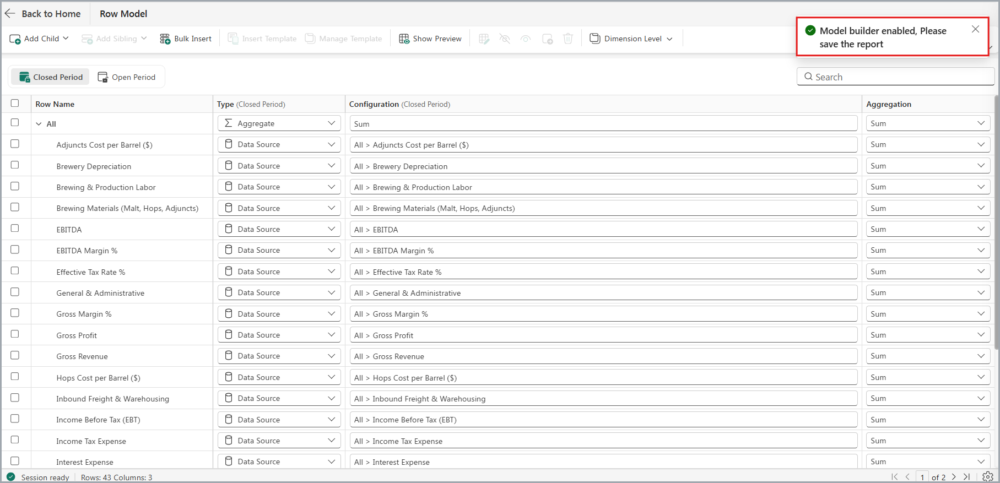

8. In the **Row Model** builder, select the check box next to the **Row Name** column header.

   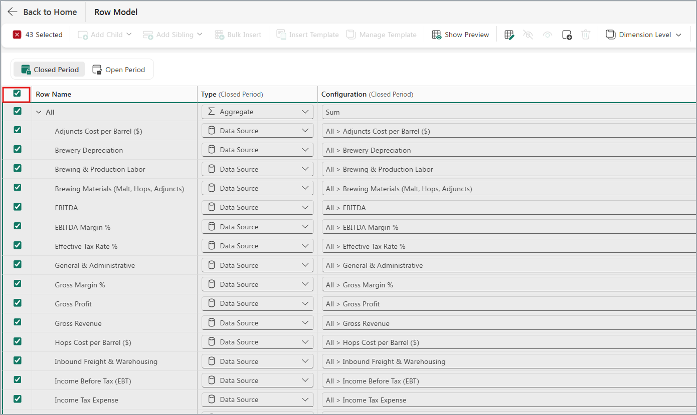

   All rows are selected, and the toolbar displays **43 Selected**.

9. Clear the check box for the **All** row.

   The toolbar displays **42 Selected**.

   > **Important:** The **All** row is the root node of the model. Keep its check box cleared so that you don't delete it with the account rows.

10. On the toolbar, select the **Delete** icon.

    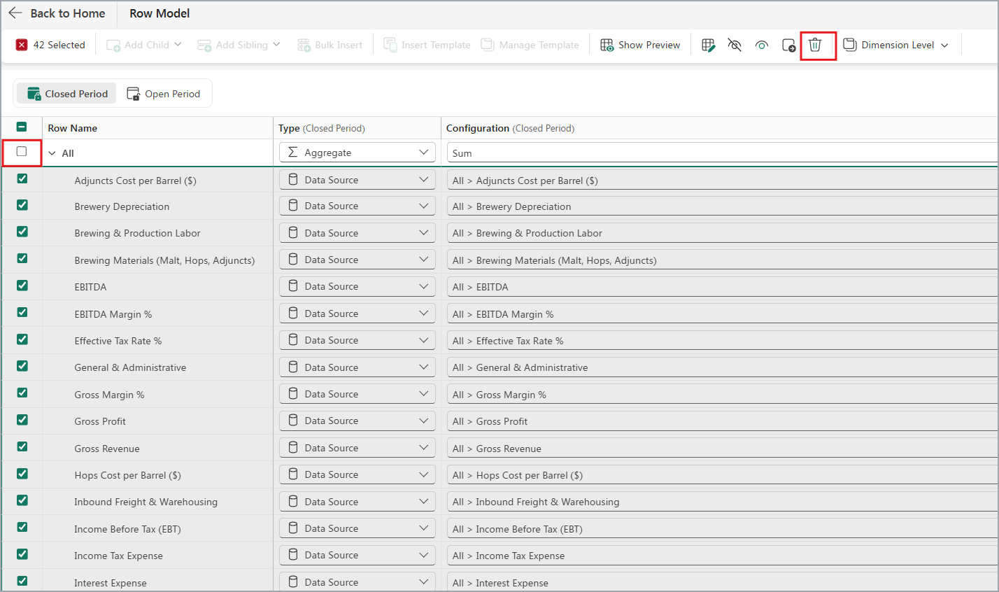

    The **Warning** dialog opens.

11. In the **Warning** dialog, select **Delete** to confirm that you want to delete the rows and their child rows.

    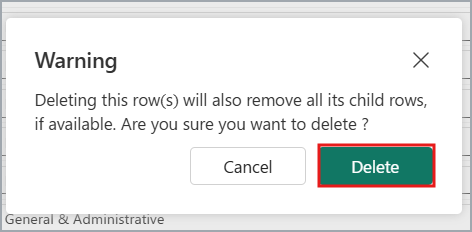

    The **Row deleted successfully** notification appears, and only the **All** row remains in the **Row Model** builder.

    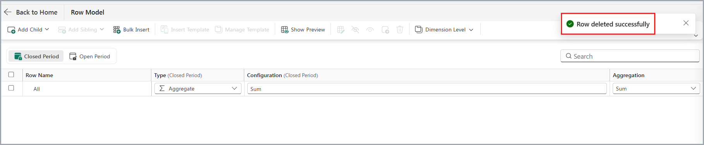

## Task 2: Configure the Net Profit root node

In this task, you rename the **All** root row in the **Row Model** builder to **Net Profit** and configure it as a formula. This makes the top of the row hierarchy represent the bottom line of the P&L.

1. In the **Row Model** builder, hover over the **All** row.

    The **Edit**, **Add**, and **Delete** icons appear next to the row name.

2. Select the **Edit** icon (pencil) next to the **All** row name.

    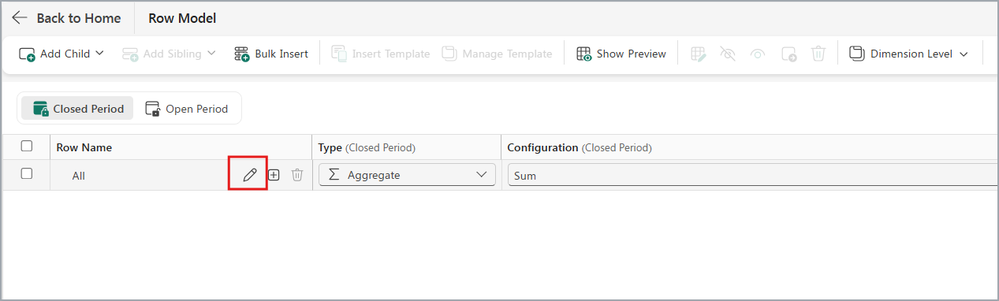

    The **All** configuration pane opens on the **General** tab.

3. In the **All** pane, on the **General** tab, enter or select the following details:

    - **Row Name** - +++Net Profit+++
    - **Closed Period** > **Configure as** - **Formula**

    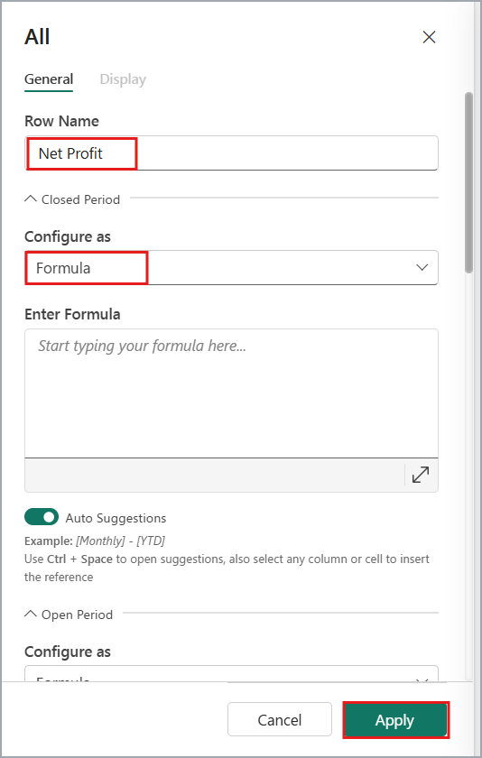

    The **Enter Formula** box appears under **Configure as**.

4. Select **Apply**.

    The root node is renamed to **Net Profit**, and its **Type (Closed Period)** changes to **Formula**.

## Task 3: Add the Gross Profit formula node

In this task, you build the **Gross Profit** branch of the row model under **Net Profit**. You add formula, data source, and aggregate rows, and then you configure the formulas that calculate **Net Revenue** and **Gross Profit**. **Gross Profit** is the first level under the bottom line, and later rows feed into it.

1. In the **Row Model** builder, select the check box next to the **Net Profit** row.

2. On the toolbar, select **Add Child** > **Formula**.

    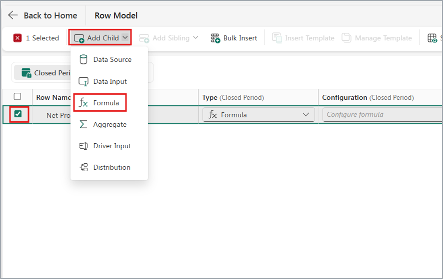

    A child row named **New Row** appears under **Net Profit**. Its **Type (Closed Period)** is **Formula**.

3. Hover over the **New Row** row.

    The **Edit**, **Add**, and **Delete** icons appear next to the row name.

4. Select the **Edit** icon (pencil) next to the **New Row** row.

    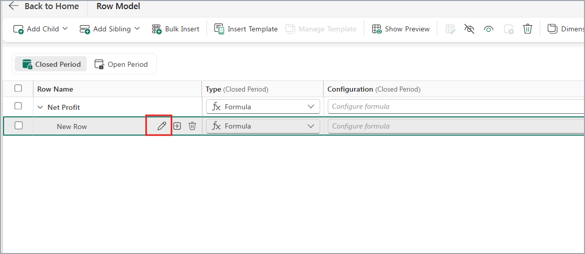

    The **New Row** pane opens on the **General** tab.

5. On the **General** tab, in the **Row Name** box, enter +++Gross Profit+++.

6. Under **Closed Period**, verify that **Configure as** is set to **Formula**.

7. Select **Apply**.

    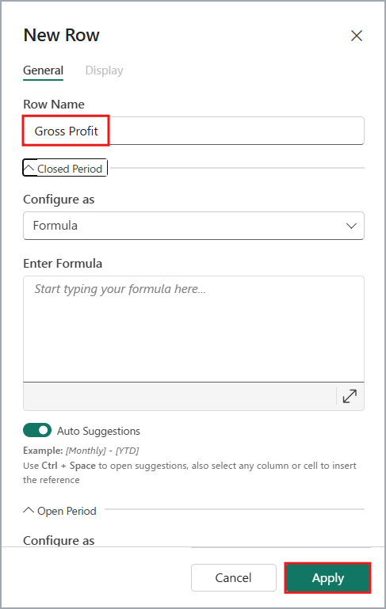

    The child row is renamed to **Gross Profit** and appears under **Net Profit** in the **Row Model** builder.

#### Add the Net Revenue formula node

Next, you add **Net Revenue** as a formula child of **Gross Profit**. This row builds the next level of the profit hierarchy, and later rows feed into it.

8. In the **Row Model** builder, select the check box next to the **Gross Profit** row.

9. On the toolbar, select **Add Child** > **Formula**.

    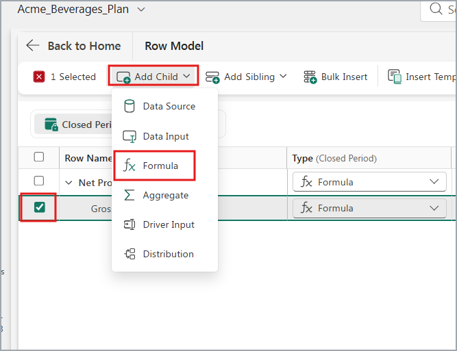

    A child row named **New Row** appears under **Gross Profit**. Its **Type (Closed Period)** is **Formula**.

10. Hover over the **New Row** row under **Gross Profit**.

    The **Edit**, **Add**, and **Delete** icons appear next to the row name.

11. Select the **Edit** icon (pencil) next to the **New Row** row.

    The **New Row** pane opens on the **General** tab.

12. On the **General** tab, in the **Row Name** box, enter +++Net Revenue+++.

13. Under **Closed Period**, verify that **Configure as** is set to **Formula**.

14. Select **Apply**.

    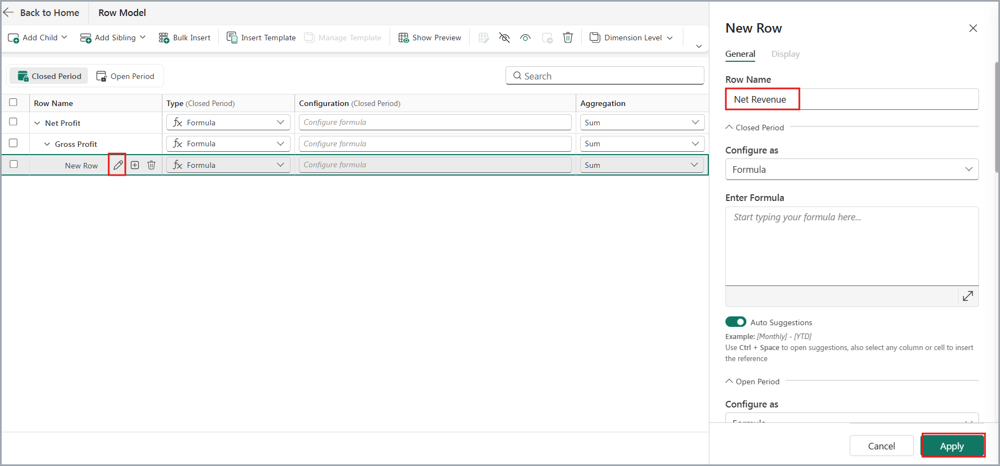

    The child row is renamed to **Net Revenue** and appears under **Gross Profit** in the **Row Model** builder.

#### Add the Gross Revenue data source node

Next, you add **Gross Revenue** as a data source child of **Net Revenue**. This row takes its values directly from the **Gross Revenue** source row instead of from a formula.

15. In the **Row Model** builder, select the check box next to the **Net Revenue** row.

16. On the toolbar, select **Add Child** > **Data Source**.

    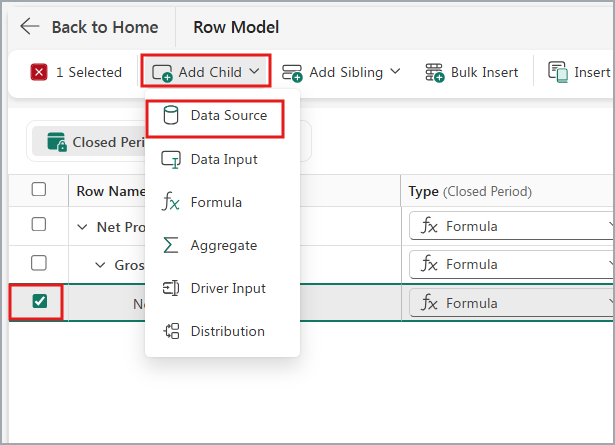

    A child row named **New Row** appears under **Net Revenue**. Its **Type (Closed Period)** is **Data Source**.

17. Hover over the **New Row** row.

    The **Edit**, **Add**, and **Delete** icons appear next to the row name.

18. Select the **Edit** icon (pencil) next to the **New Row** row.

    The **New Row** pane opens on the **General** tab.

19. On the **General** tab, in the **Row Name** box, enter +++Gross Revenue+++.

    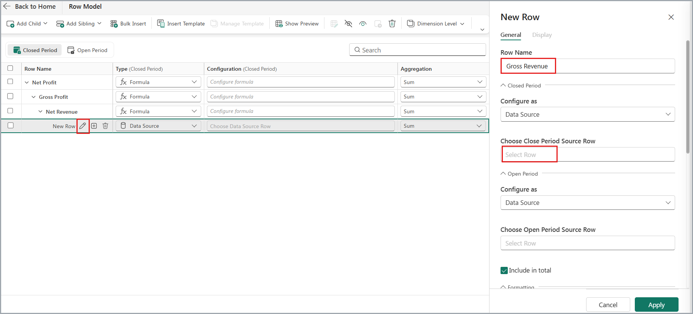

20. Under **Closed Period**, verify that **Configure as** is set to **Data Source**.

21. Select the **Choose Close Period Source Row** box.

    The pane shows a list of the available source rows.

22. In the search box, enter +++Gross Revenue+++.

23. In the list, select **Gross Revenue**.

    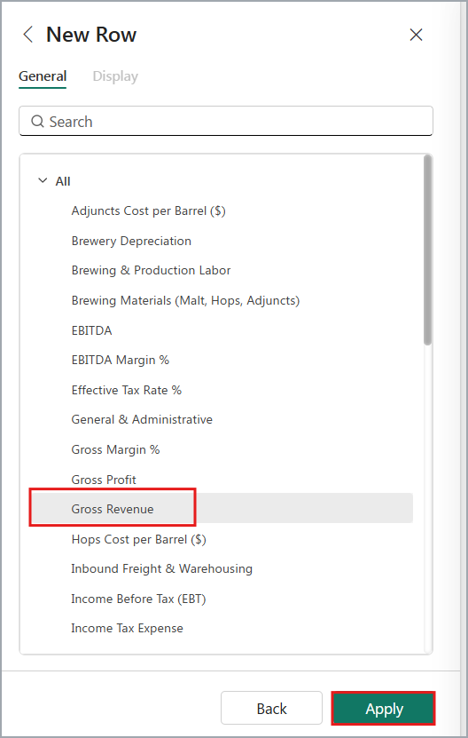

24. Select **Apply**.

    The child row is renamed to **Gross Revenue** and appears under **Net Revenue** in the **Row Model** builder.

25. Verify that the **Gross Revenue** row has the following settings:
    - **Row Name** - **Gross Revenue**
    - **Closed Period** > **Configure as** - **Data Source**
    - **Choose Close Period Source Row** - **All > Gross Revenue**
    - **Open Period** > **Configure as** - **Data Source**
    - **Choose Open Period Source Row** - **All > Gross Revenue**
    - **Include in total** - selected

    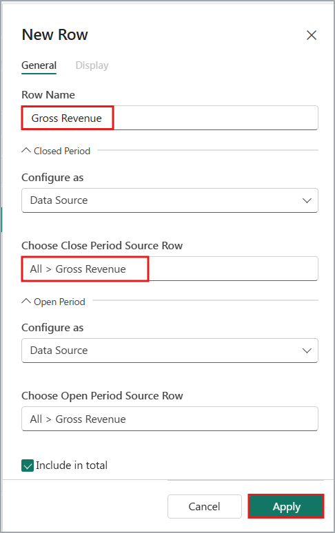

#### Add the revenue deduction rows

Next, you add the three revenue deductions as data source siblings of **Gross Revenue**. The **Net Revenue** formula subtracts these rows from **Gross Revenue**.

26. In the **Row Model** builder, select the check box next to the **Gross Revenue** row.

27. On the toolbar, select **Add Sibling** > **Data Source**.

    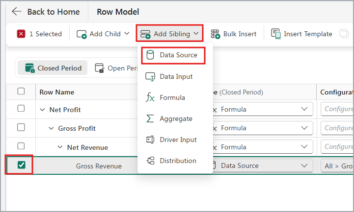

    A new row appears under **Net Revenue** at the same level as **Gross Revenue**.

28. Hover over the **New Row** row.

    The **Edit**, **Add**, and **Delete** icons appear next to the row name.

29. Select the **Edit** icon (pencil) next to the **New Row** row.

    The **New Row** pane opens on the **General** tab.

30. On the **General** tab, in the **Row Name** box, enter +++Returns and Breakage+++.

31. Under **Closed Period**, verify that **Configure as** is set to **Data Source**.

32. Select the **Choose Close Period Source Row** box.

    A list of the available source rows opens.

33. In the search box, enter +++Less: Returns & Breakage+++.

34. In the list, select **All > Less: Returns & Breakage**.

    The **Choose Close Period Source Row** and **Choose Open Period Source Row** boxes both show **All > Less: Returns & Breakage**.

35. Select **Apply**.

    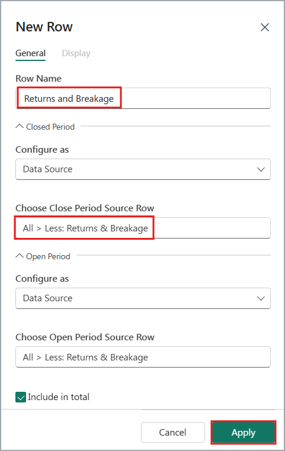

    The **Returns and Breakage** row appears under **Net Revenue**. Its **Type (Closed Period)** is **Data Source**.

36. On the **Row Model** page, select the check box next to the **Returns and Breakage** row.

37. On the toolbar, select **Add Sibling** > **Data Source**.

    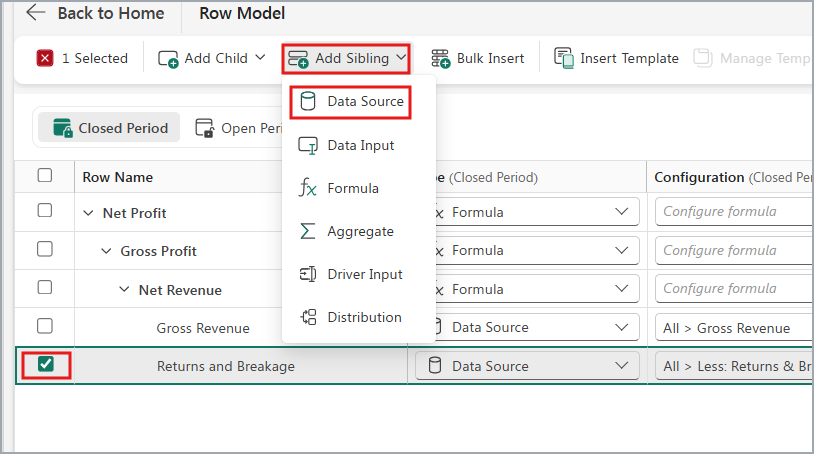

    A new row appears under **Net Revenue** at the same level as **Gross Revenue**.

38. Hover over the **New Row** row.

    The **Edit**, **Add**, and **Delete** icons appear next to the row name.

39. Select the **Edit** icon (pencil) next to the **New Row** row.

    The **New Row** pane opens on the **General** tab.

40. On the **General** tab, in the **Row Name** box, enter +++Distribution Allowance & Rebates+++.

41. Under **Closed Period**, verify that **Configure as** is set to **Data Source**.

42. Select the **Choose Close Period Source Row** box.

    A list of the available source rows opens.

43. In the search box, enter +++Distributor Allowances & Rebates+++.

44. In the list, select **All > Less: Distributor Allowances & Rebates**.

    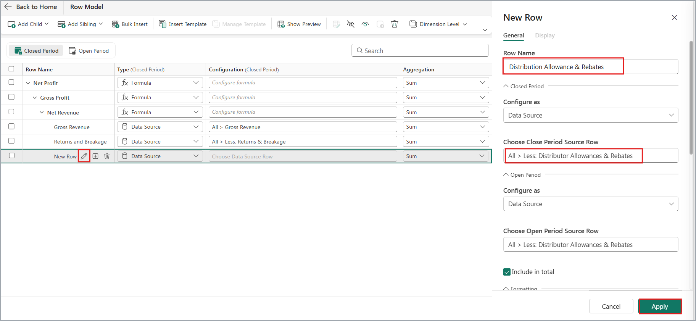

    The **Choose Close Period Source Row** and **Choose Open Period Source Row** boxes both show **All > Less: Distributor Allowances & Rebates**.

    > **Note:** Source rows for revenue deductions can start with **Less:**, for example **Less: Returns & Breakage**. Select the row that matches the deduction name.

45. Select **Apply**.

    The **Distribution Allowance & Rebates** row appears under **Net Revenue**. Its **Type (Closed Period)** is **Data Source**.

46. On the **Row Model** page, select the check box next to the **Distribution Allowance & Rebates** row.

47. On the toolbar, select **Add Sibling** > **Data Source**.

    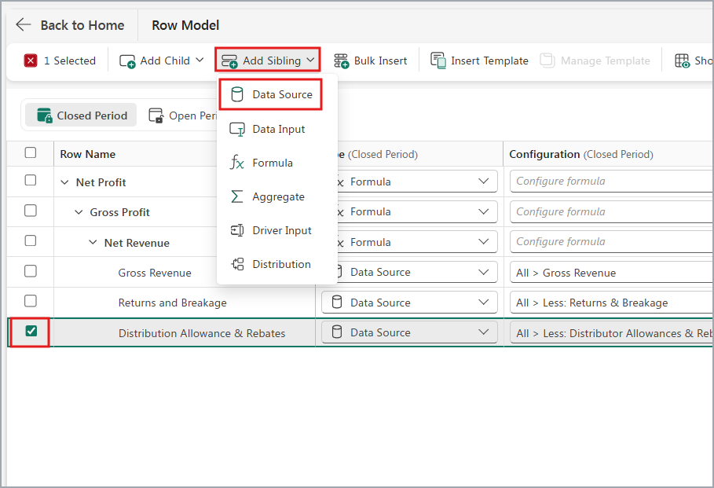

    A new row appears under **Net Revenue** at the same level as **Gross Revenue**.

48. Hover over the **New Row** row.

    The **Edit**, **Add**, and **Delete** icons appear next to the row name.

49. Select the **Edit** icon (pencil) next to the **New Row** row.

    The **New Row** pane opens on the **General** tab.

50. On the **General** tab, in the **Row Name** box, enter +++Federal & State Excise Taxes+++.

51. Under **Closed Period**, verify that **Configure as** is set to **Data Source**.

52. Select the **Choose Close Period Source Row** box.

    A list of the available source rows opens.

53. In the search box, enter +++Federal & State Excise Taxes+++.

54. In the list, select **All > Less: Federal & State Excise Taxes**.

    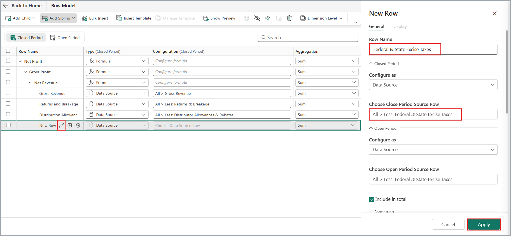

    The **Choose Close Period Source Row** and **Choose Open Period Source Row** boxes both show **All > Less: Federal & State Excise Taxes**.

55. Select **Apply**.

    The **Net Revenue** row now has four data source child rows: **Gross Revenue**, **Returns and Breakage**, **Distribution Allowance & Rebates**, and **Federal & State Excise Taxes**.

56. Under **Net Revenue**, verify that each child row shows **Data Source** in the **Type (Closed Period)** column.

    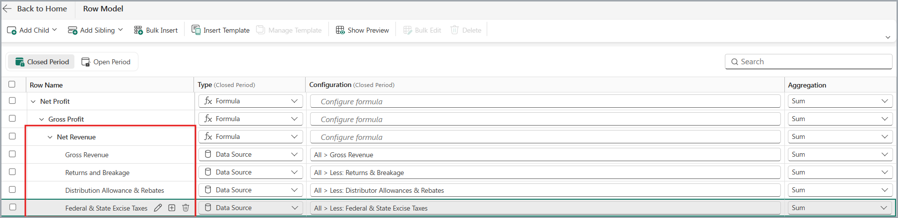

    Each of the four rows shows **Data Source** in the **Type (Closed Period)** column and **Sum** in the **Aggregation** column.

#### Configure the Net Revenue formula

Next, you enter the formula that calculates **Net Revenue** from its child rows.

57. In the **Net Revenue** row, select **Configure formula** in the **Configuration (Closed Period)** column.

    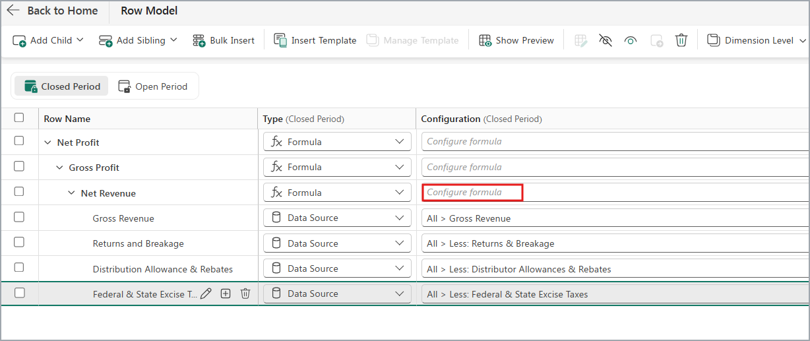

    The **Net Revenue** pane opens with a formula editor.

58. In the formula editor, enter the following formula to subtract **Returns and Breakage**, **Distribution Allowance & Rebates**, and **Federal & State Excise Taxes** from **Gross Revenue**:

    +++[Gross Profit].[Net Revenue].[Gross Revenue]-[Gross Profit].[Net Revenue].[Returns and Breakage]-[Gross Profit].[Net Revenue].[Distribution Allowance & Rebates]-[Gross Profit].[Net Revenue].[Federal & State Excise Taxes]+++

    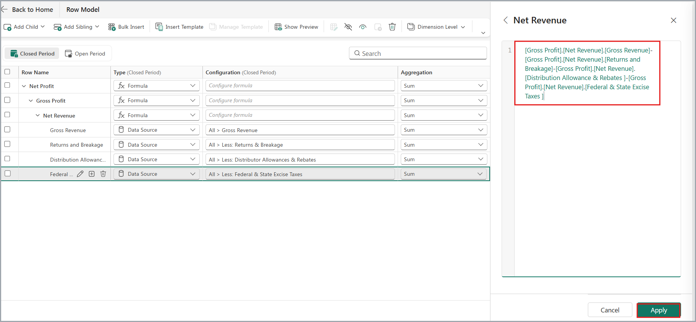

    > **Note:** Each row reference uses its full path in the hierarchy, for example [Gross Profit].[Net Revenue].[Gross Revenue]. If the formula editor shows an error, check that each name matches the row name in the grid exactly, including any trailing spaces.

59. Select **Apply**.

    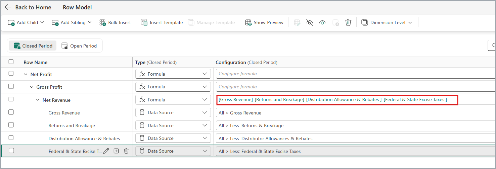

    The pane closes. The **Configuration (Closed Period)** column for the **Net Revenue** row shows **[Gross Revenue]-[Returns and Breakage]-[Distribution Allowance & Rebates]-[Federal & State Excise Taxes]**.

#### Add the COGS aggregate node

Next, you add **COGS** as an aggregate sibling of **Net Revenue** with four data source child rows. **COGS** sums its child rows so that the **Gross Profit** formula can subtract the total cost of goods sold.

60. In the **Row Model** builder, select the check box next to the **Net Revenue** row.

    The toolbar shows **1 Selected**.

61. On the toolbar, select **Add Sibling** > **Aggregate**.

    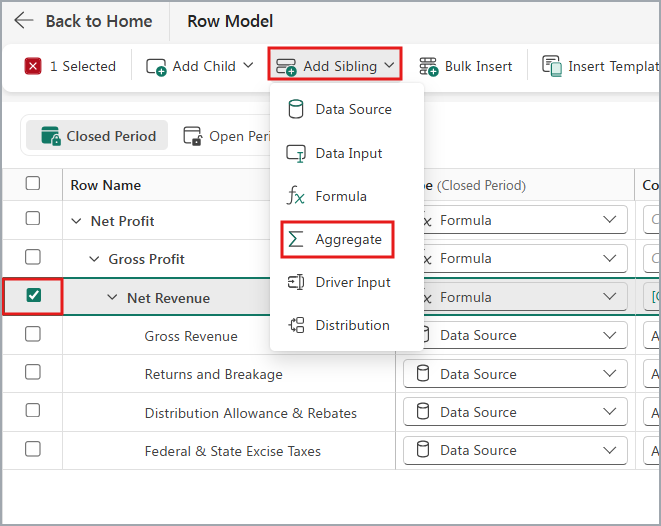

    A new aggregate row appears under **Gross Profit** at the same level as **Net Revenue**.

62. Hover over the **New Row** row.

    The **Edit**, **Add**, and **Delete** icons appear next to the row name.

63. Select the **Edit** icon (pencil) next to the **New Row** row.

    The **New Row** pane opens on the **General** tab. Under **Closed Period**, **Configure as** is set to **Aggregate**, and **Aggregate children rows with** is set to **Sum**.

64. In the **Row Name** box, enter +++COGS+++.

    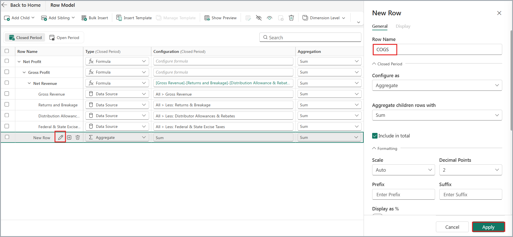

65. Select **Apply**.

    The pane closes. The row is now named **COGS**. Its **Type (Closed Period)** is **Aggregate**, and its **Configuration (Closed Period)** is **Sum**.

66. Select the check box next to the **COGS** row.

    The toolbar shows **1 Selected**.

67. On the toolbar, select **Add Child** > **Data Source**.

    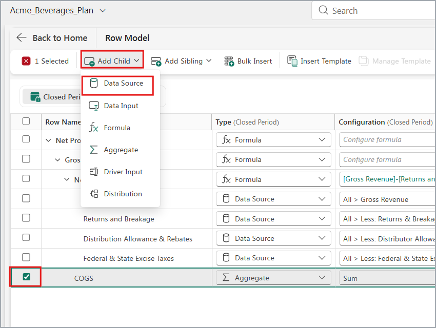

    A new data source row named **New Row** appears under **COGS**.

68. Hover over the **New Row** row under **COGS**.

    The **Edit**, **Add**, and **Delete** icons appear next to the row name.

69. Select the **Edit** icon (pencil) next to the **New Row** row.

    The **New Row** pane opens. Under **Closed Period**, **Configure as** is set to **Data Source**.

70. In the **Row Name** box, enter +++Brewing Materials+++.

71. Under **Closed Period**, select the **Choose Close Period Source Row** box.

72. In the search box, enter +++Brewing Materials+++.

73. In the search results, select **All > Brewing Materials (Malt, Hops, Adjuncts)**.

    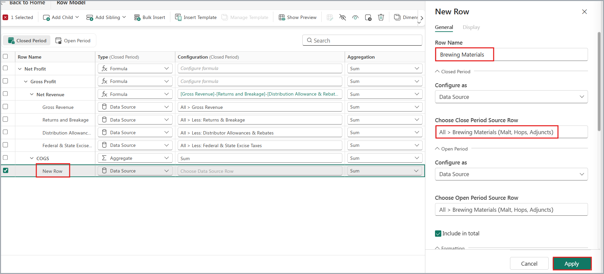

    The **Choose Close Period Source Row** and **Choose Open Period Source Row** boxes both show **All > Brewing Materials (Malt, Hops, Adjuncts)**.

    > **Note:** Some source rows include a description in parentheses after the account name. Select the row that starts with the account name that you searched for.

74. Select **Apply**.

    The pane closes. **Brewing Materials** appears under **COGS** with the type **Data Source** and the configuration **All > Brewing Materials (Malt, Hops, Adjuncts)**.

75. Select the check box next to the **COGS** row.

    The toolbar shows **1 Selected**.

    > **Note:** If the toolbar shows more than one selected row, clear the check boxes of all rows except **COGS**.

76. On the toolbar, select **Add Child** > **Data Source**.

    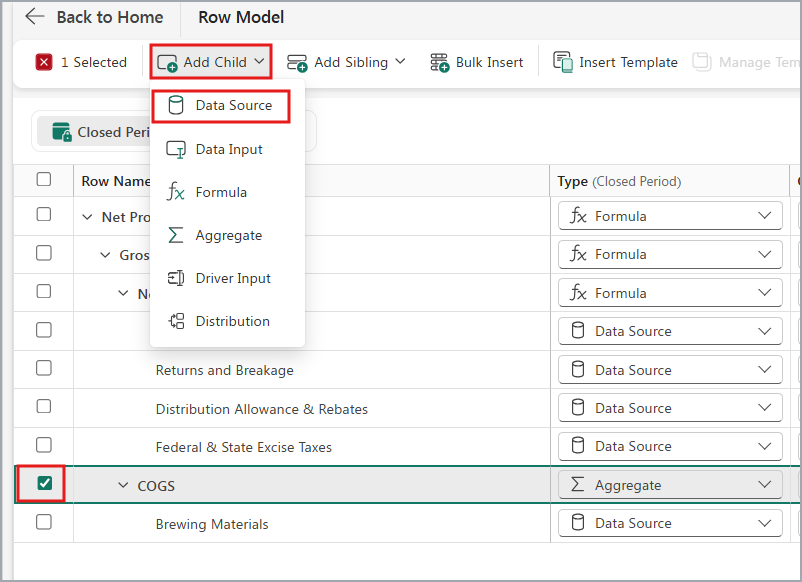

    A new data source row named **New Row** appears under **COGS**.

77. Configure the new row by repeating steps 68 to 74 with the following values:
    - **Row Name** - +++Packaging+++
    - Search term - +++Packaging+++
    - **Choose Close Period Source Row** - **All > Packaging (Cans, Bottles, Kegs, Labels)**

    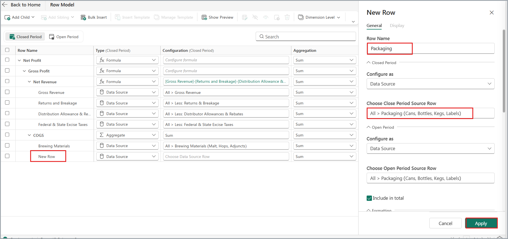

    **Packaging** appears under **COGS**, below **Brewing Materials**, with the type **Data Source**.

78. Add another child row under **COGS** by repeating steps 75, 76, and 68 to 74 with the following values:
    - **Row Name** - +++Plant Overhead and Maintenance+++
    - Search term - +++Plant Overhead & Maintenance+++
    - **Choose Close Period Source Row** - **All > Plant Overhead & Maintenance**

    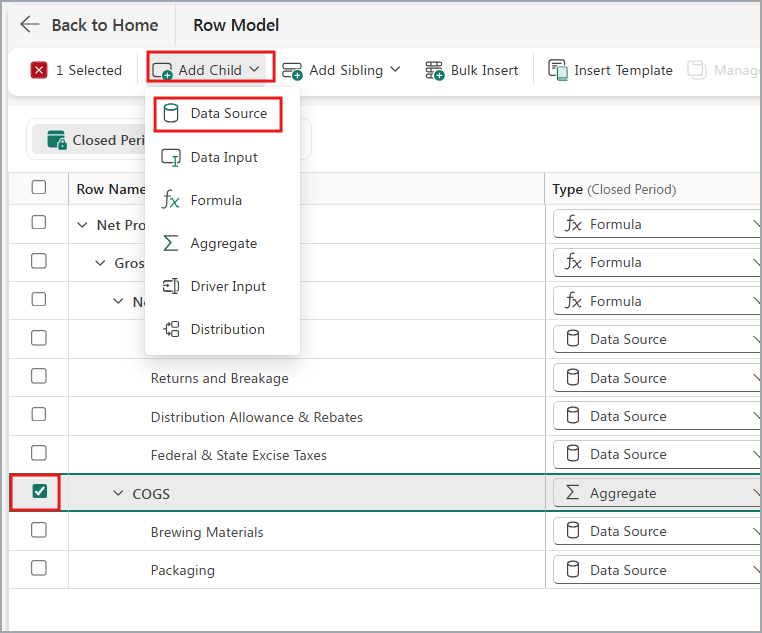

    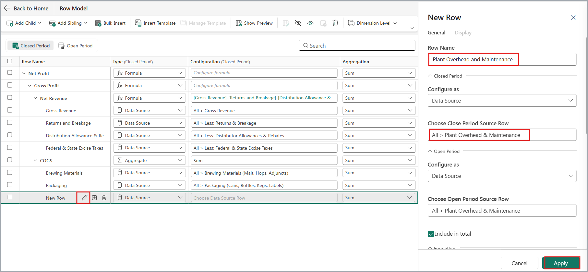

    **Plant Overhead and Maintenance** appears under **COGS**, below **Packaging**, with the type **Data Source**.

    > **Note:** The source row name uses an ampersand (&) instead of the word "and."

79. Add the last child row under **COGS** by repeating steps 75, 76, and 68 to 74 with the following values:
    - **Row Name** - +++Water & Utilities+++
    - Search term - +++Water & Utilities+++
    - **Choose Close Period Source Row** - **All > Water & Utilities**

    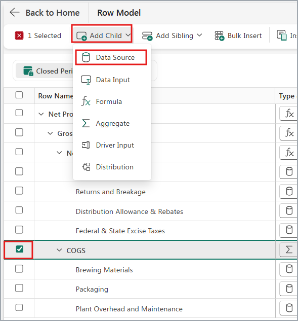

    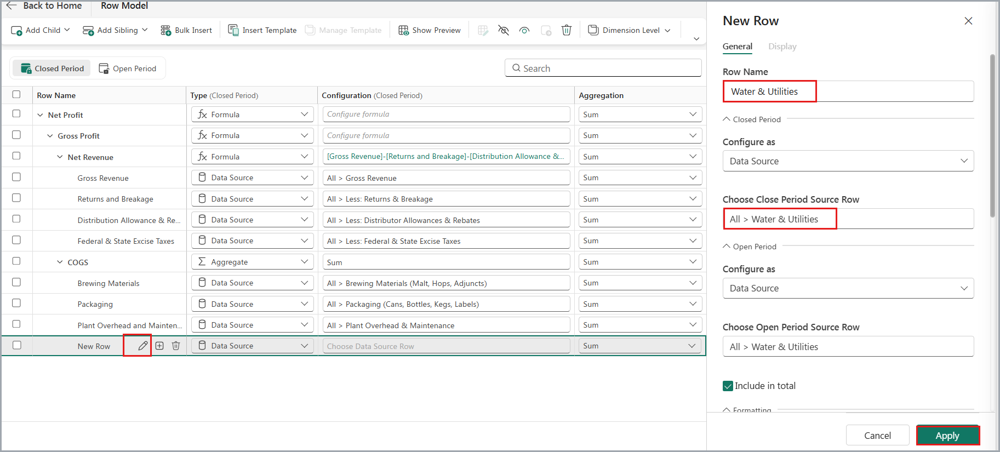

    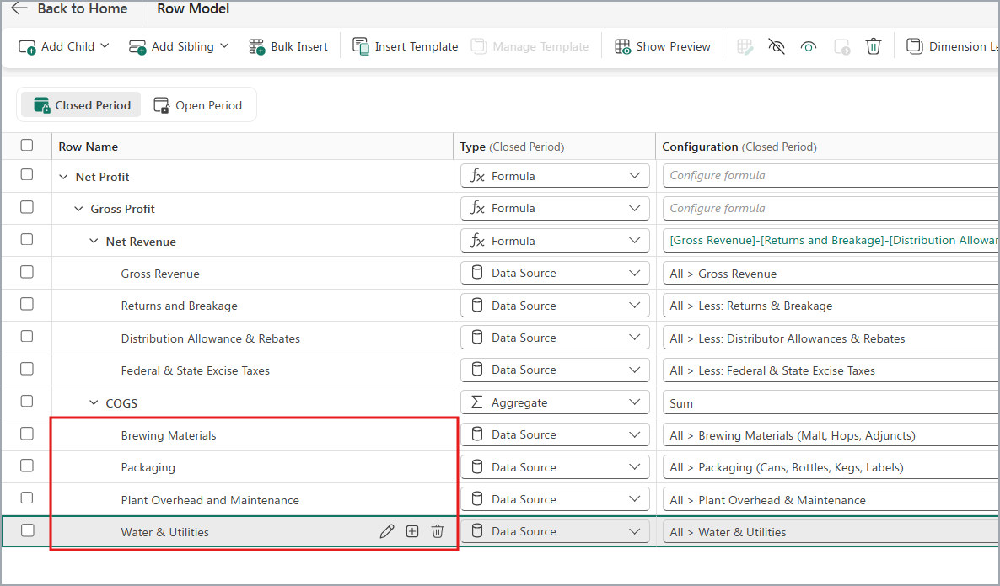

    **COGS** now has four data source child rows: **Brewing Materials**, **Packaging**, **Plant Overhead and Maintenance**, and **Water & Utilities**. The **COGS** aggregate row is configured.

#### Configure the Gross Profit formula

Finally, you enter the formula that calculates **Gross Profit** by subtracting **COGS** from **Net Revenue**.

80. In the **Gross Profit** row, select **Configure formula** in the **Configuration (Closed Period)** column.

    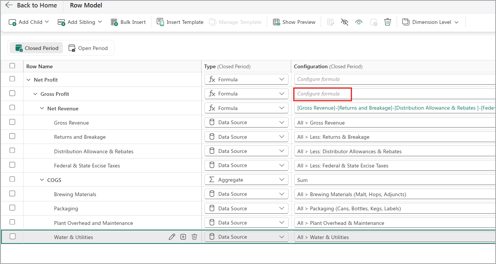

    The **Gross Profit** formula pane opens.

81. In the **Gross Profit** formula pane, enter the following formula to subtract **COGS** from **Net Revenue**:

    +++[Gross Profit].[Net Revenue]-[Gross Profit].[COGS]+++

    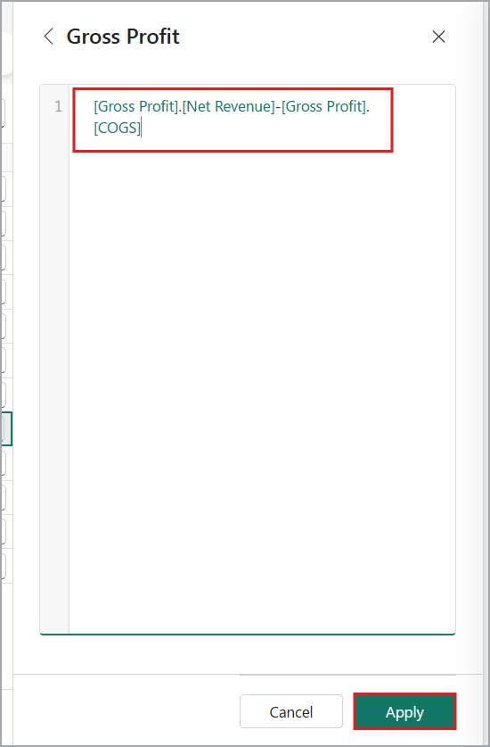

82. Select **Apply**.

    The formula pane closes.

83. Verify that the **Configuration (Closed Period)** column for **Gross Profit** shows **[Net Revenue]-[COGS]**.

    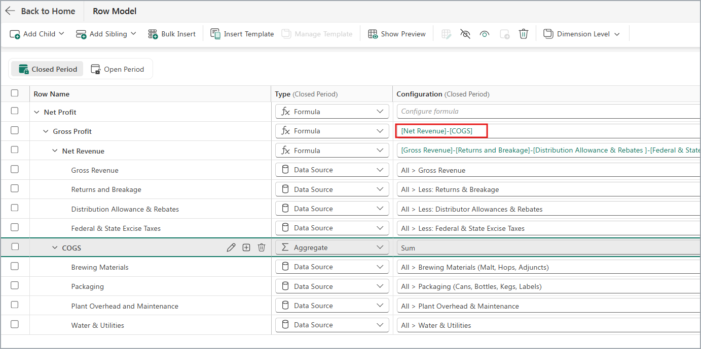

    **Gross Profit** is now configured to subtract **COGS** from **Net Revenue**.

## Task 4: Add the Operating Expenses rows and configure Net Profit

In this task, you add an **Operating Expenses** aggregate row at the same level as **Gross Profit**, add its four child rows, and configure the **Net Profit** formula. This row collects the operating cost lines that the model later uses to calculate **Net Profit**.

120. Select the check box next to the **Gross Profit** row.

     **1 Selected** appears on the toolbar.

121. On the toolbar, select **Add Sibling** > **Aggregate**.

     

     A new row named **New Row** appears at the bottom of the model, with the type **Aggregate** and the configuration **Sum**.

122. Hover over the **New Row** row, and then select the **Edit** icon (pencil) next to the row name.

     The **New Row** pane opens on the **General** tab.

123. In the **Row Name** box, enter the following name:

     +++Operating Expenses+++

124. Verify that the remaining settings on the **General** tab match the following values:

     - **Configure as** (under **Closed Period**) - **Aggregate**
     - **Aggregate children rows with** - **Sum**
     - **Include in total** - selected

     

125. Select **Apply**.

     The row is renamed **Operating Expenses**. It appears below **Water & Utilities** at the same level as **Gross Profit**, with the type **Aggregate** and the configuration **Sum**.

126. Select the check box next to the **Operating Expenses** row.

     **1 Selected** appears on the toolbar.

127. On the toolbar, select **Add Child** > **Data Source**.

     

     A new child row named **New Row** appears under **Operating Expenses**, with the type **Data Source**.

128. In the **Operating Expenses** section, on the **New Row** row, select the **Edit** icon (pencil).

     The **New Row** pane opens on the **General** tab.

129. In the **Row Name** box, enter the following name:

     +++Selling & Marketing+++

130. Under **Closed Period**, verify that **Configure as** is set to **Data Source**.

131. Select the **Choose Close Period Source Row** box.

132. In the search box, enter the following search term:

     +++Selling & Marketing+++

133. Select **All > Selling & Marketing** from the results.

     **All > Selling & Marketing** appears in the **Choose Close Period Source Row** box. Under **Open Period**, the **Choose Open Period Source Row** box also shows **All > Selling & Marketing**.

134. Select **Apply**.

     

     The **Row updated successfully** message appears. The row is renamed **Selling & Marketing**, with the type **Data Source** and the configuration **All > Selling & Marketing**.

135. Repeat steps 7 to 15 to add each of the following child rows under **Operating Expenses**. For each row, enter the row name in the **Row Name** box and in the search box, and then select the matching source row:

     - **Row Name** and search term - +++Outbound Distribution & Logistics+++; **Choose Close Period Source Row** - **All > Outbound Distribution & Logistics**
     - +++General & Administrative+++ - **All > General & Administrative**
     - +++Research & Product Development+++ - **All > Research & Product Development**

     

     **Operating Expenses** now has four child rows: **Selling & Marketing**, **Outbound Distribution & Logistics**, **General & Administrative**, and **Research & Product Development**. Each child row has the type **Data Source**.

136. On the **Net Profit** row, in the **Configuration (Closed Period)** column, select **Configure formula**.

     

     The **Net Profit** formula pane opens.

137. In the formula editor, enter the following formula to subtract **Operating Expenses** from **Gross Profit**:

     +++[Gross Profit]-[Operating Expenses]+++

138. Select **Apply**.

     

     The **Configuration (Closed Period)** column of the **Net Profit** row shows **[Gross Profit]-[Operating Expenses]**.

139. Verify that the **Net Profit** row shows **Formula** in the **Type (Closed Period)** column and **[Gross Profit]-[Operating Expenses]** in the **Configuration (Closed Period)** column.

     

     **Net Profit** is now configured as the root node of the row model.

## Task 5: View the row model

In this task, you return to the planning sheet and review the completed row model. This review confirms that every account connects to **Net Profit** through the data source, aggregate, and formula rows that you configured.

1. In the **Row Model** builder, select **Back to Home**.

   

   The planning sheet opens, and **Row Model** is selected in the **Explorer** pane.

2. Verify that the planning sheet shows the full P&L hierarchy:
   - **Net Profit** is the root node.
   - **Gross Profit** and **Operating Expenses** appear under **Net Profit**.
   - **Net Revenue** and **COGS** appear under **Gross Profit**.
   - The **2024**, **2025**, and **2026** columns show the **Sum of Value** for each row.

   

3. If the **COGS** node is collapsed, select the expand icon next to **COGS**.

   The node expands and shows its contributing data source rows: **Brewing Materials**, **Packaging**, **Plant Overhead and Maintenance**, and **Water & Utilities**.

## Outcomes

When you complete this lab, you have the following results:

- The **Row Model** planning sheet uses **Account** rows and **Value** from the **P&L Data** table.
- **Net Profit** is configured as the root node with the **Formula** type.
- **Net Revenue** has four data source child rows:
  - **Gross Revenue**
  - **Returns and Breakage**
  - **Distribution Allowance & Rebates**
  - **Federal & State Excise Taxes**
- The **Net Revenue** formula subtracts **Returns and Breakage**, **Distribution Allowance & Rebates**, and **Federal & State Excise Taxes** from **Gross Revenue**.
- **COGS** is configured as an aggregate of four child rows:
  - **Brewing Materials**
  - **Packaging**
  - **Plant Overhead and Maintenance**
  - **Water & Utilities**
- **Gross Profit** uses the formula **[Net Revenue]-[COGS]**.
- **Operating Expenses** is configured as an aggregate of four child rows:
  - **Selling & Marketing**
  - **Outbound Distribution & Logistics**
  - **General & Administrative**
  - **Research & Product Development**
- **Net Profit** uses the formula **[Gross Profit]-[Operating Expenses]**.
- The planning sheet shows the full P&L hierarchy, and all nodes are connected.

## Summary

In this lab, you created a new planning sheet named Row Model in the Acme_Beverages_Plan app and assigned Account, Date Hierarchy, and Value from the P&L Data table. You enabled the Row Model in the Row Model builder and configured Net Profit as the root node by using the Formula type. You added Gross Revenue, Returns and Breakage, Distribution Allowance & Rebates, and Federal & State Excise Taxes as data source children of Net Revenue, and you configured a formula that deducts the last three from Gross Revenue. You configured COGS as an aggregate of Brewing Materials, Packaging, Plant Overhead and Maintenance, and Water & Utilities. You also configured Operating Expenses as an aggregate of Selling & Marketing, Outbound Distribution & Logistics, General & Administrative, and Research & Product Development. Finally, you configured the Gross Profit formula as Net Revenue minus COGS and the Net Profit formula as Gross Profit minus Operating Expenses. You then viewed the full P&L hierarchy in the planning sheet.
