# Lab 05- Multi-dimensional planning

## Scenario

Acme Beverages plans its business at more than one level of detail. The finance team plans revenue by region and country. The cost team plans by category and brand. Because these plans use different grains, leadership struggles to see a single, consistent view of profitability, and keeping the plans in sync requires manual reconciliation and re-entry.

To solve this, Acme Beverages uses Cube measures in the Acme_Beverages_Plan app. Both plans feed one consolidated profitability view automatically, and a change in either direction cascades instantly across all three sheets. The key components are:

- **Regional Plan sheet**: Captures the **Sales Plan** by Region Name and Country Name, with a breakdown that extends it to Category and Brand.
- **Brand Plan sheet**: Captures the **Cost Plan** by Category and Brand, with a breakdown that extends it to Region Name and Country Name.
- **Profitability sheet**: Brings both Cube measures together at the common Region → Country → Category → Brand grain and calculates **Gross Profit**.

In this lab, you are a planning analyst at Acme Beverages. You build the three connected planning sheets and then revise revenue and cost assumptions to see how changes stay aligned across every plan in real time.

## Introduction

Real planning rarely happens at one exact grain. In this lab, you use the Acme_Beverages_Plan app to build three connected planning sheets. The Regional Plan sheet has a Sales Plan Cube measure based on 2025 Gross Revenue. The Brand Plan sheet has a Cost Plan Cube measure based on 2025 COGS. The Profitability sheet combines both measures at the common Region → Country → Category → Brand grain and calculates Gross Profit with a formula. You then revise a revenue assumption in a source sheet and a cost assumption in the consolidated output. Each change cascades instantly across all three sheets with no reconciliation step.

## Objectives

After completing this lab, you will be able to:

- Create a Regional Plan sheet with a Sales Plan Cube measure that uses multi-dimension allocation
- Create a Brand Plan sheet with a Cost Plan Cube measure that uses multi-dimension allocation
- Configure breakdowns that extend each plan to the common Region → Country → Category → Brand grain
- Build a Profitability sheet that inserts both Cube measures and calculates Gross Profit with a formula
- Revise a revenue assumption in a source sheet and verify that the change is reflected in the consolidated view
- Revise a cost assumption in the consolidated view and verify that the change flows back to the source plan

## Architecture

You build a Regional Plan sheet with a Sales Plan Cube measure from 2025 Gross Revenue and a Brand Plan sheet with a Cost Plan Cube measure from 2025 COGS. Both Cube measures feed a Profitability sheet at the Region, Country, Category, and Brand grain, where a formula calculates Gross Profit. Revising revenue in the Regional Plan or cost in the Profitability sheet cascades across all three sheets in real time.

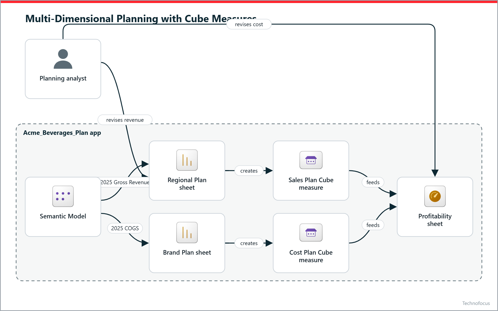

## Prerequisites

- Completion of <PREVIOUS LAB>, in which you created the **Acme_Beverages_Plan** app.
- Access to the following items in the **Acme_Beverages_Plan** app:
  - The **2025 Gross Revenue** and **2025 COGS** measures.
  - The **Region Name**, **Country Name**, **Category**, and **Brand** dimensions.
  - The date hierarchy **Year** > **Quarter Name** > **Month Short Name**.
- About 15 minutes to complete the lab.

# Exercise 1: Build the templates for multi-dimensional planning

In this exercise, you build the Regional Plan, Brand Plan, and Profitability sheets and calculate Gross Profit at the common grain.

## Task 1: Create the Regional Plan sheet

In this task, you create the **Regional Plan** sheet, where finance plans revenue by region and country. This sheet is one of the plans that later feeds the consolidated profitability view.

1. Open the **Acme_Beverages_Plan** app that you created in <PREVIOUS LAB>.

2. On the **Home** tab, in the **Create** group, select **New Planning Sheet**.

   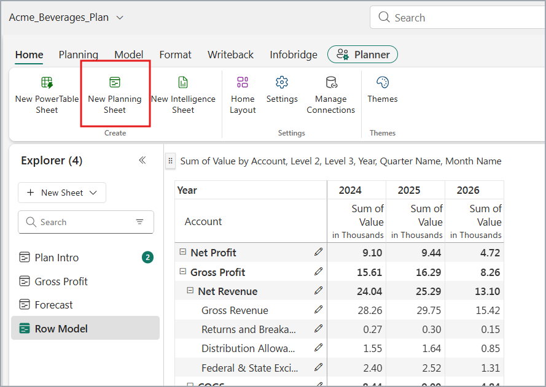

3. In the **New Planning Sheet** dialog box, in the **Name** box, enter +++Regional Plan+++.

4. Select **Create**.

   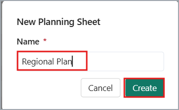

   The new **Regional Plan** sheet opens with the **Fields** and **Data** panes.

5. In the **Fields** pane, on the **Assign Data** tab, under **Rows**, select **+ Add Rows** > **Region Name**.

6. Under **Rows**, select **+ Add Rows** > **Country Name**.

7. Under **Columns**, select **+ Add Columns** > **Date Hierarchy**.

8. Verify that **Date Hierarchy** contains the **Year**, **Quarter Name**, and **Month Short Name** levels, in that order.

9. In the **Data** pane, expand **Semantic Model** > **Measure Table** > **Revenue**.

10. Select the **2025 Gross Revenue** check box.

    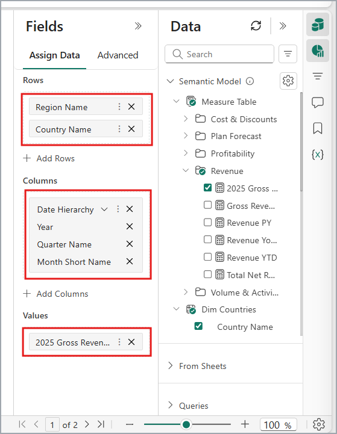

    The measure appears under **Values** in the **Fields** pane. The sheet shows **2025 Gross Revenue** by **Region Name**, **Country Name**, **Year**, **Quarter Name**, and **Month Short Name**.

11. On the **Planning** tab, select **Number** > **Copy from another series** > **2025 Gross Revenue**.

    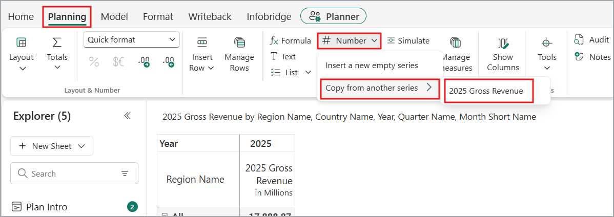

    The **Save changes to proceed** dialog box opens.

12. In the **Save changes to proceed** dialog box, select **Save and continue**.

    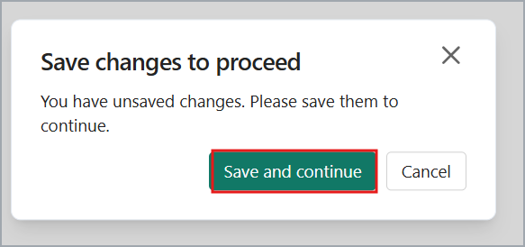

    Your changes are saved, and the **Data Input** pane opens.

13. In the **Data Input** pane, in the **Title** box, enter +++Sales Plan+++.

14. Verify that the **Data Input** pane shows the following settings:

    - **Insert as** - **Visual Measure**
    - **Input type** - **Number**
    - **Column aggregation type** - **Sum**
    - **Row aggregation type** - **Sum**
    - **Distribute parent value to children** - selected

15. Under **Enable Multi-Dimension Allocation**, select **+ Add Breakdown**.

    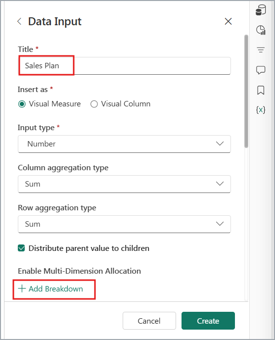

    The **Add Breakdown** dialog box opens.

16. In the **Add Breakdown** dialog box, verify that **Reference Measures** is set to **2025 Gross Revenue**.

17. Under **Breakdowns**, verify that **Breakdown 1** contains **Region Name** and **Country Name**.

18. Next to **Breakdown 1**, select the dimensions box to open the field list.

19. In the **Search** box, enter +++Category+++, and then select **Category**.

20. In the **Search** box, enter +++Brand+++, and then select **Brand**.

    **Breakdown 1** now contains **Region Name**, **Country Name**, **Category**, and **Brand**.

21. In the **Add Breakdown** dialog box, select **Create**.

    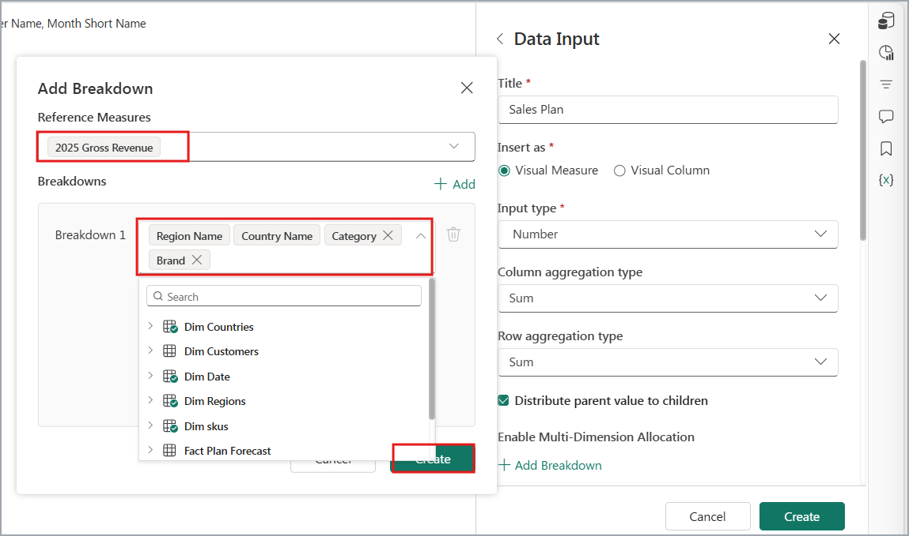

    The **Add Breakdown** dialog box closes, and the **Data Input** pane appears again.

22. In the **Data Input** pane, under **Enable Multi-Dimension Allocation**, verify that **1 Breakdown added** appears with a check mark.

23. At the bottom of the **Data Input** pane, select **Create**.

    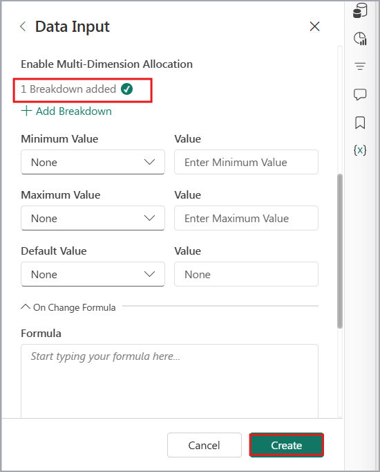

    The **Data Input** pane closes, and the **Sales Plan** visual measure is added.

24. Verify that the **Cube measure created successfully** notification appears in the upper-right corner.

    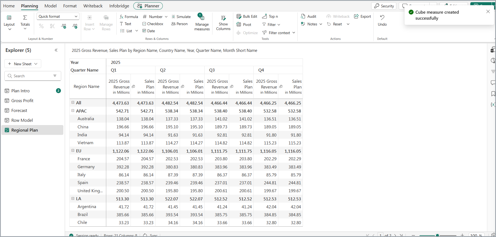

    The **Sales Plan** columns appear next to the **2025 Gross Revenue** columns under **Q1**, **Q2**, **Q3**, and **Q4**.

25. On the **Planning** tab, select **Totals** > **Column Subtotal** > **Left**.

    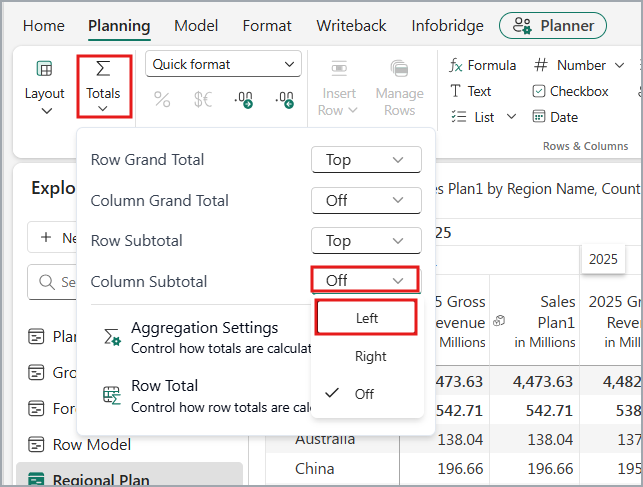

    A **Total** column appears to the left of the quarter columns.

26. In the **Year** row of the column header, select the expand arrow next to **2025**.

    The quarters **Q1**, **Q2**, **Q3**, and **Q4** appear under **2025**.

27. On the **Planning** tab, select **Show Columns**.

    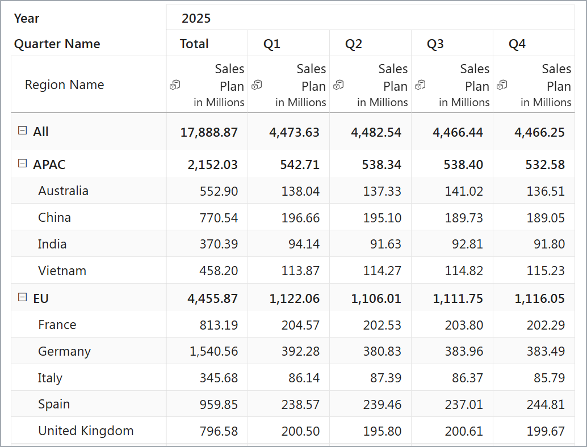

28. In the **Show Columns** list, clear the **2025 Gross Revenue** check box.

    The sheet shows only the **Sales Plan** measure, with a **Total** column followed by **Q1**, **Q2**, **Q3**, and **Q4**. The **Total** value for **All** is **17,888.87** million.

## Task 2: Create the Brand Plan sheet

In this task, you create the **Brand Plan** planning sheet. This sheet captures the cost plan by category and brand, and it later feeds the consolidated profitability view.

1. On the **Home** tab, in the **Create** group, select **New Planning Sheet**.

   The **New Planning Sheet** dialog box opens.

2. In the **Name** box, enter +++Brand Plan+++.

3. Select **Create**.

   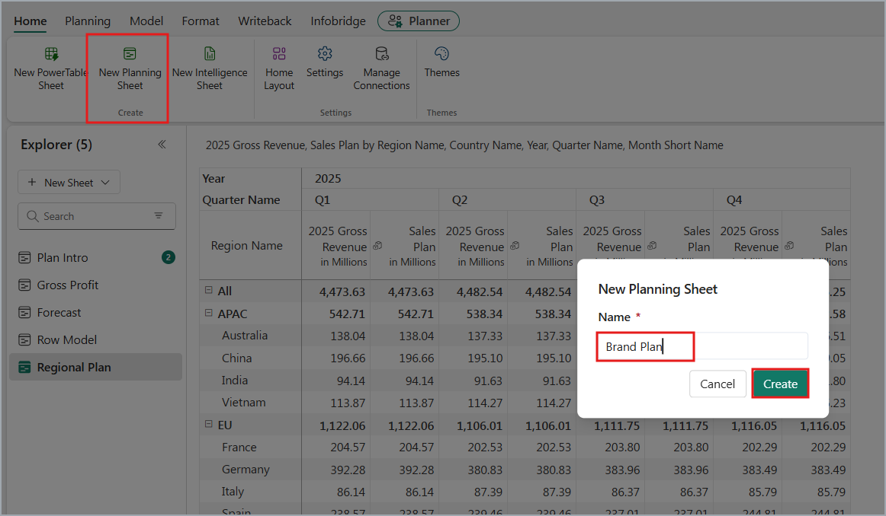

   The **Brand Plan** sheet opens and appears in the **Explorer** pane.

4. In the **Fields** pane, on the **Assign Data** tab, under **Rows**, select **+ Add Rows** > **Category**.
   - **Category**
   - **Brand**

5. Under **Columns**, select **+ Add Columns** > **Date Hierarchy**.

   The **Date Hierarchy** adds the **Year**, **Quarter Name**, and **Month Short Name** levels to **Columns**.

6. In the **Data** pane, under **Semantic Model** > **Measure Table**, select the **2025 COGS** check box.

   > **Note:** If **2025 COGS** doesn't appear directly under **Measure Table**, expand the folders under **Measure Table** to find it.

   The **Brand Plan** sheet shows **2025 COGS** by **Category** and **Brand** across the **Year**, **Quarter Name**, and **Month Short Name** columns.

7. In the **Fields** pane, on the **Assign Data** tab, verify that the fields are assigned as follows:
   - Rows - **Category**, **Brand**
   - Columns - **Date Hierarchy** with **Year**, **Quarter Name**, **Month Short Name**
   - Values - **2025 COGS**

   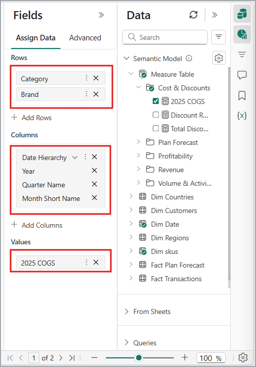

8. On the **Planning** tab, select **Number** > **Copy from another series** > **2025 COGS**.

   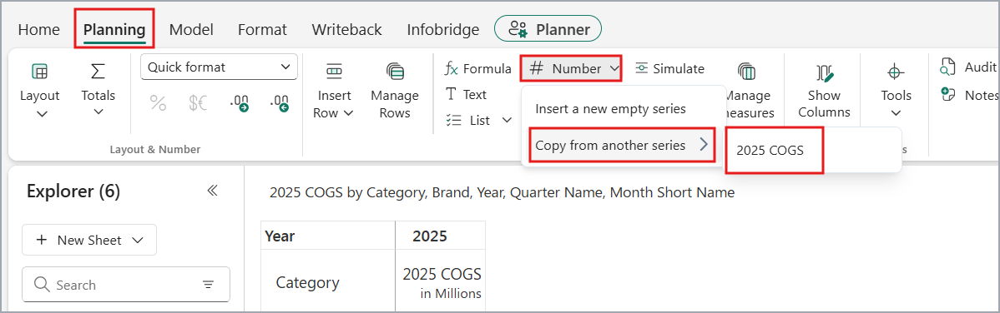

   The **Save changes to proceed** dialog box opens.

9. Select **Save and continue**.

   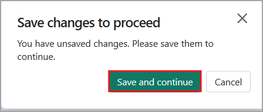

   The changes are saved, and the **Data Input** pane opens.

10. In the **Data Input** pane, in the **Title** box, enter +++Cost Plan+++.

11. Keep the following default settings:
    - Insert as - **Visual Measure**
    - Input type - **Number**
    - Column aggregation type - **Sum**
    - Row aggregation type - **Sum**
    - **Distribute parent value to children** - selected

12. Under **Enable Multi-Dimension Allocation**, select **+ Add Breakdown**.

    The **Add Breakdown** dialog box opens. A default breakdown named **Breakdown 1** already contains **Category** and **Brand**.

13. Under **Reference Measures**, keep **2025 COGS** selected.

    > **Note:** If a different measure appears under **Reference Measures**, remove it and select **2025 COGS** from the list.

14. Next to **Breakdown 1**, select the dimensions box to open the field list.

    **Breakdown 1** now shows **Category**, **Brand**, **Country Name**, and **+1**. The **+1** represents **Region Name**.

15. In the **Add Breakdown** dialog box, select **Create**.

    The dialog box closes, and the breakdown appears in the **Data Input** pane.

16. At the bottom of the **Data Input** pane, select **Create**.

    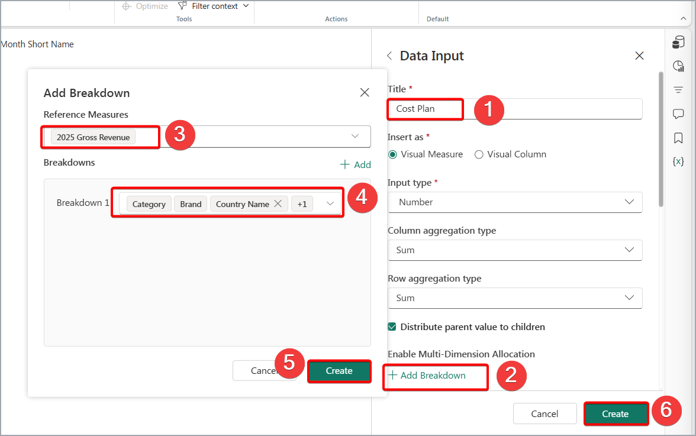

    The **Cost Plan** measure is added to the visual.

17. On the ribbon, select **Planning** > **Totals**.

18. In the **Column Subtotal** list, select **Left**.

    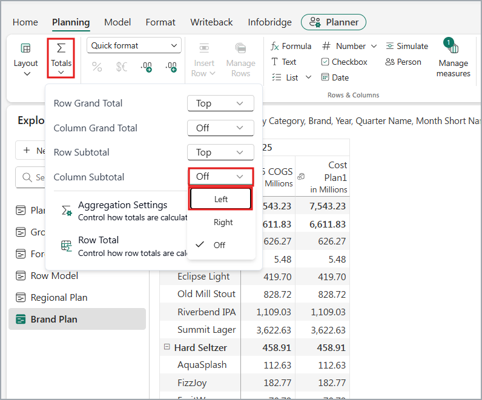

    Column subtotals appear to the left of the period columns that they summarize.

19. On the ribbon, select **Planning** > **Show Columns**.

20. In the field list, clear the **2025 COGS** check box.

    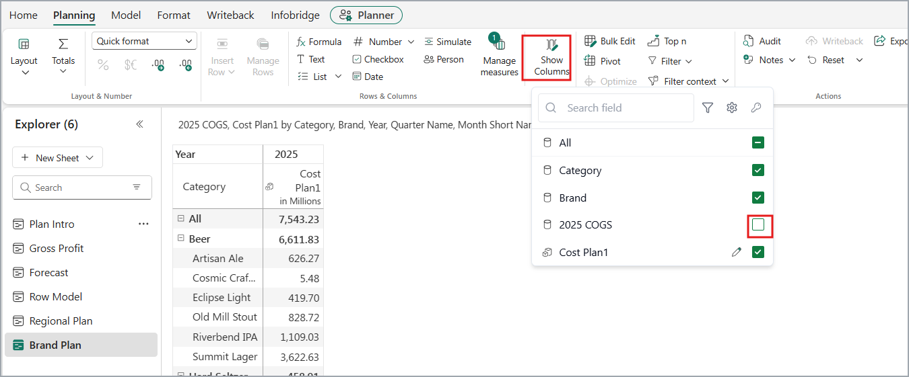

    The **2025 COGS** column is hidden, and only the **Cost Plan** column remains in the visual.

21. In the **Year** row of the column header, select the expand arrow next to **2025**.

    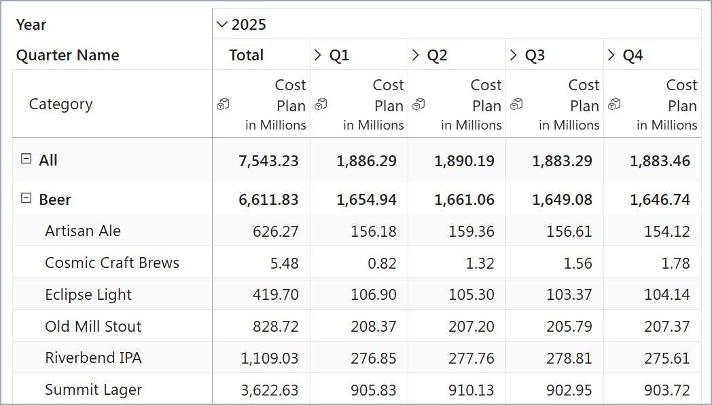

    The visual shows a **Total** column on the left, followed by **Q1**, **Q2**, **Q3**, and **Q4**. Each column shows **Cost Plan** values in millions.

## Task 3: Create the Profitability sheet

In this task, you create the **Profitability** planning sheet with region, country, category, and brand rows and a date hierarchy in the columns. You insert the **Sales Plan** and **Cost Plan** Cube measures, filter the sheet to 2025, and show column subtotals. You then add a **Gross Profit** formula measure so that you can compare both plans and their difference in one sheet.

1. On the ribbon, select **Home** > **New Planning Sheet**.

2. In the **New Planning Sheet** dialog box, enter the following value:
   - **Name** - +++Profitability+++

   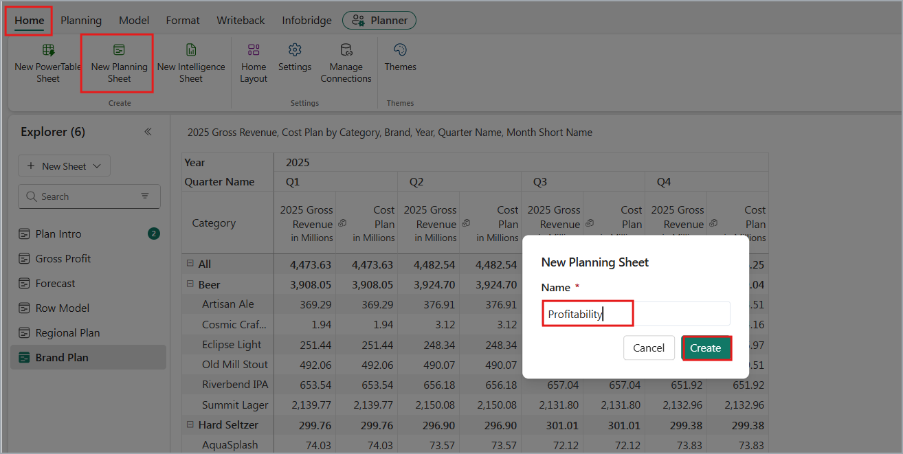

3. Select **Create**.

   The **Profitability** sheet is created and appears in the **Explorer** pane.

4. In the **Fields** pane, on the **Assign Data** tab, under **Rows**, use **+ Add Rows** to add the following fields in this order:
   - **Region Name**
   - **Country Name**
   - **Category**
   - **Brand**

   The rows show the region, country, category, and brand hierarchy.

5. Under **Columns**, select **+ Add Columns** > **Date Hierarchy**.

   The columns show the **Year**, **Quarter Name**, and **Month Short Name** hierarchy.

6. In the **Data** pane, expand **From Sheets** > **Cube Measures**.

7. Under **Cube Measures**, select **Sales Plan**.

8. Select **Insert as measure**.

   The **Sales Plan** measure is added to the visual.

9. Under **Cube Measures**, select **Cost Plan**.

10. Select **Insert as measure**.

    The **Cost Plan** measure is added to the visual. The **Profitability** sheet now shows both **Sales Plan** and **Cost Plan** values.

    > **Note:** If a measure doesn't appear in the visual, in the **Data** pane, go to **From Sheets** > **Cube Measures**. Then select **...** > **Insert as measure** next to the measure name.

    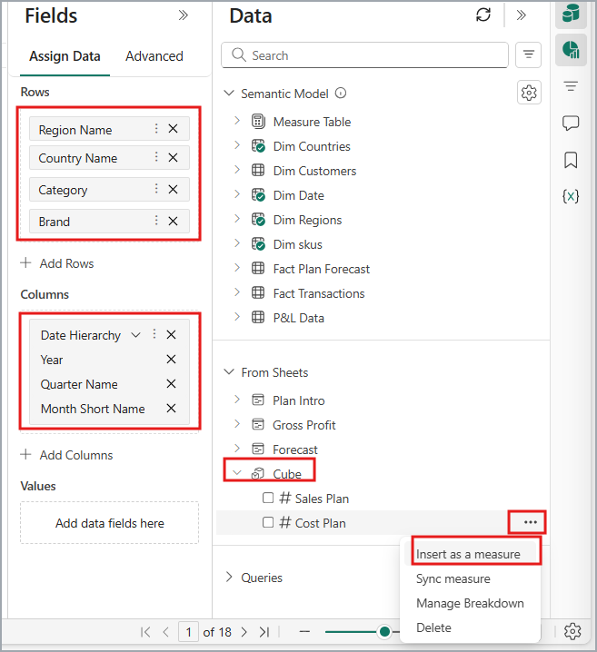

    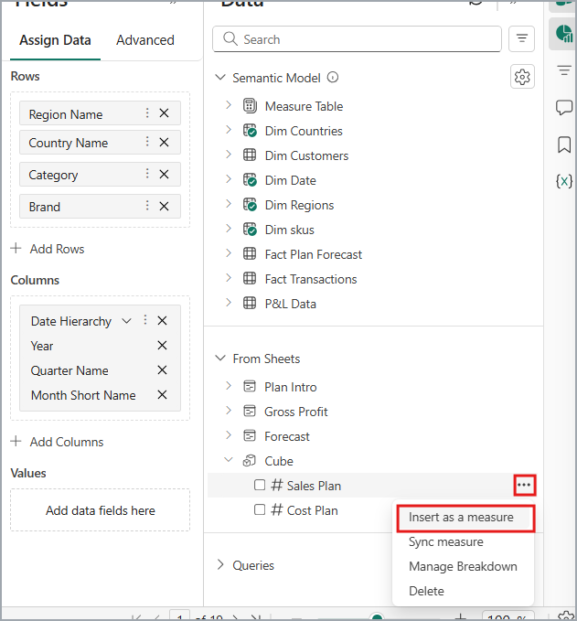

11. If the **Save changes to proceed** dialog box appears, select **Save and continue**.

    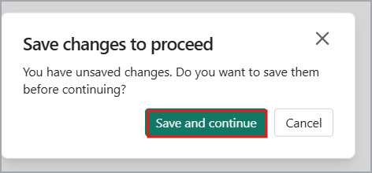

    The changes are saved, and the measure is added to the visual.

12. On the right toolbar, select **Filter**.

    The **Filter** pane opens.

13. In the **Filter** pane, on the **Year** card, select the expand arrow.

    The **Year** card expands and shows the **Basic**, **Advanced**, and **Top N** tabs.

14. On the **Basic** tab, clear the **Select All** check box.

15. Select the **2025** check box.

    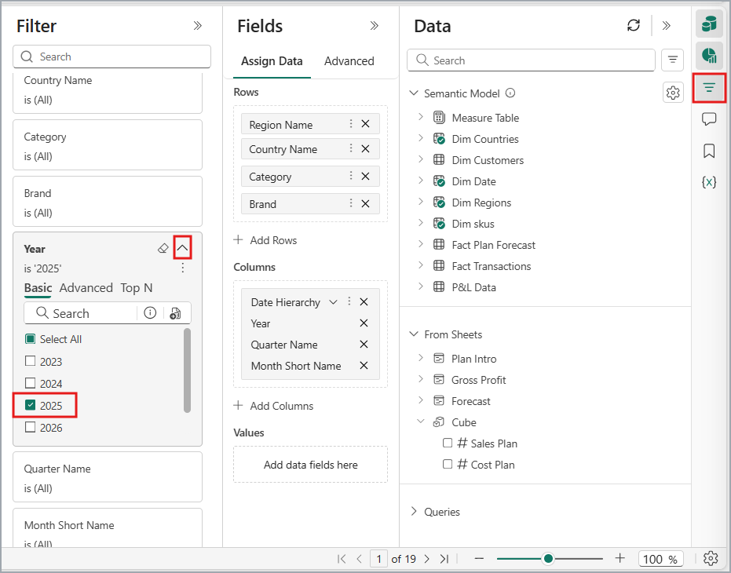

    The **Year** card shows **is '2025'**, and the visual shows only 2025 data.

16. On the **Planning** tab, in the **Layout & Number** group, select **Totals**.

    The **Totals** menu opens and shows the **Row Grand Total**, **Column Grand Total**, **Row Subtotal**, and **Column Subtotal** settings.

17. In the **Totals** menu, select the **Column Subtotal** list.

    The list opens and shows the **Left**, **Right**, and **Off** options.

18. In the **Column Subtotal** list, select **Left**.

    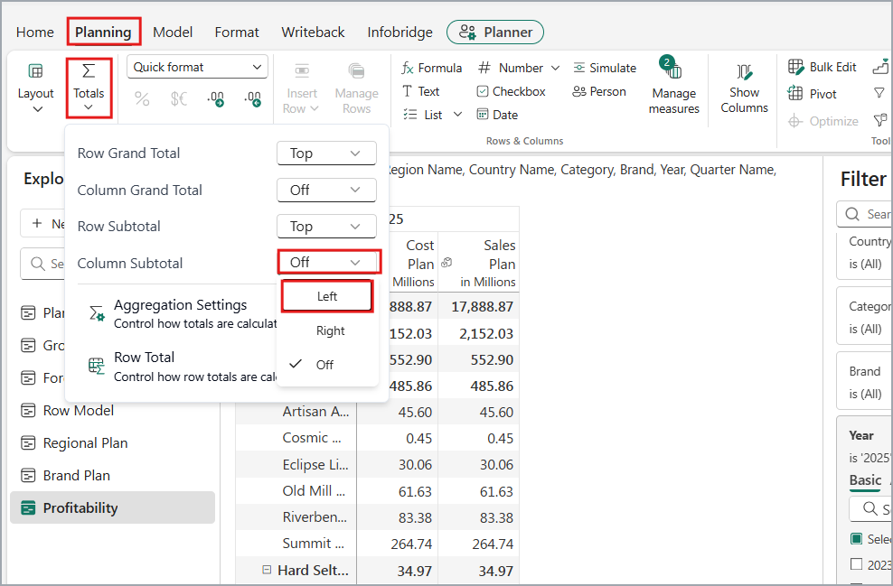

    A **Total** column appears on the left side of the visual.

19. In the **Year** row of the column header, select the expand arrow next to **2025**.

    The columns show the 2025 quarters **Q1**, **Q2**, **Q3**, and **Q4**, with the **Total** column on the left.

20. In the visual, review the **Sales Plan** and **Cost Plan** values for each region, country, category, and brand row.

    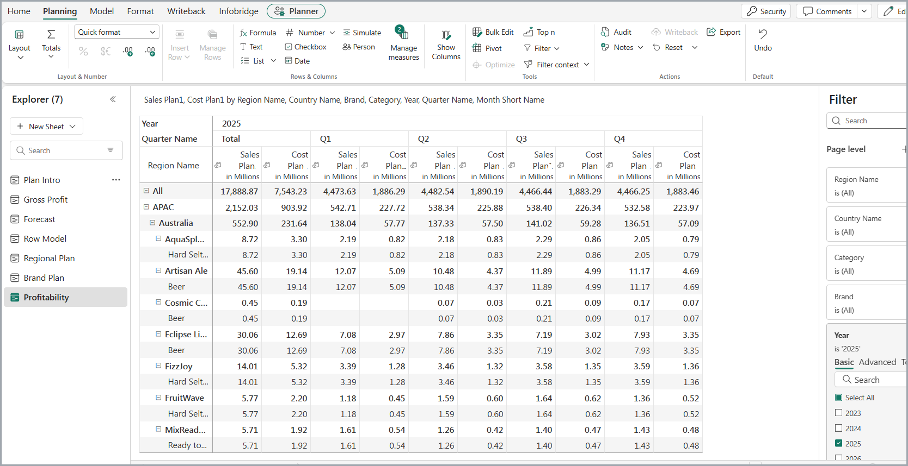

    Both measures are populated at the common region, country, category, and brand grain. The breakdowns on the Cube measures handle the allocation.

21. On the **Planning** tab, in the **Rows & Columns** group, select **Formula**.

    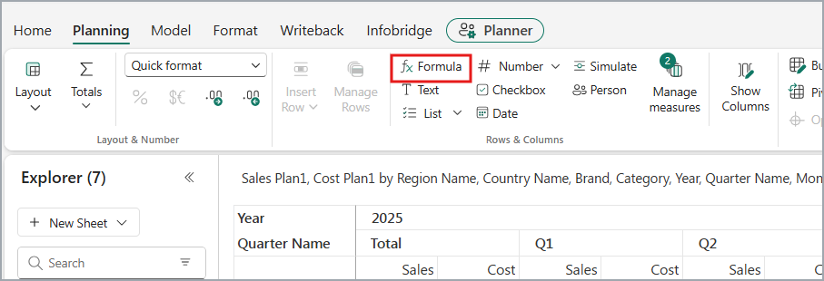

    The **Formula Measure** pane opens.

22. In the **Formula Measure** pane, enter or select the following values:
    - **Title** - +++Gross Profit+++
    - **Insert as** - **Visual Measure**
    - **Data type** - **Number**
    - **Formula** - +++[Sales Plan] - [Cost Plan]+++
    - **Column aggregation type** - **Formula**
    - **Row aggregation type** - **Formula**

    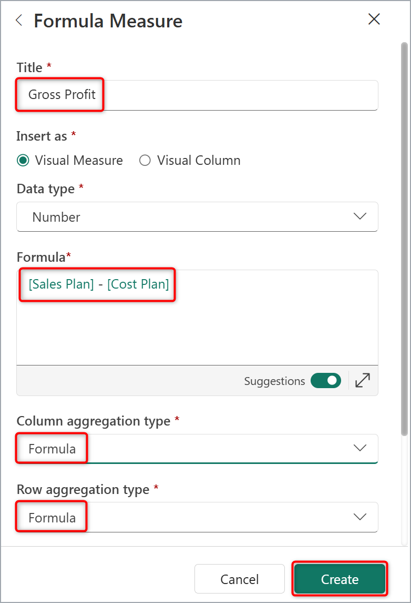

    > **Note:** When both aggregation types are set to **Formula**, every subtotal and total uses the same formula to calculate **Gross Profit**.

23. Select **Create**.

    The **Gross Profit** measure is added to the visual. It shows the difference between **Sales Plan** and **Cost Plan** for every row and quarter.

24. In the visual, review the **Gross Profit** column for each region, country, category, and brand row.

    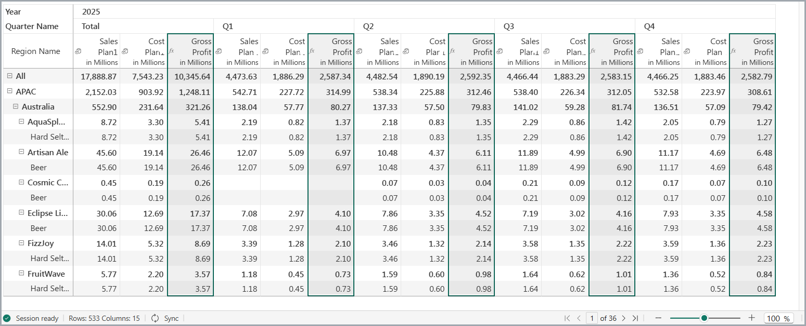

    **Gross Profit** appears at every region, country, category, and brand combination. It combines two measures that come from different dimensional levels.

# Exercise 2: Align plans in real time

In this exercise, you revise revenue and cost assumptions and confirm that each change flows through all three connected sheets without reconciliation or re-entry.

## Task 1: Revise the revenue assumption

In this task, you increase the EU **Sales Plan** total by 10% on the **Regional Plan** sheet. This shows how a single region-level change flows to every category and brand intersection on the **Profitability** sheet.

1. In the **Explorer** pane, select the **Regional Plan** sheet.
2. In the **EU** row, double-click the **Total** cell in the **Sales Plan** column.

   The current cell value, **4455868698.10999**, opens in the formula bar.

3. In the formula bar, at the end of the existing value, enter +++ +10%+++.

   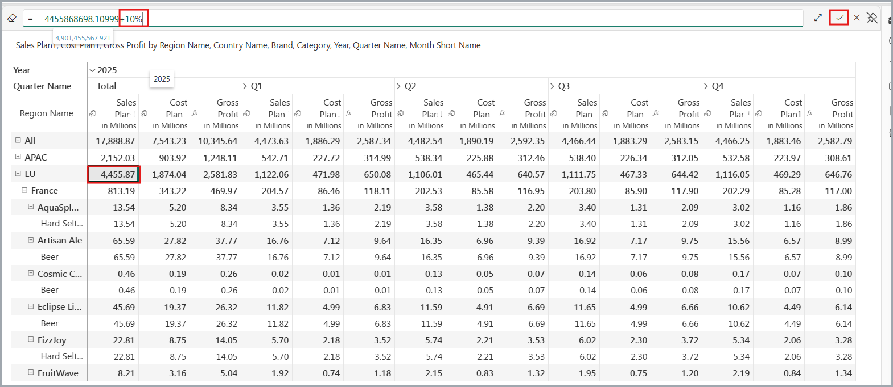

   The formula bar shows a preview of the new value, **4,901,455,567.921**.

4. Press **Enter** to apply the change.

   The EU **Sales Plan** total updates to **4,901.46** million, and the updated cells are highlighted.

   > **Note:** You can also select the checkmark next to the formula bar to apply the change.

5. In the **All** row, review the **Sales Plan** value in the **Total** column.

   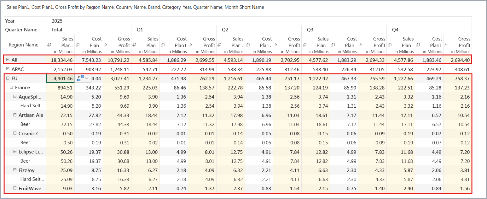

   The **Sales Plan** grand total updates to **18,334.46** million.

6. In the **Explorer** pane, select the **Profitability** sheet.
7. In the visual, review the **Sales Plan** and **Gross Profit** values in the **EU** rows.

   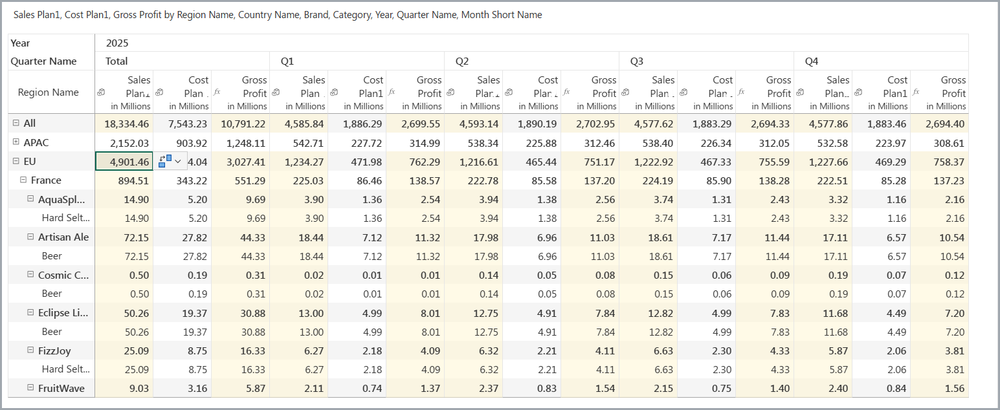

   The EU **Sales Plan** and **Gross Profit** values update across all EU categories and brands. The **Sales Plan** grand total matches the **18,334.46** million value on the **Regional Plan** sheet.

## Task 2: Revise the cost assumption from the output

In this task, you increase the **Cost Plan** for United States beer directly on the consolidated **Profitability** sheet. You then confirm that the change flows back to the **Brand Plan** sheet, so planners can work at any level and the plans stay aligned.

1. In the **Explorer** pane, select the **Profitability** sheet.
2. In the **Region Name** column, expand **NA**.
3. Under **NA**, expand **United States**.
4. Under **United States**, in the **Beer** row, double-click the **Total** cell in the **Cost Plan** column.

   The current cell value, **2753247031.6**, opens in the formula bar.

5. In the formula bar, at the end of the existing value, enter +++ +8%+++.

   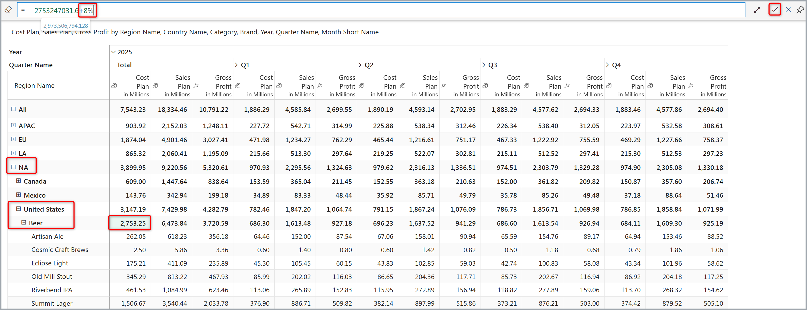

   The formula bar shows a preview of the new value, **2,973,506,794.128**.

6. Press **Enter** to apply the change.

   The **Cost Plan** total for **Beer** updates to **2,973.51** million, an increase of about 220 million, and the updated cells are highlighted.

   > **Note:** You can also select the checkmark next to the formula bar to apply the change.

7. Review the **Cost Plan** and **Gross Profit** values in the **Beer**, **United States**, **NA**, and **All** rows.

   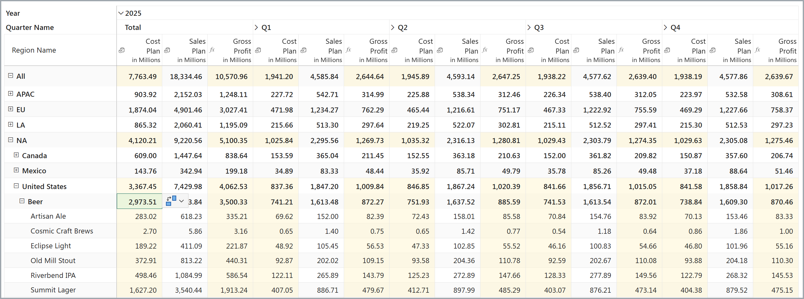

   The **Cost Plan** values increase for all beer brands, and the **Gross Profit** values decrease. For example, the **Gross Profit** total for **Beer** changes to **3,500.33** million, and the **Cost Plan** total for **All** changes to **7,763.49** million.

8. In the **Explorer** pane, select the **Brand Plan** sheet.
9. In the **Beer** row, review the value in the **Total** column under **Cost Plan**.

   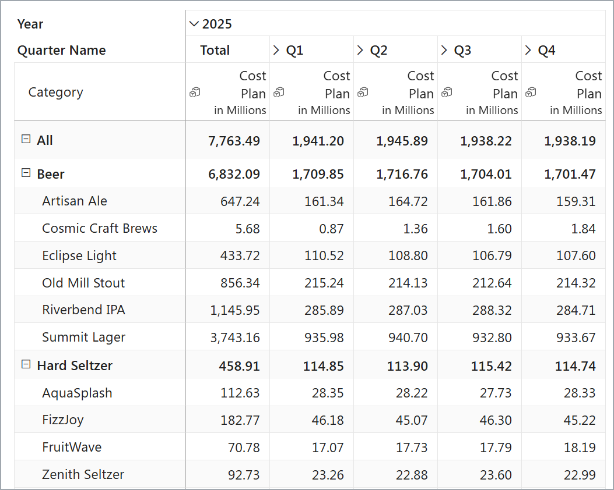

   The **Cost Plan** total for **Beer** changes from **6,611.83** million to **6,832.09** million. This increase of about 220 million shows that the revision that you made on the consolidated sheet flows back to the source plan.

10. In the upper-right corner of the app, select **Save**.

    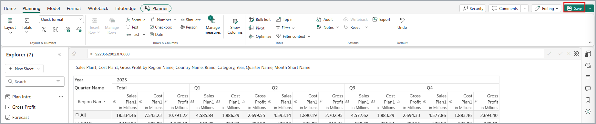

    The app saves your revised **Cost Plan** values.

## Summary

In this lab, you built three connected planning sheets in the **Acme_Beverages_Plan** app. You confirmed that revenue and cost revisions stay aligned across every plan in real time. You completed the following tasks:

- You created the **Regional Plan** sheet and configured the **Sales Plan** Cube measure. You added **Category** and **Brand** to the breakdown. You set **2025 Gross Revenue** as the reference measure.
- You created the **Brand Plan** sheet and configured the **Cost Plan** Cube measure. You added **Region Name** and **Country Name** to the breakdown. You set **2025 COGS** as the reference measure.
- You built the **Profitability** sheet. You imported both Cube measures at the **Region Name** > **Country Name** > **Category** > **Brand** grain. You calculated **Gross Profit**.
- You revised the revenue assumption in the **Regional Plan** sheet. You increased the **Sales Plan** for **EU** by 10 percent. The **Sales Plan** grand total updated to 18,334.46 million. The change appeared immediately in the **Profitability** sheet across all **EU** categories and brands.
- You revised the cost assumption in the **Profitability** sheet. You increased the **Cost Plan** for **United States** > **Beer** by 8 percent. The value updated to 2,973.51 million. The change cascaded back to the **Brand Plan** sheet, where the value changed from 6,611.83 million to 6,832.09 million.

## Summary

In this lab, you built three connected planning sheets in the **Acme_Beverages_Plan** app.

- Created the **Regional Plan** sheet and configured the **Sales Plan** Cube measure. You used **2025 Gross Revenue** as the reference measure. You added **Category** and **Brand** to the breakdown.
- Created the **Brand Plan** sheet and configured the **Cost Plan** Cube measure. You used **2025 COGS** as the reference measure. You added **Region Name** and **Country Name** to the breakdown.
- Built the **Profitability** sheet and imported both Cube measures at the Region > Country > Category > Brand grain.
- Calculated **Gross Profit** in the **Profitability** sheet.
- Revised the revenue assumption in the **Regional Plan** sheet by appending 10% to the EU **Sales Plan**. The grand total updated to 18,334.46M. The change appeared instantly in the **Profitability** sheet across all EU categories and brands.
- Revised the cost assumption in the **Profitability** sheet by appending 8% to the NA Beer **Cost Plan**. The value updated to 2,973.51M. The change cascaded back to the **Brand Plan** sheet, where the total changed from 6,611.83M to 6,832.09M.

