# Lab 06- Getting started with PowerTable

## Scenario

Acme Beverages needs an Asset Management data app. The company tracks its asset data in spreadsheets. This approach makes the data hard to manage and keep consistent.

To solve this problem, Acme Beverages moves the asset data into a database. The company then manages the data with a mini data app in Microsoft Fabric that uses Fabric Plan. The solution uses these key components:

- Fabric SQL database: Stores the assets, employees, and locations tables that the app uses for data management.
- Fabric Plan item: Holds the PowerTable app and connects it to the system database.
- PowerTable sheets: Provide a spreadsheet-like interface to view, format, edit, import, and audit the data in the database.

In this lab, you're a data professional at Acme Beverages. You build the Asset Management app that replaces the spreadsheets. The app lets users manage asset data directly in Microsoft Fabric.

## Introduction

In this lab, you build an Asset Management data app in Microsoft Fabric. You create a Fabric SQL database and a Fabric Plan item, and then you create PowerTable sheets for the Assets, Employees, and Locations tables from an Excel spreadsheet. You then configure the Assets sheet with formatted columns, a conditional formatting rule, lookups, and a formula column. Finally, you manage data with the Row Editor, Form Editor, Bulk Editor, Find and Replace, file import, and audit features of PowerTable.

## Objectives

After completing this lab, you will be able to:

- Create a Fabric SQL database for data management.
- Create a Fabric Plan item and set up its connection to the system database.
- Create PowerTable sheets for the Assets, Employees, and Locations tables by importing data from an Excel file.
- Configure the Assets sheet with image and single-select columns, a conditional formatting rule, lookup values, and a formula column.
- Update and insert data by using the Row Editor, Form Editor, Bulk Editor, and Find and Replace.
- Import new records from a file and review changes in the audit logs.

## Architecture

The learner uploads asset, employee, and location data from assets.xlsx through the Fabric Plan item's PowerTable sheets. A connection using an organizational account links the Plan item to the Fabric SQL database, which stores the tables. Users then view, format, edit, import, and audit the data in the PowerTable sheets.

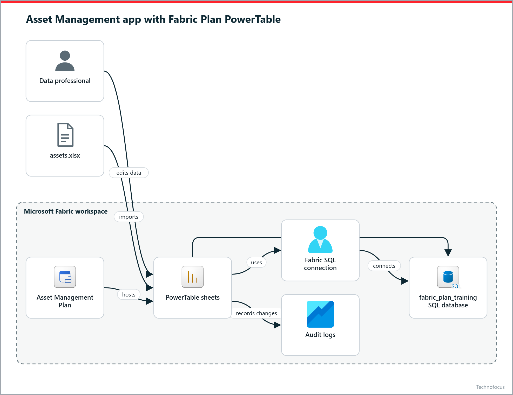

## Prerequisites

To complete this lab, you need:

- Access to a Microsoft Fabric training workspace with permission to create items.
- Permission to create **SQL database** and **Plan** items in the workspace.
- The **assets.xlsx** file, which contains the asset, employee, location, and import data that you use in this lab.
- An organizational account to create the Fabric Plan connection.

## Scenario

Acme Beverages tracks its asset data in spreadsheets. The company needs an asset management data app. In this lab, you move the asset data into a database. You then manage the data with a mini data app in Microsoft Fabric that uses Fabric Plan.

# Exercise 1: Create the Fabric SQL database and Fabric Plan item

In this exercise, you create the Fabric SQL database that the PowerTable app uses for data management and the Fabric Plan item that holds the PowerTable app.

## Task 1: Create a workspace

In this task, you create the Microsoft Fabric workspace for the lab. The workspace holds the Fabric SQL database and the Fabric Plan item that you create later.

1. In Microsoft Fabric, on the **Home** page, under **Welcome to Fabric**, select **New workspace**.

   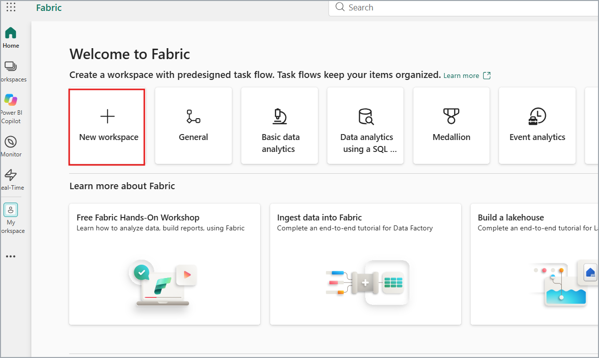

   The **Create a workspace** pane opens.

2. In the **Create a workspace** pane, in the **Name** field, enter the following value:

   +++FabricPlan-Day2-568795+++

   The **This name is available** message appears under the **Name** field.

   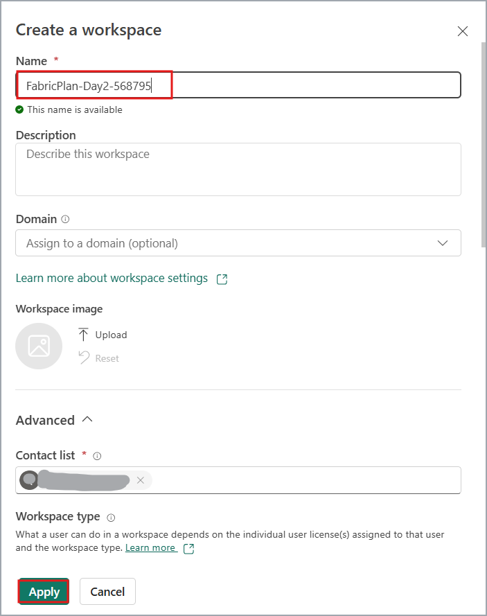

   > **Note:** The workspace name must be unique. If the name isn't available, add more digits to the end of the name, and use that name in the rest of the lab.

3. Under **Advanced**, verify that your account appears in the **Contact list** field.

4. Select **Apply**.

   Fabric creates the workspace and opens the **FabricPlan-Day2-568795** workspace page.

## Task 2: Create a folder in the workspace

In this task, you create a folder in the workspace. The folder keeps the lab items organized in one place.

1. On the **FabricPlan-Day2-568795** workspace page, select **New folder**.

   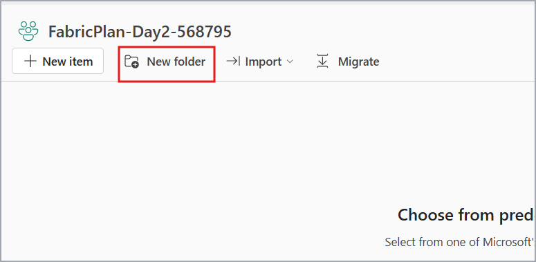

   The **New folder** dialog box opens.

2. In the **New folder** dialog box, enter the following folder name:

   +++FabricPlan-Day2+++

3. Select **Create**.

   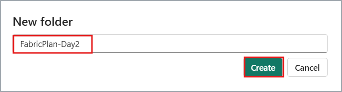

   The **FabricPlan-Day2** folder appears in the workspace.

## Task 3: Create a Fabric SQL database

In this task, you create a SQL database named **fabric_plan_training** in the training workspace. You use this database to store the data that you work with later in the lab.

1. Go to the **FabricPlan-Day2** folder in the **FabricPlan-Day2-568795** workspace.

2. On the toolbar, select **New item**.

   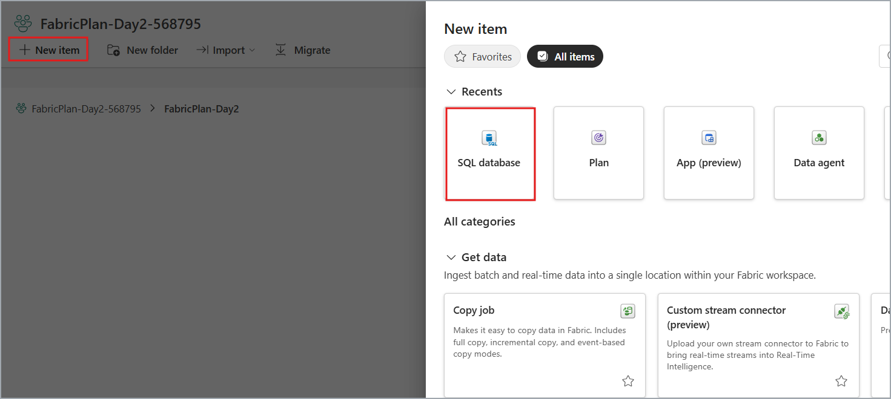

   The **New item** pane opens.

3. In the **New item** pane, select **All items**.

4. In the **Filter by keyword** box, enter +++SQL+++.

5. Select **SQL database**.

   The **New SQL database** dialog box opens.

6. In the **New SQL database** dialog box, enter the following details:
   - **Name** - +++fabric_plan_training+++

7. Select **Create**.

   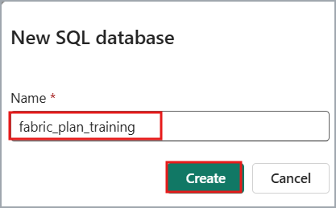

   The database opens on the **Home** tab, and the **Build your database** page appears.

8. In the **Explorer** pane, verify that the **fabric_plan_training** database appears.

   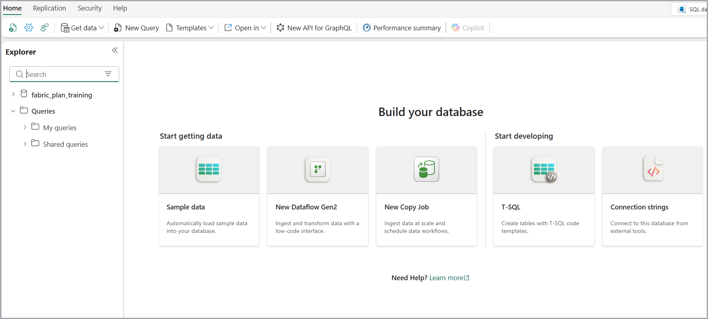

## Task 4: Create a Fabric Plan item

In this task, you start creating a Plan item in the same workspace as the **fabric_plan_training** database. You configure the Plan item and its connection in the next exercise.

1. Go to the **FabricPlan-Day2** folder in the **FabricPlan-Day2-568795** workspace.

   The **fabric_plan_training** SQL database and the **fabric_plan_training** SQL analytics endpoint appear in the item list.

2. On the toolbar, select **New item**.

   The **New item** pane opens.

3. In the **New item** pane, select **All items**.

4. In the **Filter by keyword** box, enter +++Plan+++.

5. Select **Plan**. The **New Plan** dialog box opens.

   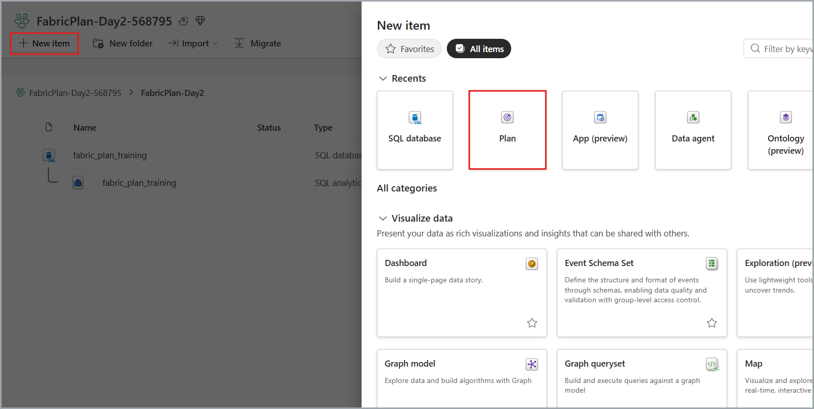

6. In the **New Plan** dialog box, enter the following details:
   - **Name** - +++Asset Management+++
   - **Location** - Keep the default workspace location.

7. Select **Create**.

   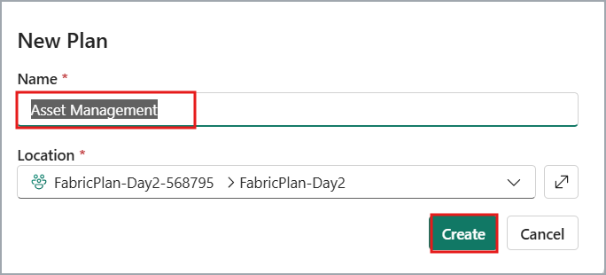

   The **Asset Management** Plan item opens on the **Home** tab, and the **How Would You Like To Get Started?** page appears.

# Exercise 2: Create the PowerTable sheets

In this exercise, you create the **Assets**, **Employees**, and **Locations** PowerTable sheets by using data that you import from an Excel spreadsheet.

## Task 1: Create the Assets PowerTable sheet

In this task, you create the **Assets** PowerTable sheet in the **Asset Management** Plan item. You also set up the connection that links the Plan item to the system database so that workspace viewers can use the Plan item.

1. On the **How Would You Like To Get Started?** page, under **Create new sheet**, select **PowerTable**.

   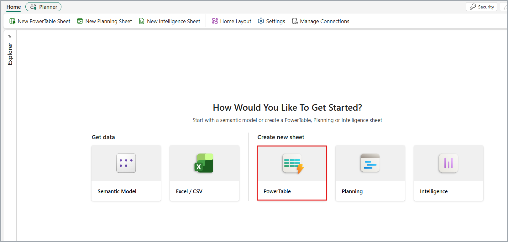

   The **New PowerTable Sheet** dialog box opens.

2. In the **New PowerTable Sheet** dialog box, enter the following details:
   - **Name** - +++Assets+++

3. Select **Create**.

   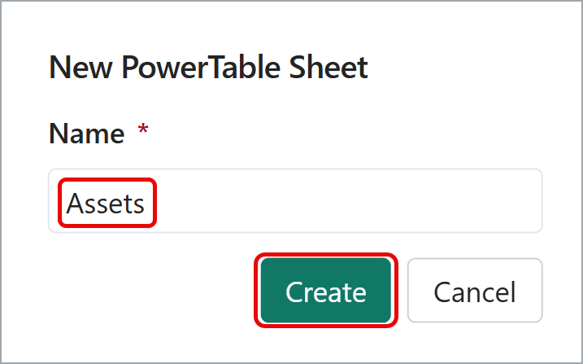

   The **Assets** sheet opens on the **Welcome to PowerTable** page, and the **Extra configuration recommended** banner appears at the top of the page.

   > **Note:** You set up the connection only one time for each Fabric Plan item. This connection links the Plan item to the system database. It also lets users with the Viewer workspace role use this Plan item.

4. On the **Extra configuration recommended** banner, select **Set up connection**. The **Select Fabric SQL Connection** dialog box opens.

   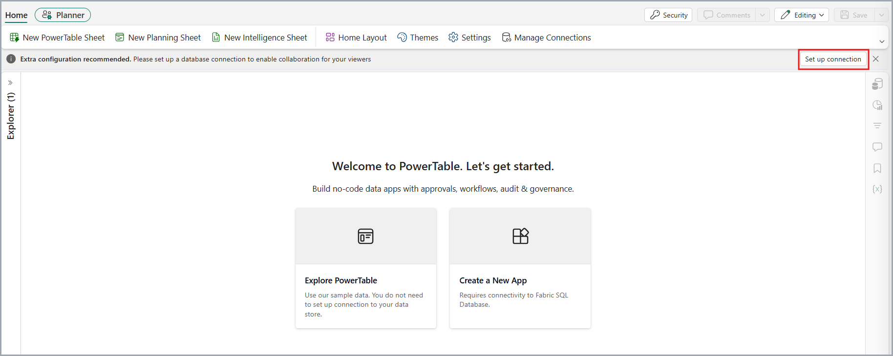

5. In the **Select Fabric SQL Connection** dialog box, select **+ Create Connection**.

   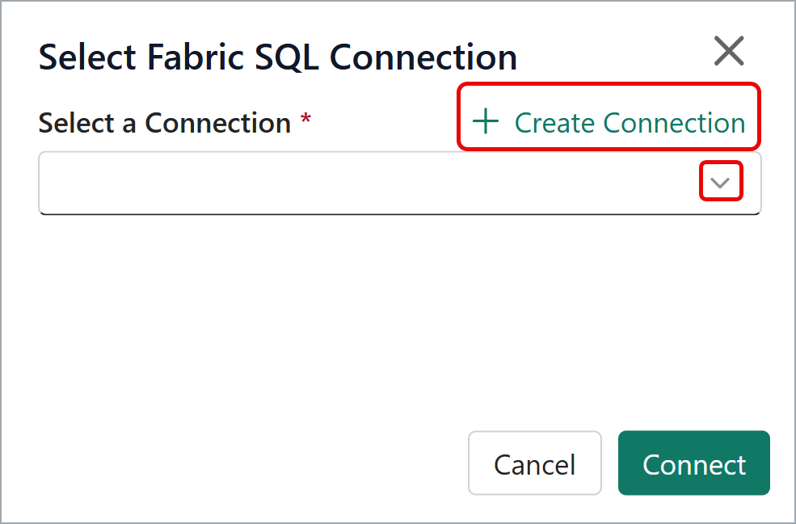

   The **Create New Connection** dialog box opens.

   > **Note:** If a Fabric SQL connection already exists, you can select the drop-down arrow in the **Select a Connection** box and select that connection instead. In that case, skip to step 8.

6. In the **Create New Connection** dialog box, under **Connection credentials**, configure the following settings:
   - **Connection** - **Create new connection**
   - **Connection name** - +++FabricSql-outh+++
   - **Authentication kind** - **Organizational account**

   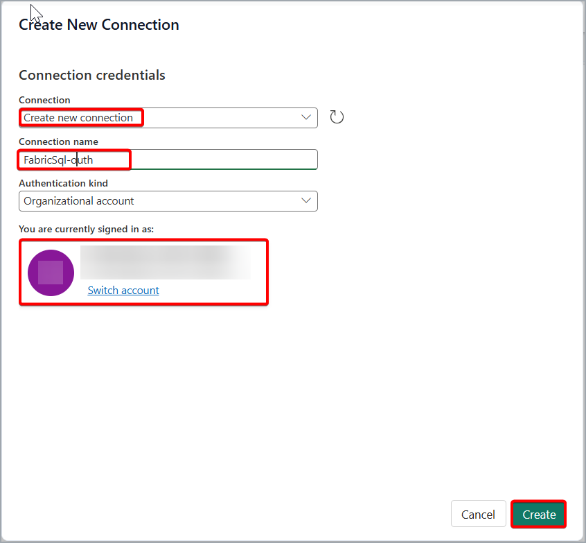

   > **Note:** Under **You are currently signed in as**, your account appears by default. To use a different account, select **Switch account**.

7. Select **Create**.

   The **Select Fabric SQL Connection** dialog box opens, and the new connection appears in the **Select a Connection** box.

8. In the **Select Fabric SQL Connection** dialog box, select **Connect**.

   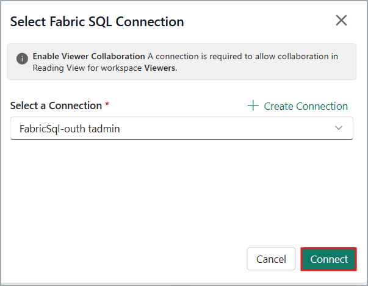

   The dialog box closes, and the PowerTable **Home** page opens.

9. Verify that the **Connection saved successfully!** message appears in the upper-right corner of the page.

   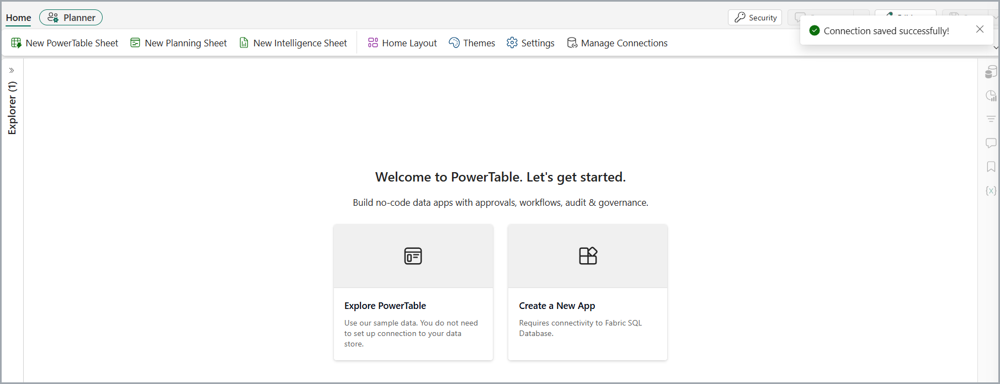

   The connection is saved, and PowerTable is connected to the Fabric SQL database.

10. On the PowerTable **Home** page, select **Create a New App**.

    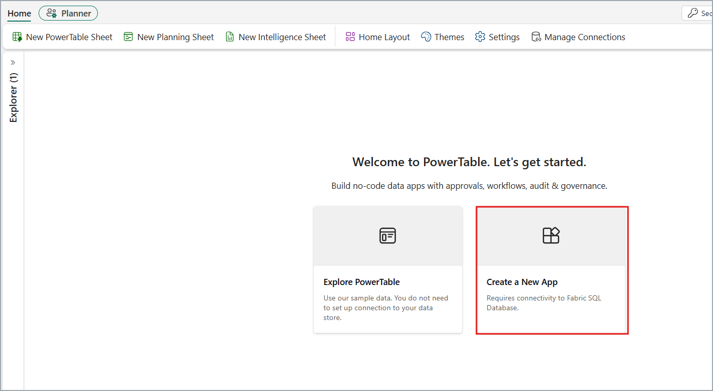

    The **Select Fabric SQL Connection** dialog box opens.

11. In the **Select a Connection** list, select **FabricSql-outh**.

12. Under **Select Database From**, verify that **Database Item** is selected.

13. In the **Database Name** box, select the search icon.

    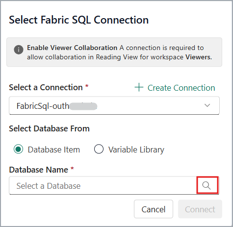

    The **OneLake catalog** opens on the **Select destination database** page.

14. In the list of databases, select **fabric_plan_training**, the database that you created earlier.

    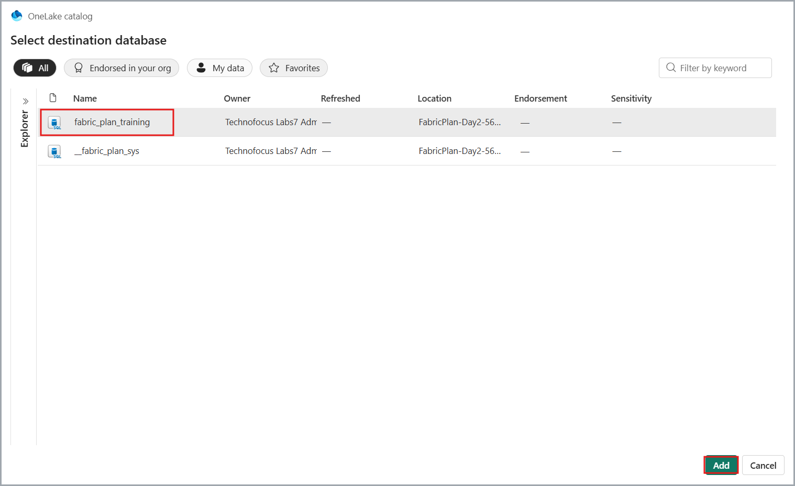

    > **Note:** Make sure that you select **fabric_plan_training** and not **\_\_fabric_plan_sys**.

15. Select **Add**.

    The **Select Fabric SQL Connection** dialog box opens again, and **fabric_plan_training** appears in the **Database Name** box.

16. In the **Select Fabric SQL Connection** dialog box, select **Connect**.

    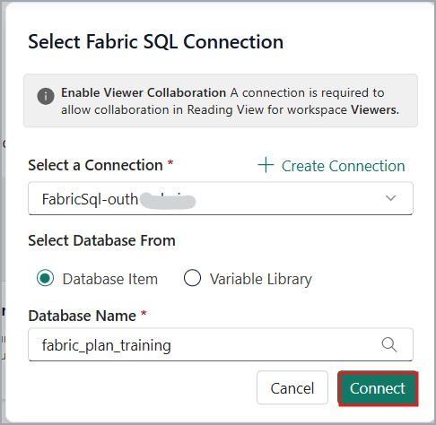

    The dialog box closes, and PowerTable connects the new app to the **fabric_plan_training** database.

17. In the **Select Table** dialog box, under **Select Table**, select **New Table**.

18. In the **Schema** list, select **dbo**.

19. In the **Table Name** box, enter +++assets+++.

20. Under **Import Data**, select **Upload File**.

    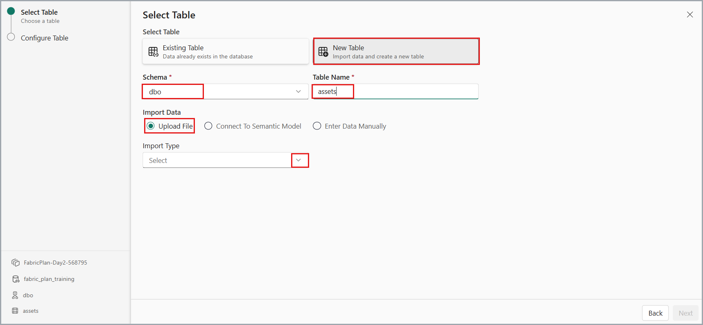

21. In the **Import Type** list, select **Excel**.

    The **Upload File** area appears below the **Import Type** list.

22. In the **Upload File** area, select **Click or drop files here**.

    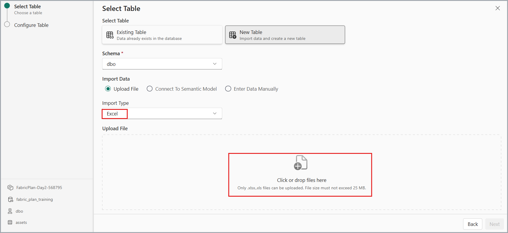

    The **Open** dialog box opens.

23. In the **Open** dialog box, go to **This PC** > **Local Disk (D:)** > **Labfiles**.

24. Select the **assets.xlsx** file.

25. Select **Open**.

    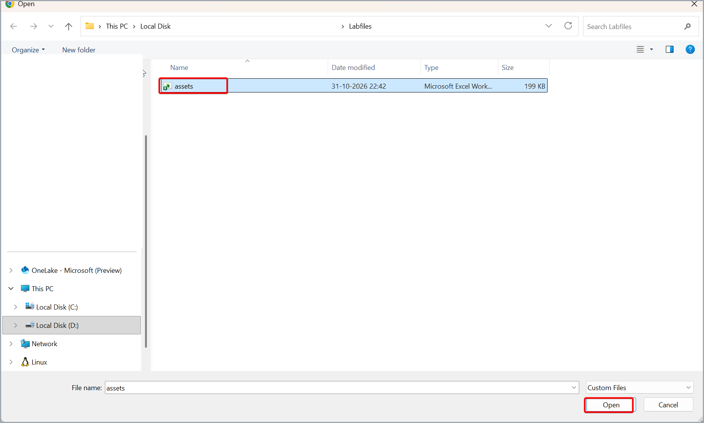

    The **assets.xlsx** file appears under **Uploaded File** in the **Select Table** dialog box.

    > **Note:** If you uploaded the wrong file, select **Change** next to the file name, and then select a different file. You can upload only .xlsx and .xls files, and the file size must not exceed 25 MB.

26. Select **Next**.

    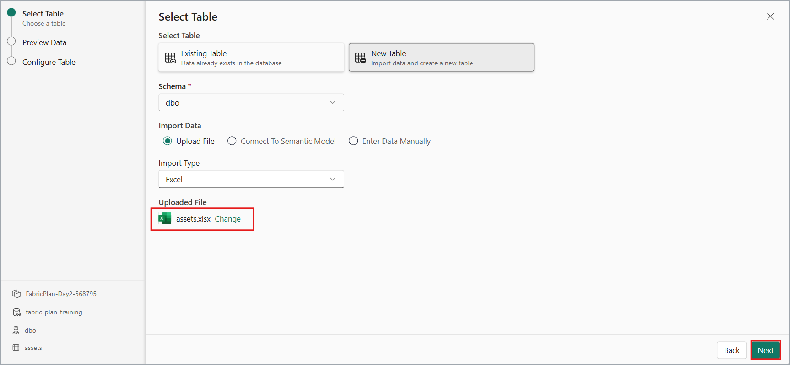

    The wizard moves to the **Preview Data** step.

27. In the **Preview Data** section, in the worksheet list, select **Sheet1**.

    The preview table shows the asset records from **Sheet1**, and **Total Row Count** shows **99**.

28. Select **Next**.

    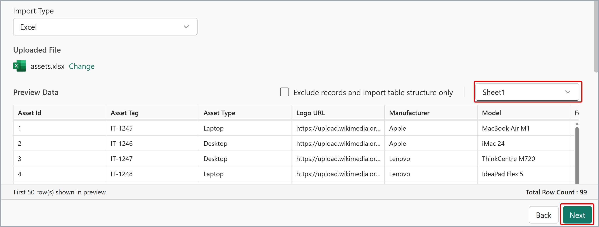

    The **Configure Table** page opens and lists the 17 columns from the file.

29. In the **Asset Id** row, select the **Identity Column** check box.

    The **Asset Id** column now has **INT** as its data type, with **Primary Key** and **Identity Column** selected.

    > **Note:** An identity column generates the ID value automatically for each new record.

30. Select **Finish**.

    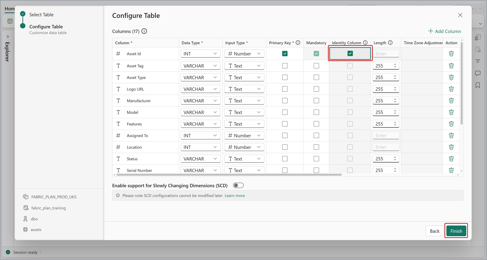

    The **Assets** sheet opens and shows the imported data. The status bar shows **Rows: 99** and **Columns: 17**.

31. On the **Home** tab, select **Save**.

    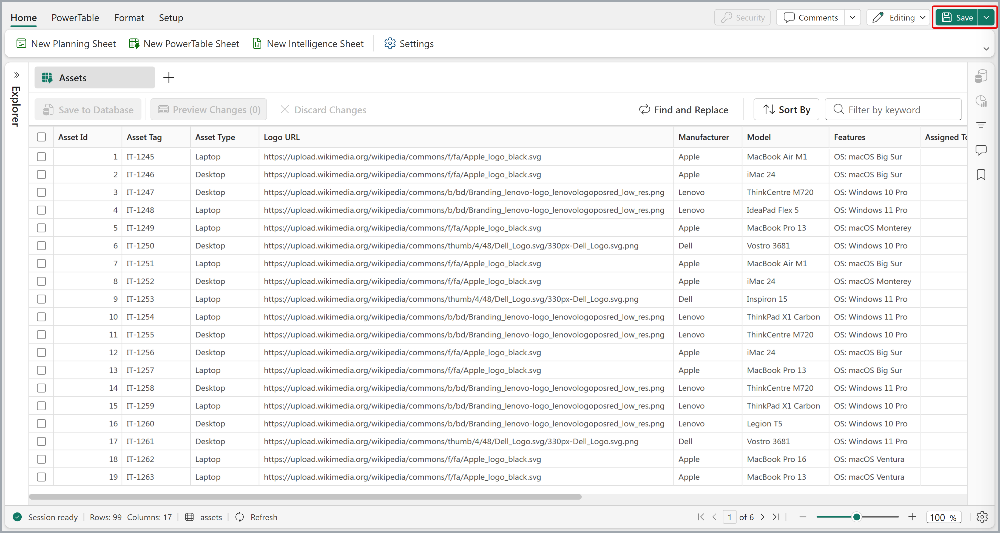

    Your changes, including the **Assets** sheet, are saved.

## Task 2: Create the Employees PowerTable sheet

In this task, you create a second PowerTable sheet for employee data. A separate sheet keeps the employee records apart from the asset records in the **Assets** sheet.

1. On the **Home** tab, select **New PowerTable Sheet**.

   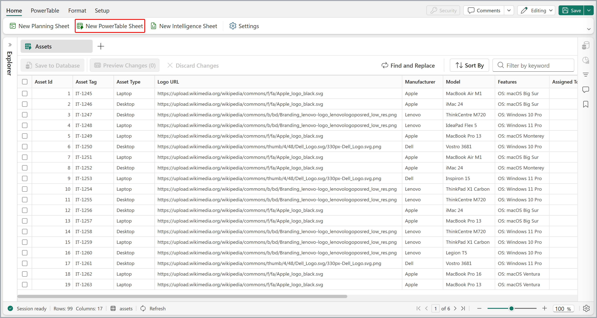

   The **New PowerTable Sheet** dialog box opens.

2. In the **New PowerTable Sheet** dialog box, for **Name**, enter +++Employees+++.

3. Select **Create**.

   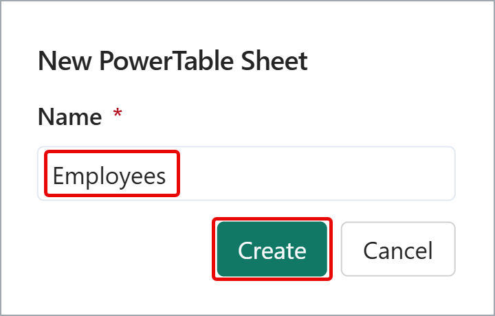

   A new **Employees** tab opens and shows the **Welcome to PowerTable. Let's get started.** page.

4. Select **Create a New App**.

   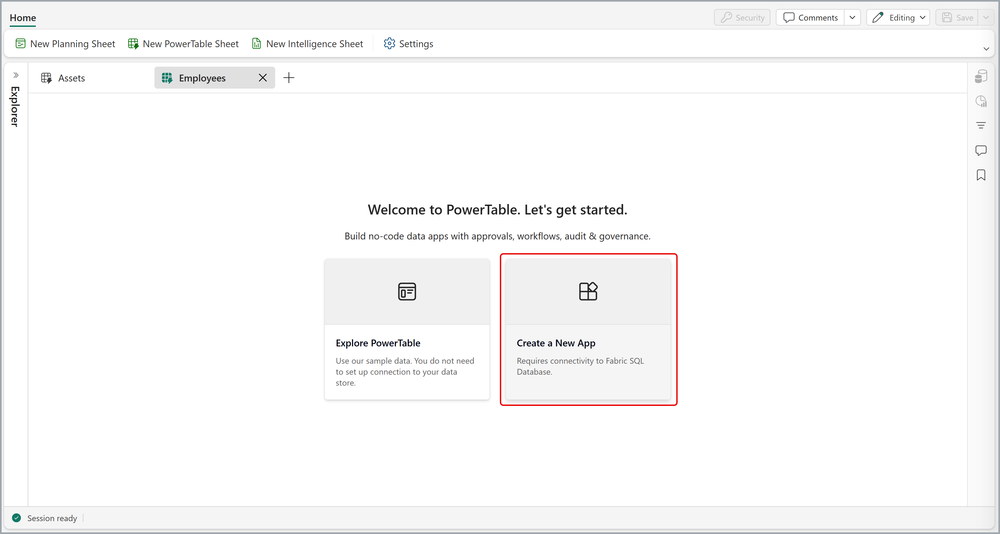

   The **Select Fabric SQL Connection** dialog box opens.

5. In the **Select Fabric SQL Connection** dialog box, in the **Select a Connection** list, select **FabricSql-outh**.

6. Next to **Database Name**, select the search icon.

   The **OneLake catalog** opens.

7. In the **OneLake catalog**, select **fabric_plan_training**.

8. Select **Add**.

   The **Database Name** box shows **fabric_plan_training**.

   > **Note:** Use the connection and the database that you created earlier in this lab.

9. Select **Connect**.

   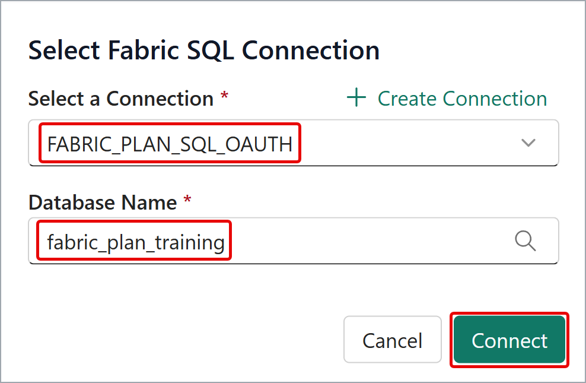

   The **Select Table** page of the wizard opens.

10. On the **Select Table** page, configure the following settings:
    - **Select Table** - **New Table**
    - **Schema** - **dbo**
    - **Table Name** - +++employees+++
    - **Import Data** - **Upload File**
    - **Import Type** - **Excel**

    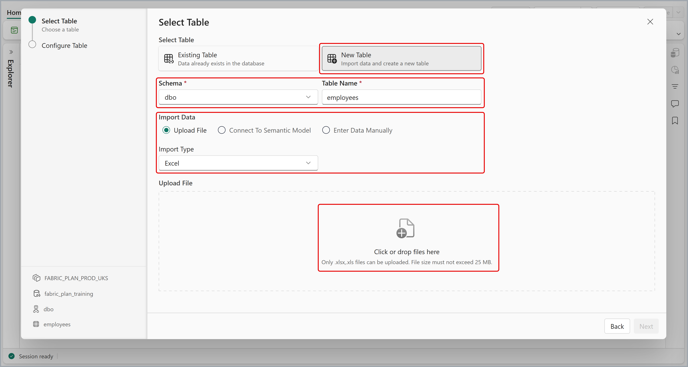

11. In the **Upload File** section, select **Click or drop files here**.

    A file browser opens.

12. In the file browser, go to **This PC** > **Local Disk (D:)** > **Labfiles**.

13. Select the **assets.xlsx** file.

14. Select **Open**.

    The **assets.xlsx** file uploads to the **Upload File** section of the wizard.

    > **Note:** You can upload only .xlsx and .xls files. The file size must not exceed 25 MB.

15. Select **Next**.

16. In the **Preview Data** section, in the worksheet list, select **Sheet2**.

    The preview shows the employee data from the **Sheet2** worksheet, and **Total Row Count** shows **30**.

17. Select **Next**.

    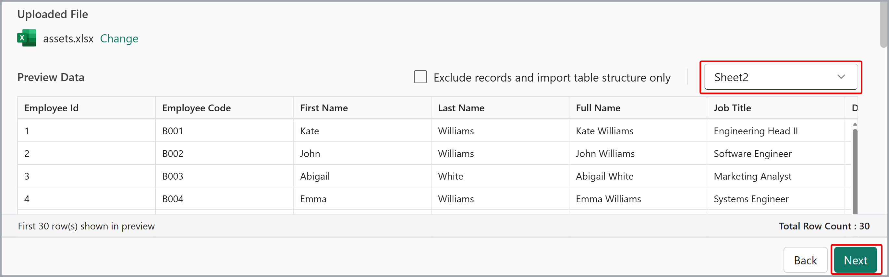

    The **Configure Table** page opens and lists the nine columns of the **employees** table.

18. On the **Configure Table** page, in the **Employee Id** row, select the **Identity Column** check box.

    > **Note:** The **Primary Key** check box for the **Employee Id** column is already selected. Keep the existing settings for the other columns.

19. Select **Finish**.

    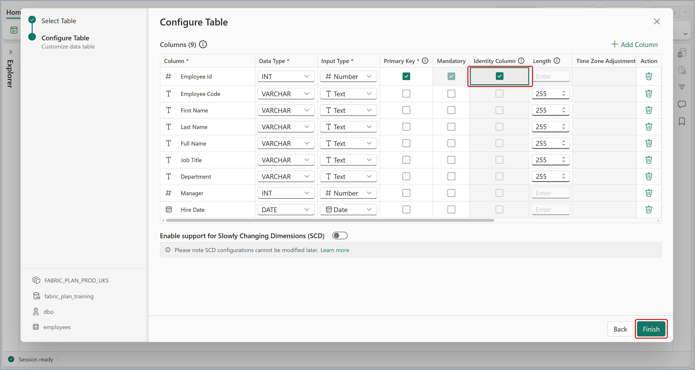

    The wizard closes, and the **Employees** sheet shows the imported employee records. The status bar shows **Rows: 30** and **Columns: 9**.

20. On the **Home** tab, select **Save**.

    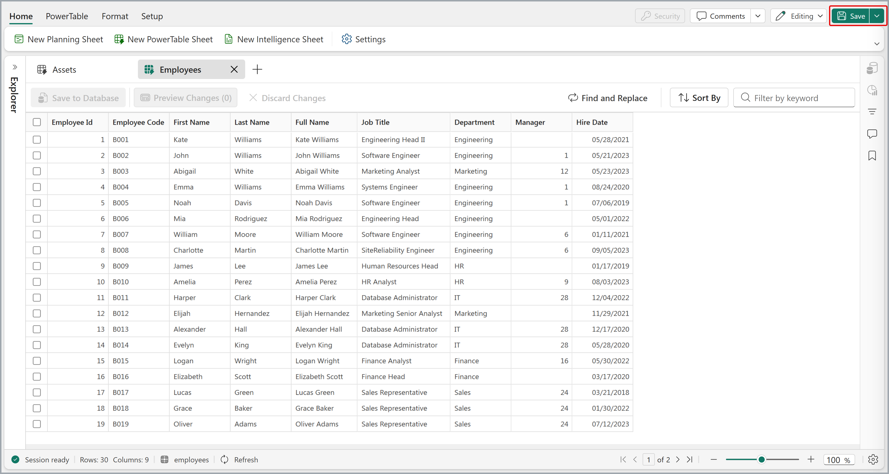

    Your changes, including the new **Employees** sheet, are saved.

## Task 3: Create the Locations PowerTable sheet

In this task, you add a new PowerTable sheet for the location data. A separate sheet keeps the location records in their own table, so you can manage them independently of the employee records.

1. Select **Home** > **New PowerTable Sheet**.

   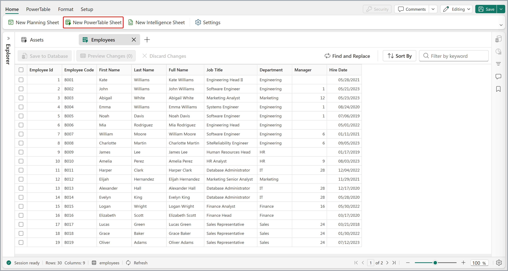

   The **New PowerTable Sheet** dialog box opens.

2. In the **New PowerTable Sheet** dialog box, for **Name**, enter +++Locations+++.

3. Select **Create**.

   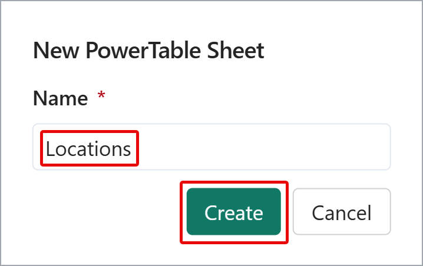

   A new **Locations** tab opens and shows the **Welcome to PowerTable. Let's get started.** page.

4. Select **Create a New App**.

   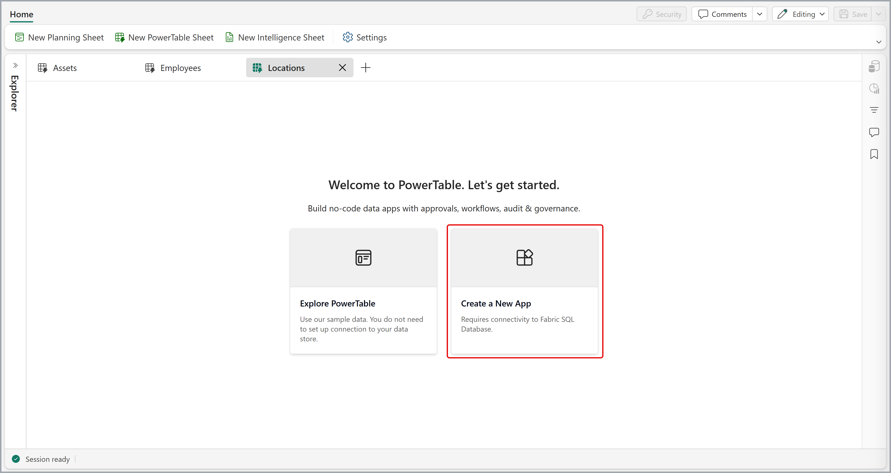

   The **Select Fabric SQL Connection** dialog box opens.

5. In the **Select Fabric SQL Connection** dialog box, in the **Select a Connection** list, select **FabricSql-outh**.

6. Next to **Database Name**, select the search icon.

   The **OneLake catalog** opens.

7. In the **OneLake catalog**, select **fabric_plan_training**.

8. Select **Add**.

   The **Database Name** box shows **fabric_plan_training**.

   > **Note:** Use the same connection and database that you created earlier in this lab.

9. Select **Connect**.

   

   The **Select Table** page of the wizard opens.

10. On the **Select Table** page, configure the following settings:
    - **Select Table** - **New Table**
    - **Schema** - **dbo**
    - **Table Name** - +++locations+++
    - **Import Data** - **Upload File**
    - **Import Type** - **Excel**

11. Under **Upload File**, select **Click or drop files here**.

    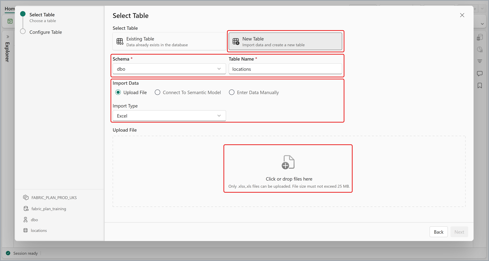

    A file browser opens.

12. In the file browser, go to **This PC** > **Local Disk (D:)** > **Labfiles**.

13. Select the **assets.xlsx** file.

14. Select **Open**.

    The **assets.xlsx** file uploads to the wizard.

15. Select **Next**.

    The **Preview Data** page opens.

16. In the **Preview Data** section, in the worksheet list, select **Locations**.

17. In the **Source Table Name** box, enter +++locations+++.

18. Keep the default values for **Start Cell** and **End Cell**.

19. Verify that the check box next to the **Locations** label is selected.

20. Select the chevron next to the check box to expand the data preview.

    The preview shows the rows and columns from the **Locations** worksheet.

21. Select **Next**.

    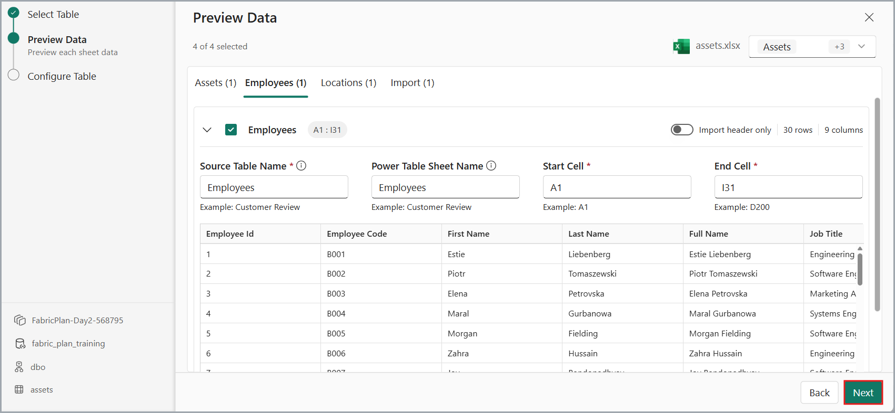

    The **Configure Table** page opens.

22. On the **Configure Table** page, select the **Locations** tab.

23. In the **Location Id** row, select the **Identity Column** check box.

    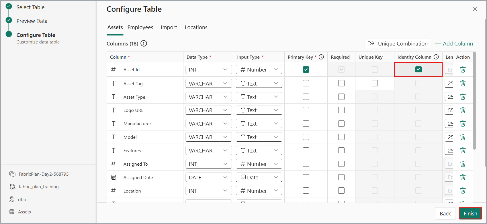

24. Select **Finish**.

    The **Creating Tables** dialog box opens. Each table shows **Created successfully** when the import completes.

25. In the **Creating Tables** dialog box, select **Done**.

    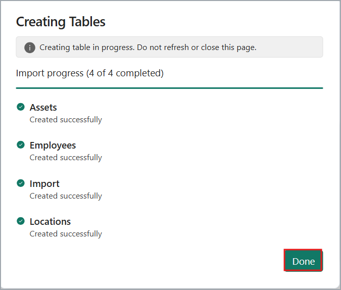

    The **Locations** tab shows the data from the **locations** table. The table includes the **Location Id**, **Location**, **Description**, **Building**, and **Floor** columns.

26. On the **Home** tab, select **Save**.

    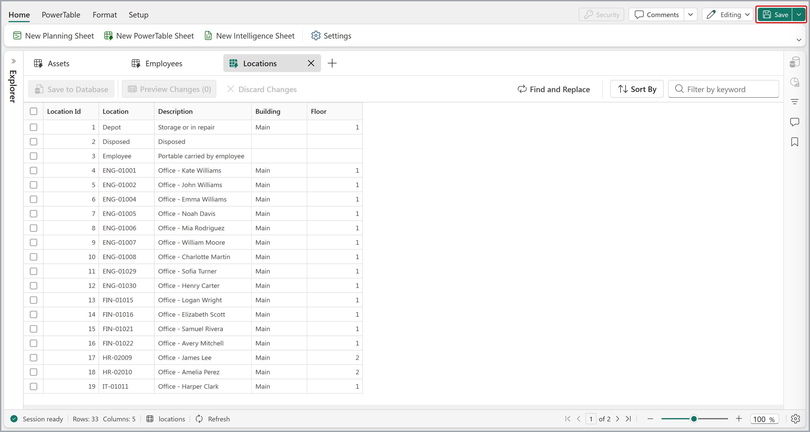

    Your changes are saved, including the new **Locations** sheet.

# Exercise 3: Set up the Assets sheet

In this exercise, you format the **Assets** sheet columns, add a conditional formatting rule, configure lookups, and add a formula column.

## Task 1: Format the Logo URL column

In this task, you change the input type of the **Logo URL** column so that the sheet renders the logo images instead of raw text. You also give the column a shorter display name.

1. In the **Asset Management** app that you created, expand the **Explorer** pane on the left side.

2. In the **Explorer** pane, select the **Assets** sheet if it isn't already open.

   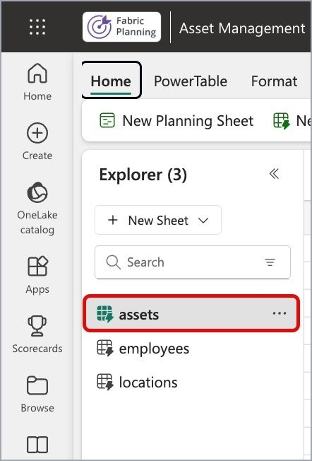

   The **Assets** sheet opens.

3. Select the collapse icon (**«**) to collapse the **Explorer** pane.

4. Hover over the **Logo URL** column header.

5. In the **Logo URL** column header, select the ellipsis (**...**).

6. On the context menu, select **Edit**.

   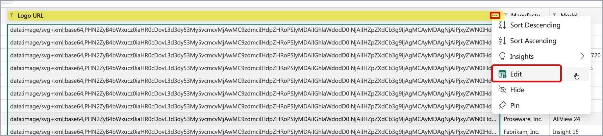

   The **Logo URL** side panel opens on the right, on the **General** tab.

7. On the **General** tab, in the **Input Type** list, select **Image**.

   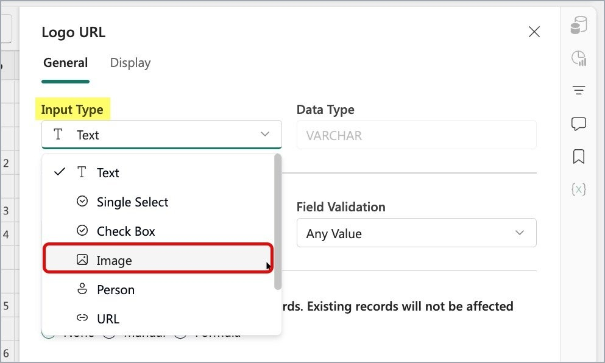

   The **Input Type** box shows **Image**. This setting tells PowerTable to render the stored URL as a thumbnail instead of raw text.

8. In the **Logo URL** side panel, select the **Display** tab.

9. In the **Display Name** box, enter +++Logo+++.

10. Select **Save**.

    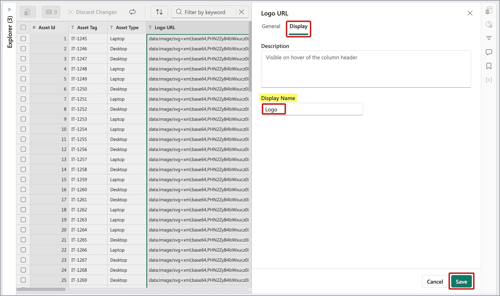

    The column header changes to **Logo**, and the column cells show the logo images.

11. Drag the right edge of the **Logo** column header to resize the column.

12. In the top-right corner of the toolbar, select **Save**.

    

    PowerTable saves your changes to the sheet.

13. Verify that the **Assets** sheet shows the manufacturer logos in the **Logo** column.

    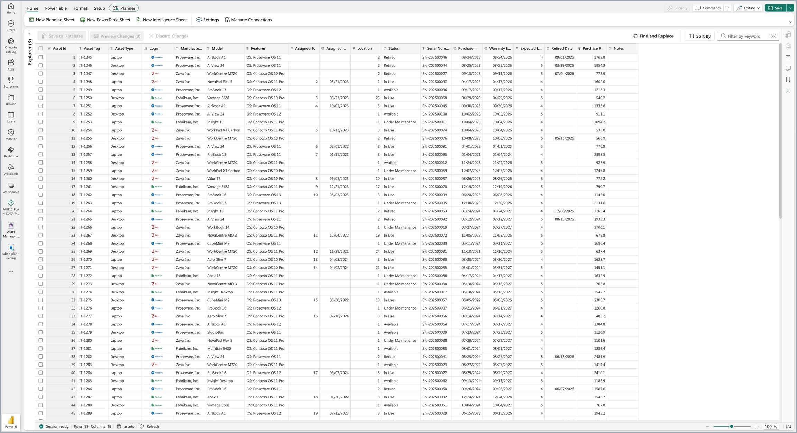

## Task 2: Format the Asset Type and Status columns

In this task, you convert the **Asset Type** and **Status** columns to single-select lists that use the values already in the data. A single-select list restricts entry to existing values, which prevents typos and keeps filtering reliable.

1. Hover over the **Asset Type** column header.

2. In the **Asset Type** column header, select the ellipsis (**...**).

3. In the menu, select **Edit**.

   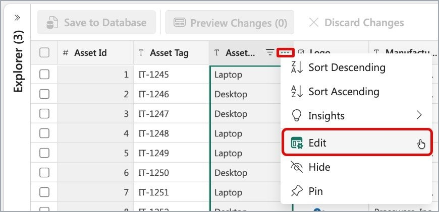

   The **Asset Type** pane opens on the right, with the **General** tab selected.

4. On the **General** tab, in the **Input Type** list, select **Single Select**.

5. In the **Values Type** list, select **Distinct Values**.

6. Select **Save**.

   

   The **Asset Type** column now accepts only values that already exist in the column.

7. Hover over the **Status** column header.

8. In the **Status** column header, select the ellipsis (**...**).

9. In the menu, select **Edit**.

   The **Status** pane opens on the right, and the **General** tab is selected.

10. On the **General** tab, in the **Input Type** list, select **Single Select**.

11. In the **Values Type** list, select **Distinct Values**.

12. Select **Save**.

    The **Status** column now shows its values as single-select tags.

13. In the top-right corner of the toolbar, select **Save**.

    

    Your changes to the sheet are saved.

14. Review the **Assets** sheet to confirm that the **Asset Type** and **Status** columns show their values as tags.

    

## Task 3: Create a conditional formatting rule for retired assets

In this task, you add a formatting rule that styles every row whose status is **Retired**. This visual highlight helps users find retired assets without filtering the sheet.

1. In the toolbar, select the **Format** tab.

2. Select **Format Rules**.

3. In the **Format Rules** menu, select **Create Rule**.

   

   The **Create Formatting Rule** pane opens on the right.

4. In the **Title** box, enter +++Retired+++.

5. In the **Apply To** list, select **Rows**.

6. Under **Condition If**, in the column list, select **Status**.

7. In the operator list, select **is**.

8. In the value list, select **Retired**.

9. Under **Style**, select the **Italic** (**I**) button.

10. In the **Fill Color** list, select a gray color.

11. In the **Font Color** list, select a red color.

12. Select **Apply**.

    

    The **Retired** rule is applied, and the **Manage Rule** pane opens. Every row with the **Retired** status appears in italic red text on a gray background.

13. In the **Manage Rule** pane, confirm that the **Retired** rule is turned on.

14. Select **X** to close the **Manage Rule** pane.

    

    The **Manage Rule** pane closes.

15. In the toolbar, select **Save**.

    

    Your formatting changes to the **Assets** sheet are saved.

16. Review the **Assets** sheet to confirm that every row with the **Retired** status appears in italic red text on a gray background.

    

## Task 4: Configure lookup values for the Assigned To and Location columns

In this task, you point the **Assigned To** and **Location** columns at the **employees** and **locations** tables. The columns then display readable names instead of ID numbers, which makes the asset data easier to understand.

1. In the **Assets** sheet, hover over the **Assigned To** column header.

2. In the **Assigned To** column header, select the ellipsis (**...**).

3. On the context menu, select **Edit**.

   

4. On the **General** tab of the **Assigned To** side panel, set the following values:
   - **Input Type** - **Single Select**
   - **Values Type** - **Lookup**
   - **Lookup Schema** - **dbo**
   - **Lookup Table** - **employees**
   - **Lookup Key Column** - **Employee Id**
   - **Lookup Display Column** - **Full Name**

   

   The lookup pulls its values from the **employees** table. The **Assets** sheet shows employee names but still stores the underlying **Employee Id** value.

5. In the **Assigned To** side panel, select the **Display** tab.

6. In the **Display Name** field, enter the following value:

   +++Assigned Employee+++

   

7. Select **Save**.

   The column header changes to **Assigned Employee**, and the cells show employee names instead of ID numbers.

8. In the **Assets** sheet, hover over the **Location** column header.

9. In the **Location** column header, select the ellipsis (**...**).

10. On the context menu, select **Edit**.

    

    The **Location** side panel opens.

11. On the **General** tab of the **Location** side panel, set the following values:
    - **Input Type** - **Single Select**
    - **Values Type** - **Lookup**
    - **Lookup Schema** - **dbo**
    - **Lookup Table** - **locations**
    - **Lookup Key Column** - **Location Id**
    - **Lookup Display Column** - **Location**

    

12. Select **Save**.

    The **Location** column shows location names from the **locations** table instead of ID numbers.

13. In the toolbar, select **Save**.

   

   Your changes are saved.

## Task 5: Add a formula column to calculate the end-of-life date

In this task, you add a formula column that calculates the expected end-of-life date for each asset from its purchase date and expected lifetime. You can then plan asset replacements without calculating dates by hand.

1. Select the **PowerTable** tab.

2. On the **PowerTable** tab, select the drop-down arrow next to **Insert Column**.

3. In the drop-down menu, select **Formula Column**.

   

   The **Add Formula Column** pane opens on the **General** tab.

4. On the **General** tab, enter the following values:
   - **Column Name** - +++Expected EOL Date+++
   - **Formula** - +++DATEADD([Purchase Date], (365*[Expected Lifetime In Years]))+++

   

   > **Important:** Don't copy and paste the formula, because a pasted formula doesn't work. Type the formula manually so that PowerTable correctly links the column references. To insert a column reference while you type, press **Ctrl+Space**.

5. In the **Add Formula Column** pane, select **Save**.

   The **Expected EOL Date** column appears in the table and shows the calculated end-of-life date for each asset.

6. In the toolbar, select **Save**.

   

   The new formula column is saved.

7. Review the **Assets** sheet.

   

   The **Expected EOL Date** column shows a calculated date for each asset, and retired assets appear in red italic text on a gray background.

# Exercise 4: Set up the Assets sheet

<!-- Editor note: This exercise duplicates Exercise 3 (same title, tasks, columns, rule, and formula). Delete Exercise 4 and all its tasks from the guide. Then renumber the later exercises (Exercise 5 becomes Exercise 4) and update any cross-references. -->

In this exercise, you format the **Assets** sheet columns, add a conditional formatting rule, configure lookups, and add a formula column.

## Task 1: Format the Logo URL column

In this task, you change the **Logo URL** column so that it shows each manufacturer's logo as an image instead of a URL. You also give the column a shorter display name to make the sheet easier to read.

1. Hover over the **Logo URL** column header.

2. In the **Logo URL** column header, select the ellipsis (**...**).

3. In the menu, select **Edit**.

   

   The **Logo URL** dialog opens on the **General** tab.

4. On the **General** tab, select the **Input Type** list.

5. In the **Input Type** list, select **Image**.

   

   > **Note:** The **Image** input type supports direct image URLs and Base64 strings that start with data:image. The **Data Type** stays **VARCHAR**.

6. In the **Logo URL** dialog, select the **Display** tab.

7. In the **Display Name** field, enter +++Logo+++.

8. Select **Save**.

   

   The column header changes to **Logo**, and the column shows the manufacturer logos as images.

9. On the **PowerTable** tab, select **Save**.

   

   PowerTable saves the column changes to the sheet.

10. Verify that the **Assets** sheet shows the manufacturer logos in the **Logo** column.

    

## Task 2: Format the Asset Type and Status columns

In this task, you change the **Asset Type** and **Status** columns to single-select lists that use the distinct values already in each column. A single-select list keeps new entries consistent with the existing values.

1. In the **Assets** sheet, hover over the **Asset Type** column header.

   The ellipsis (**...**) appears in the column header.

2. In the **Asset Type** column header, select the ellipsis (**...**).

3. In the menu, select **Edit**.

   

   The **Asset Type** dialog opens on the **General** tab.

4. On the **General** tab, in the **Input Type** list, select **Single Select**.

5. In the **Values Type** list, select **Distinct Values**.

6. Select **Save**.

   

   The dialog closes, and the **Asset Type** column offers a list of its distinct values when you edit a cell.

7. In the **Assets** sheet, hover over the **Status** column header.

   The ellipsis (**...**) appears in the column header.

8. In the **Status** column header, select the ellipsis (**...**).

9. In the menu, select **Edit**.

   The **Status** dialog opens on the **General** tab.

10. On the **General** tab, in the **Input Type** list, select **Single Select**.

11. In the **Values Type** list, select **Distinct Values**.

12. Select **Save**.

    The dialog closes, and the **Status** column offers a list of its distinct values when you edit a cell.

13. On the **PowerTable** tab, select **Save**.

    

    PowerTable saves the column changes to the sheet.

14. Verify that the **Assets** sheet shows the **Asset Type** and **Status** values as colored labels.

    

## Task 3: Create a conditional formatting rule for retired assets

In this task, you create a conditional formatting rule that highlights every asset with the **Retired** status. The highlight helps users find retired assets in the sheet without filtering the data.

1. In the toolbar, select the **Format** tab.

2. Select **Format Rules** > **Create Rule**.

   

   The **Create Formatting Rule** dialog opens.

3. In the **Create Formatting Rule** dialog, configure the following settings:
   - **Title** - +++Retired+++
   - **Apply To** - **Rows**

4. Under **Condition If**, select the following values:
   - Column - **Status**
   - Operator - **is**
   - Value - **Retired**

5. Under **Style**, select the **Italic** (**I**) button.

6. In the **Fill Color** list, select a gray color.

7. In the **Font Color** list, select a red color.

   

8. Select **Apply**.

   The **Manage Rule** dialog opens, and rows with the **Retired** status appear in red italic text on a gray background.

9. In the **Manage Rule** dialog, select the close (**X**) button.

    

    The **Manage Rule** dialog closes, and the **Retired** rule stays turned on.

10. On the **PowerTable** tab, select **Save**.

    

    PowerTable saves the formatting rule to the sheet.

11. In the **Assets** sheet, confirm that rows with the **Retired** status appear in red italic text on a gray background, for example **IT-1245**, **IT-1246**, **IT-1247**, and **IT-1255**.

    

## Task 4: Configure lookup values for the Assigned To and Location columns

In this task, you configure the **Assigned To** and **Location** columns to show lookup values instead of ID numbers. Lookup values make the sheet easier to read and help users enter consistent data.

1. In the **Assets** sheet, hover over the **Assigned To** column header.

2. In the **Assigned To** column header, select the ellipsis (**...**) > **Edit**.

   

   The column settings for **Assigned To** open.

3. In the **Assigned To** dialog, on the **General** tab, configure the following settings:
   - **Input Type** - **Single Select**
   - **Values Type** - **Lookup**
   - **Lookup Schema** - **dbo**
   - **Lookup Table** - **employees**
   - **Lookup Key Column** - **Employee Id**
   - **Lookup Display Column** - **Full Name**

   

   The **Assigned To** column shows employee names instead of employee ID numbers.

4. In the **Assets** sheet, hover over the **Location** column header.

5. In the **Location** column header, select the ellipsis (**...**) > **Edit**.

   The **Location** dialog opens.

6. In the **Location** dialog, on the **General** tab, configure the following settings:
   - **Input Type** - **Single Select**
   - **Values Type** - **Lookup**
   - **Lookup Schema** - **dbo**
   - **Lookup Table** - **locations**
   - **Lookup Key Column** - **Location Id**
   - **Lookup Display Column** - **Location**

   The dialog closes, and the **Location** column shows location names instead of location ID numbers.

7. On the **PowerTable** tab, select **Save**.

   

   PowerTable saves the lookup settings for both columns.

## Task 5: Add a formula column to calculate the end-of-life date

In this task, you add a formula column that calculates when each asset reaches its end of life. The column uses each asset's purchase date and expected lifetime, so users don't need to calculate the date by hand.

1. On the **PowerTable** tab, select the **Insert Column** drop-down arrow > **Formula Column**.

   

   The **Add Formula Column** dialog opens.

2. On the **General** tab, in the **Column Name** box, enter the following value:

   +++Expected EOL Date+++

3. In the **Formula** box, enter the following formula by typing it character by character:

   +++DATEADD([Purchase Date], (365*[Expected Lifetime In Years]))+++

   

   > **Important:** Don't copy and paste the formula. PowerTable references columns in a special way behind the scenes, so a pasted formula doesn't work. To insert a column reference while you type, press **Ctrl+Space**.

4. Select **Save**.

   The dialog closes, and the **Expected EOL Date** column appears in the **Assets** sheet with a calculated end-of-life date for each asset.

5. In the top-right corner of the toolbar, select **Save**.

   

   PowerTable saves your changes to the sheet.

6. Review the **Assets** sheet.

   

   The **Expected EOL Date** column shows a calculated date for each asset. Retired assets appear in red italic text on a gray background.

# Exercise 5: Manage data in PowerTable

In this exercise, you edit, import, and audit asset data in the **Assets** sheet by using the PowerTable editing tools.

## Task 1: Edit a single row with the Row Editor

In this task, you change the status of one asset and remove its employee assignment directly in the sheet. Single-row edits let you update individual records as quickly as in a spreadsheet.

1. In the **Assets** sheet, find the fourth row, which has the **Asset Tag** value **IT-1248**.

2. In the **IT-1248** row, select the **Status** cell.

   A drop-down list opens and shows the current value **In Use**.

3. Under **Select an option**, select **Available**.

   

   The **Status** cell for **IT-1248** shows **Available**.

4. In the **IT-1248** row, right-click the **Assigned To** cell, which contains **John Williams**.

5. In the shortcut menu, select **Clear Contents**.

   

   The **Assigned To** cell for **IT-1248** is now empty.

6. Select **Save to Database**.

   

   The **Save Changes?** dialog box opens.

   > **Note:** The **Save to Database**, **Preview Changes**, and **Discard Changes** buttons become available after you edit a row. **Preview Changes** shows the number of pending changes, for example **Preview Changes (1)**.

   > **Note:** You can use the keyboard or the mouse to move between rows and columns. You can also copy and paste values between rows and columns, and from other applications into the sheet.

7. In the **Save Changes?** dialog box, optionally select the **Don't show this again** check box so that you don't need to confirm every save.

8. Select **Proceed**.

   

   PowerTable saves your changes to the database.

9. Verify that the **Data saved successfully** message appears.

   

   The page refreshes and shows your changes. The **Save to Database**, **Preview Changes**, and **Discard Changes** buttons are unavailable again.

## Task 2: Insert a row with a form

In this task, you set PowerTable to open a form when you insert a row. A form shows all fields for the new record in one place. This helps you enter complete and consistent data.

1. In the **Assets** sheet, select the **PowerTable** tab on the ribbon.
2. On the **PowerTable** tab, select the arrow next to **Insert Row**.
3. Select the toggle next to **Insert Using Form By Default** to turn it on.

   

   The toggle turns green, and **Insert Row** now opens a form by default.

4. On the **PowerTable** tab, select **Insert Row**.

   > **Note:** Select the **Insert Row** button itself, not the arrow next to it.

   

   The **Record Details** pane opens with the **Form Editor** tab selected.

5. On the **Form Editor** tab, enter the following details for the new asset:
   - **Asset Type** - **Laptop**
   - **Asset Tag** - +++IT-4000+++
   - **Manufacturer** - +++Lenovo+++
   - **Features** - +++OS: Windows 11 Pro+++
   - **Model** - +++IdeaPad Flex 5+++
   - **Status** - **Available**
   - **Expected Lifetime In Years** - +++3+++
   - **Warranty Exp Date** - +++06/25/2027+++
   - **Serial Number** - +++SN-202600001+++

6. Select **Apply**.

   

   The new row appears at the bottom of the **Assets** sheet as a pending change.

7. Above the **Assets** sheet, select **Save to Database**.
8. If the **Save Changes?** dialog box opens, select **Proceed**.

   PowerTable saves the new row to the database.

## Task 3: (Optional) Update a single row with the Form Editor

In this optional task, you use the **Form Editor** to change the values of one existing record. The form shows every field of the record in one pane, so you can update the record without scrolling across the sheet.

1. In the **Assets** sheet, select the row selector check box next to any row, for example, the row with the **Asset Tag** value **IT-1248**.

   The **Row** tab appears on the ribbon.

2. On the ribbon, select **Row** > **Manage Record**.

   The **Record Details** pane opens with the **Form Editor** tab selected.

3. In the **Assigned To** list, select **Kate Williams**.

4. In the **Status** list, select **In Use**.

5. Select **Apply**.

   

   The row updates in the sheet, and **Preview Changes (1)** appears above the sheet.

6. Verify that the **Save to Database**, **Preview Changes (1)**, and **Discard Changes** buttons are available above the sheet.

   

   > **Note:** Selecting **Apply** doesn't save the change to the database. It creates a pending change. You can combine pending changes with other edits, and then save, preview, or discard them together.

## Task 4: (Optional) Update multiple rows with the Form Editor

In this optional task, you use the **Form Editor** to update the same fields across several records at once. You apply a shared change, such as a new location or status, to a group of assets in one step. When you edit multiple rows, only the fields that you edit change, and all other fields keep their current values.

1. In the **Assets** sheet, select the row selector check boxes next to multiple rows, for example, the rows with the **Asset Tag** values **IT-1249**, **IT-1250**, and **IT-1251**.

   The toolbar shows **3 Selected**.

2. On the ribbon, select **Row** > **Manage Record**.

   The **Record Details** pane opens with the **Form Editor** tab selected.

3. In the **Location** list, select **Depot**.

4. In the **Status** list, select **Under Maintenance**.

5. Select **Apply**.

   

   The selected rows show the new **Location** and **Status** values, and the count on the **Preview Changes** button increases.

## Task 5: (Optional) Update multiple rows with Bulk Edit

In this optional task, you use **Bulk Edit** to apply several actions to a group of selected rows. Bulk actions can offset values, set new values, or clear cells, so you can make complex changes without editing each row.

1. In the **Assets** sheet, clear the check boxes of any rows that are still selected.

2. Select the row selector check boxes next to the rows with the **Asset Tag** values **<VALUE>**, **<VALUE>**, **<VALUE>**, and **<VALUE>**.

   The toolbar shows **4 Selected**.

3. On the ribbon, select **Row** > **Bulk Edit**.

   The **Bulk Edit** pane opens with **Action 1** ready to configure.

4. Under **Action 1**, configure the following settings to add 30 days to the current warranty expiration date:
   - **Field** - **Warranty Exp Date**
   - **Action** - **Offset Value**
   - Interval - **Day**
   - Offset by - **Add**
   - Add - +++30+++

5. Select **+ Add Action**.

   **Action 2** appears in the **Bulk Edit** pane.

6. Under **Action 2**, configure the following settings to set the status to Available:
   - **Field** - **Status**
   - Action - **Set cell value**
   - New Value - **Available**

7. Select **+ Add Action**.

   **Action 3** appears in the **Bulk Edit** pane.

8. Under **Action 3**, configure the following settings to clear the **Assigned To** value:
   - **Field** - **Assigned To**
   - Action - **Clear cell contents**

9. Select **Apply**.

   

   The selected rows update in the sheet, and the count on the **Preview Changes** button increases.

## Task 6: (Optional) Preview changes and save to the database

In this optional task, you review pending changes, revert some of them, and then save the rest to the database. The **Preview Changes** and **Discard Changes** buttons are enabled whenever a change is pending. You can use them to check or undo edits before they reach the database.

1. Above the **Assets** sheet, select **Preview Changes**.

   

   The **Preview** page opens and lists all pending changes.

2. Review the **All**, **Added**, **Updated**, and **Deleted** filters at the top of the **Preview** page.

   Changed values appear with the previous value crossed out above the new value.

3. Select the row selector check boxes next to one or more rows whose pending changes you want to revert.

4. Select **Reset**.

   

   The pending changes for the selected rows are reverted.

   > **Note:** To revert all pending changes at once, select **Discard Changes** above the sheet instead.

5. Select **Back to PowerTable**.

   The **Assets** sheet opens again.

6. Verify that none of the row check boxes in the **Assets** sheet are selected.

   

   The remaining pending changes stay in the **Assets** sheet, ready to save.

7. Above the **Assets** sheet, select **Save to Database**.

8. If the **Save Changes?** dialog box appears, select **Proceed**.

   The pending changes are saved to the database. The **Save to Database** button is unavailable until you make another change.

## Task 7: (Optional) Find and replace values

In this optional task, you use the **Find and Replace** feature to find a value in a column and replace it with another value. This feature lets you standardize data, such as manufacturer names, across many rows at once.

1. In the toolbar above the **Assets** sheet, select **Find and Replace**.

   

   The **Find and Replace** dialog box opens.

2. In the **Find and Replace** dialog box, configure the following settings:
   - **Find** - +++Apple+++
   - **Column** - **Manufacturer**
   - **Match Case** - Leave the check box cleared.
   - **Match entire cell contents** - Select the check box.
   - **Replace With** - +++Apple Inc+++

   

3. Select **Replace all**.

   A message appears, for example, **All occurrences have been replaced in 23 rows**. The **Preview Changes** button shows the number of pending changes.

4. Verify that the updated values appear in the **Manufacturer** column.

   

   The updated cells are highlighted in the table.

5. In the upper-right corner of the **Find and Replace** dialog box, select **X**.

   The dialog box closes.

6. Above the **Assets** sheet, select **Save to Database**.

7. If the **Save Changes?** dialog box appears, select **Proceed**.

   The updated **Manufacturer** values are saved to the database.

### Reference: Compare the row editing methods

In this reference, you compare the features that each row editing method supports. Use the table to choose the right method for an editing task.

| Feature | Row Editor | Form Editor (single row) | Form Editor (multiple rows) | Bulk Edit | Find and Replace |
| --- | --- | --- | --- | --- | --- |
| View existing field values | Yes | Yes | No | No | No |
| Set a field value | Yes | Yes | Yes | Yes | Yes |
| Clear a field value | Yes | Yes | No | Yes | Yes |
| Offset field values (add, subtract, multiply, divide, prefix, suffix) | Yes, manually | No | No | Yes | No |
| Replace text within existing text | Yes, manually | No | No | No | Yes |
| Replace a value across multiple rows and columns in a single action | No | No | No | No | Yes |
| Copy and paste values across multiple rows | Yes | N/A | N/A | N/A | N/A |
| Fill down values to adjacent rows | Yes | N/A | N/A | N/A | N/A |
| Preview changes | Yes | Yes | Yes | Yes | Yes |
| Discard changes | Yes | Yes | Yes | Yes | Yes |

## Task 8: (Optional) Import new phones

In this optional task, you import new phone records from an Excel file into the **Assets** sheet. Importing lets you add many rows at once instead of entering each asset manually.

1. In the **Assets** sheet, on the **PowerTable** tab, select **Import**.

   The **Import** dialog box opens.

2. In the **Import** dialog box, under **Files**, select **Excel**.

   

3. Select **Continue**.

   The **Import from file** dialog box opens.

4. In the **Import from file** dialog box, select the **Click or drop files here** area.

   

   > **Note:** You can upload only .xlsx files. The file size must not exceed 25 MB.

5. In the file browser, go to the <VALUE> folder, and then select **assets.xlsx**.

6. Select **Open**.

   The **assets.xlsx** file appears in the **Import from file** dialog box.

7. Select **Upload**.

   

   The **Select Sheet** list appears in the **Import from file** dialog box.

8. In the **Select Sheet** list, select the **Import** sheet.

   

9. Select **Proceed**.

   The **Import Rows** dialog box opens.

10. In the **Import Rows** dialog box, review the rows on the **Insert (3)**, **Update (0)**, and **Error (0)** tabs.

    PowerTable scans the file and lists three new rows on the **Insert (3)** tab: **IT-1410**, **IT-1411**, and **IT-1412**.

11. Select **Import**.

    

    The **Successfully imported rows** message appears in the **Import Rows** dialog box.

12. Select **Close**.

    

    The **Import Rows** dialog box closes.

13. In the right pane, select the **Filter** icon.

    The **Filter** panel opens and shows the **Page level** filter cards.

14. In the **Filter** panel, select the **Asset Type** filter card.

    The **Asset Type** filter card expands.

15. Under **Asset Type**, on the **Basic** tab, select the **Phone** check box.

    

    The **Assets** sheet shows the three newly imported phone records: **IT-1410**, **IT-1411**, and **IT-1412**.

## Task 9: (Optional) Audit the asset changes

In this optional task, you open the audit feature for the **Assets** sheet. Auditing helps you track the changes that users make to the asset data.

1. In the **Assets** sheet, on the **PowerTable** tab, select **Audit**.

   

   The audit feature opens for the **Assets** sheet.

2. Select the **Data** tab.

   The **Data** tab opens and lists the data changes made in the sheet.

3. Scroll through the list to review the insert, update, and delete actions that you made during this session.

   

   Each row shows the **Row Id**, **Action**, **Transaction ID**, **Source Type**, **Modified Column**, **Old Value**, **New Value**, **Updated At**, **Updated By**, and **Approved By** values for a change. You can use the following tools on this tab:

   - **Download Logs** - Downloads the audit log.
   - **All Users** - Filters the list by user.
   - Time period list, for example **Last 24 Hours** - Filters the list by time period.
   - **Search** - Searches the list.
   - **Filter** - Creates a custom filter.

4. Select the **Access** tab.

   The **Access** tab opens and lists the changes made to the security settings.

5. Scroll through the list to review the **Row Access** and **Column Access** changes that you made during this session.

   

   Each row shows the **Log ID**, **Property**, **Description**, **Updated By**, and **Updated At** values for a change. This tab has the same tools as the **Data** tab: **Download Logs**, the **All Users** filter, the time period filter (for example, **Last 7 Days**), **Search**, and **Filter**.

## Summary

In this lab, you created a SQL database in Microsoft Fabric to manage your data. You then created a Fabric Plan item with a PowerTable sheet for each of the Assets, Employees, and Locations tables. You configured the Assets sheet with formatted columns and lookups. Finally, you ran update and insert operations, using a different approach for each operation.

## Summary

In this lab, you created a SQL database in Microsoft Fabric to store and manage your data. You also created a Fabric Plan item with PowerTable sheets for the **Assets**, **Employees**, and **Locations** tables.

You set up the **Assets** sheet with formatted columns and a conditional formatting rule for retired assets. You added lookups that display employee names and location names. You also added a formula column that calculates the expected end-of-life date.

Next, you updated and inserted data by using the **Row Editor**, the **Form Editor**, **Bulk Edit**, **Find and Replace**, and file import. Finally, you reviewed your changes in the audit logs.

