# Lab 07- Set up approvals, access controls, and automations for an asset management app in PowerTable

## Scenario

Contoso Ltd. tracks its IT hardware with an asset management app built on a Fabric Plan item. The app connects to a Fabric SQL database. As more employees use the app, the IT operations team has noticed data quality problems. Users write changes directly to the database without review. Anyone can add, update, or delete rows. Retiring an asset requires several manual edits to each row.

To add checks and balances, Contoso adds governance and automation features directly in the PowerTable *assets* sheet:

- **Approval workflows**: route every change through one or more reviewers before it reaches the database. Approvals can be simple, multi-level, or rule-based.
- **Access controls**: define who can add, update, and delete rows in the sheet.
- **Automations**: run a workflow from a button in the table. The workflow retires an asset, moves it to the depot, and clears its assignment in a single step.

In this lab, you are an IT operations analyst at Contoso. You configure approvals, access controls, and a button-driven automation for the asset management app that you set up previously.

## Introduction

In this lab, you extend the asset management app that you set up previously by adding checks and balances that maintain data quality. In the PowerTable *assets* sheet of your Fabric Plan item, you set up a simple approval workflow. You then test it end to end, including the Microsoft Teams notification, the approval, and the audit log. You also explore multi-level and rule-based approval options and configure row-level access controls for add, update, and delete operations. Finally, you build a *Retire Asset* automation that uses the **Find Record(s)** and **Update Record** actions against the Fabric SQL database, and you trigger it from a button column in the sheet.

## Objectives

After completing this lab, you will be able to:

- Enable and configure a simple approval workflow that requires all changes in the *assets* sheet to be reviewed before they are saved to the database.
- Test the approval workflow by submitting a change for review, approving it, and verifying the result in the audit log.
- Explore multi-level and rule-based approval options for routing change requests to different approvers.
- Configure access controls that define who can add, update, and delete rows in the *assets* sheet.
- Create an automation that retires an asset by using a button trigger and the Find Record(s) and Update Record actions.
- Add a button column that runs the automation, and review the automation's run history.

## Architecture

An IT operations analyst edits the assets sheet in a Fabric Plan item. Edits are routed through the PowerTable approval workflow, where the approver is notified in Microsoft Teams and the approved change is written to the Fabric SQL database and recorded in the audit log. Access controls limit who can add, update, and delete rows. A button column runs the Retire Asset automation, which looks up the Depot location and updates the asset record in the database.

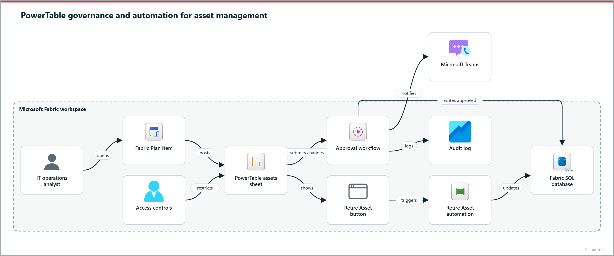

## Prerequisites

Before you start this lab, make sure that you meet the following requirements:

- You completed the previous lab. In that lab, you created the asset management Fabric Plan item and the *assets* PowerTable sheet.
- You have access to the SQL database in Microsoft Fabric that the PowerTable sheet connects to. This access includes the *dbo.assets* and *dbo.locations* tables.
- You have permission to switch the plan item to **Editing** mode and configure PowerTable settings.
- You have access to Microsoft Teams with the same account. You use Microsoft Teams to receive approval notifications.

# Exercise 1: Set up approval workflows in the assets sheet

In this exercise, you set up an approval workflow that requires a review of every change in the **assets** sheet before it reaches the database.

> **Note:** This exercise takes 5–10 minutes to complete.

## Task 1: Enable and configure simple approvals

In this task, you turn on approvals for the **assets** sheet and set yourself as the approver. After this, users can't write changes to the database without approval. Because you're the approver, you can test the workflow end to end.

1. In Microsoft Fabric, select **Workspaces** > **FabricPlan-Day2-<ID>**, and then open the asset management plan item that you created in the previous lab.
2. At the top-right corner of the plan item, select the **Reading** dropdown.
3. Select **Editing**.

   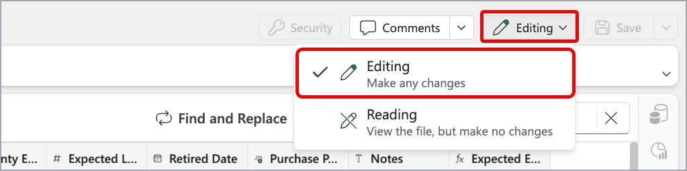

   The button label changes to **Editing**, and you have access to the setup options of the sheet.

4. On the left side of the plan item, expand the **Explorer** pane.
5. In the **Explorer** pane, select the **assets** sheet if it isn't already selected.

   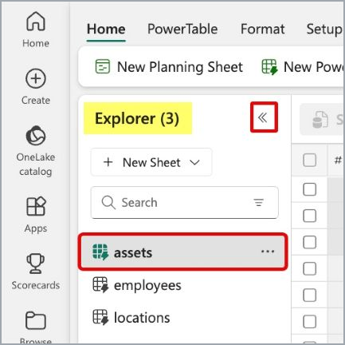

6. At the top of the **Explorer** pane, select the collapse icon (**«**).
7. On the toolbar, select **PowerTable** > **Approvals**.

   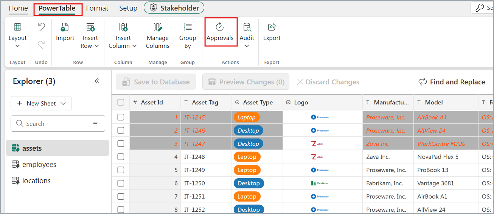

   The **Approvals Configuration** page opens. On this page, you define who reviews changes before they reach the database.

8. Turn on the **Requires Approval for All Changes** toggle.

   The toggle shows **On**, and every edit now goes through review instead of going directly to the database.
9. Leave the **Enable Multi Level Approval** toggle set to **Off**.
10. Under **Who can Approve changes?**, select **Specific users**.
11. In the approvers box, enter your email address.

    Your account appears in the approvers box.
12. Select **Save**.

    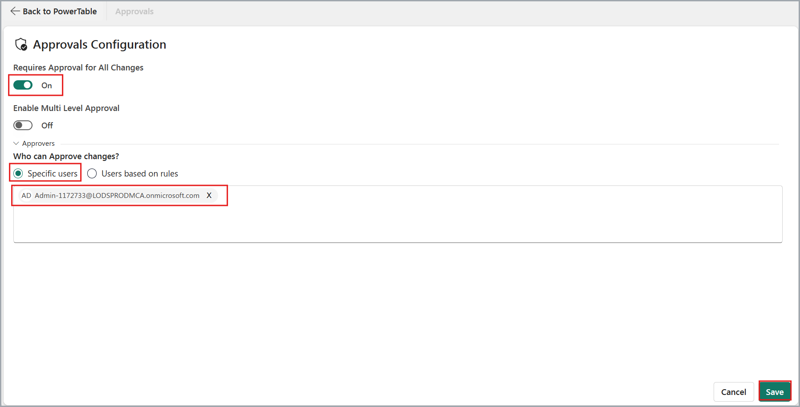

    The approval settings are saved, and you're now the approver for all changes in the **assets** sheet.

13. On the **Approvals Configuration** page, select **Back to PowerTable** to return to the main table.

    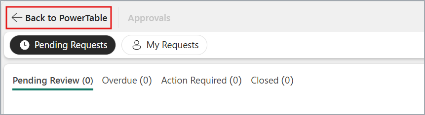

    The **assets** sheet opens in the main table view.

## Task 2: Test the approval workflow (optional)

In this task, you change a value in the **assets** sheet, submit it for review, and then approve it. This confirms that the approval workflow sends edits to a reviewer instead of writing them directly to the database.

1. In the **assets** sheet, locate the row with the **Asset Tag** value **IT-1248**.

2. In the **Location** column of that row, select a different location value, for example **IT-01013**.

   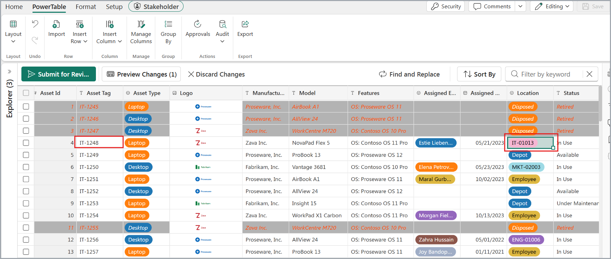

   The cell shows the new value, and the **Preview Changes** button shows **(1)** pending change.

   > **Note:** You can update any row in the sheet. This lab uses asset tag **IT-1248** as an example.

3. On the toolbar above the table, confirm that the **Save to Database** button now reads **Submit for Review**.

   This label confirms that the approval workflow is in place.

4. Select **Submit for Review**.

   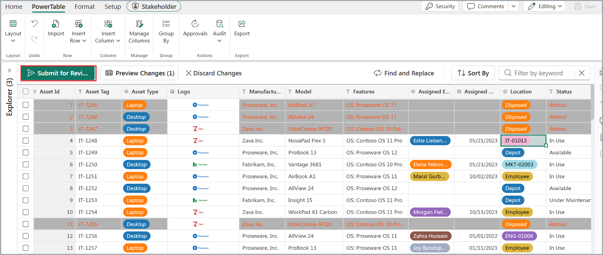

   The **Submit for review** pop-up opens.

5. In the **Submit for review** pop-up, enter the following details:

   - **Description** - +++Moving the asset to a different location for standby+++
   - **Due Date** - +++08/27/2026+++
   - **Mark as Priority** - Select the check box.

   > **Note:** All fields in the **Submit for review** pop-up are optional. If the date 08/27/2026 has passed, enter any future date.

6. Select **Submit**.

   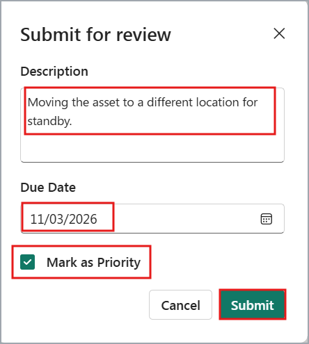

   PowerTable sends the change to the approver for review instead of saving it directly to the database.

7. Wait a few moments for PowerTable to process the submission.

   PowerTable reverts the **Location** cell to its original value. It also adds a spreadsheet-style note indicator to the corner of the updated cell. The indicator marks a record with a pending approval. The database keeps the original value until an approver approves the change.

8. Point to the **Location** cell in the **IT-1248** row to view the note.

   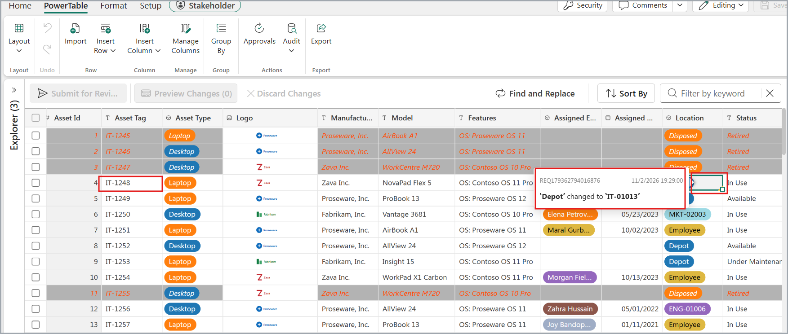

   The note shows the request ID, the submission date and time, and the pending change, for example **'Depot' changed to 'IT-01013'**.

   > **Note:** Your request ID and timestamp differ from the example.

9. On the **PowerTable** tab, in the **Actions** group, locate the **Approvals** button.

   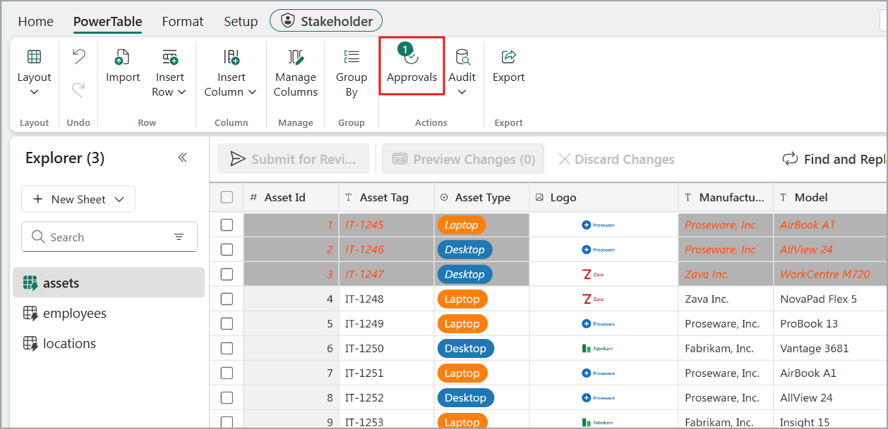

   The **Approvals** button shows a badge with the number of pending approvals, for example **1**.

10. Open a new browser tab.

11. In the new tab, go to the following URL:

    +++https://teams.cloud.microsoft+++

    The Microsoft Teams web app opens.

    > **Note:** If you're prompted to sign in, sign in with the same account that you use for Microsoft Fabric.

12. In Microsoft Teams, select **Chat**.

13. Select the chat that shows your user name followed by **(You)**.

    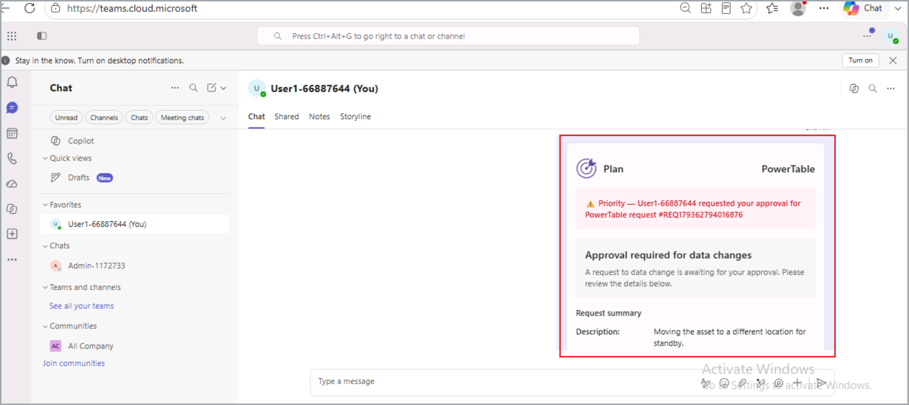

    The chat shows an approval card for **PowerTable**. The card has a **Priority** banner with the request number and the heading **Approval required for data changes**. Under **Request summary**, the **Description** field shows **Moving the asset to a different location for standby**.

    > **Note:** In this lab, you're both the requester and the approver, so the approval notification appears in your own chat. In production, the notification goes to each assigned approver.

14. Scroll down in the approval card to the **Changes summary** section.

    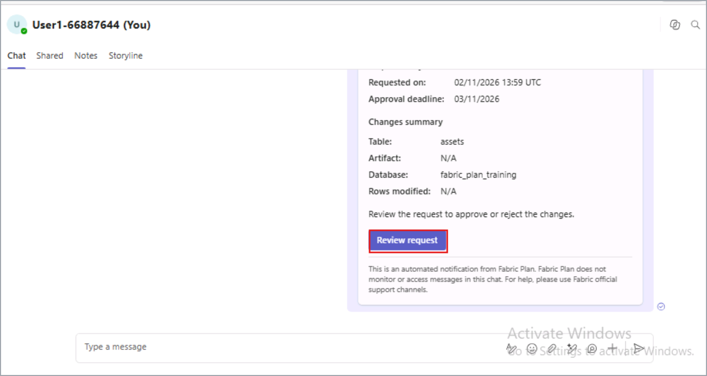

    The card shows the **Requested on** and **Approval deadline** values. Under **Changes summary**, the **Table** field shows **assets** and the **Database** field shows **fabric_plan_training**. The **Review request** button appears below the summary. Approvers use this button to approve or reject the change.

15. Return to the browser tab where your table is open in PowerTable.

16. On the toolbar, select **PowerTable** > **Approvals**.

    The **Approvals** page opens with **Pending Requests** selected. The **Pending Review (1)** tab lists your request. The **Description** column shows **Moving the asset to a different location for standby**. The **Modified Rows** column shows **1**.

17. In the row for the request, select **Details**.

    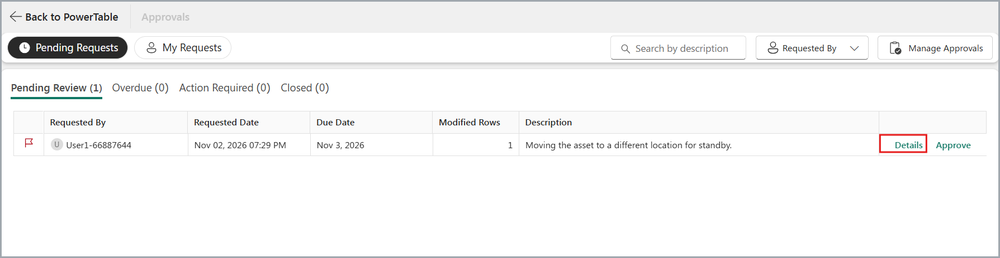

    The request details page opens. It shows the request description, the **Submitted by**, **Submitted on**, and **Due on** values, and the changed row.

18. Review the changed values in the grid.

    For the row with **Asset Id** **4** and **Asset Tag** **IT-1248**, the **Location** column shows the old value **Depot** with a strikethrough and the new value **IT-01013**.

    > **Note:** The **Partial Actions** banner tells you that you can approve, reject, or request changes for specific rows only. To do this, select the check boxes for those rows before you select an action.

19. Select **Approve**.

    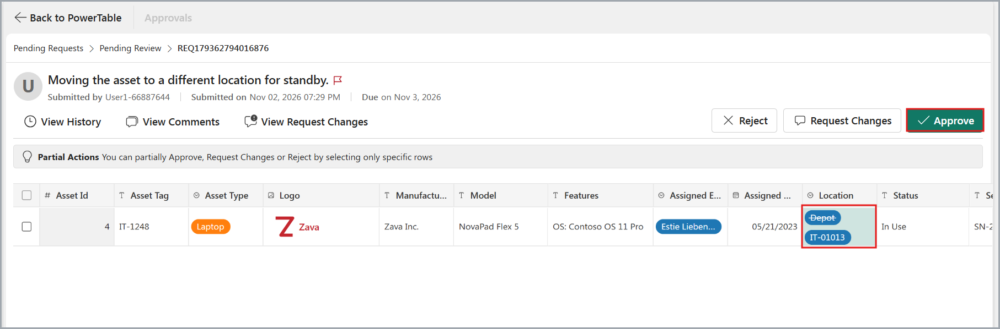

    A **Data saved successfully.** message appears. The **Pending Review** tab now shows **(0)**, and the **Closed** tab shows **(1)**.

20. Select **Back to PowerTable**.

    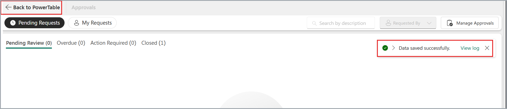

    The PowerTable grid opens. For the row with **Asset Tag** **IT-1248**, the **Location** column now shows **IT-01013**. The approved change is saved.

    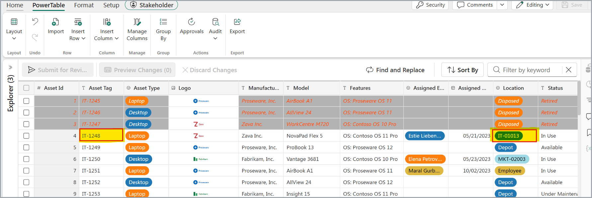

21. On the **PowerTable** tab of the toolbar, select **Audit**.

    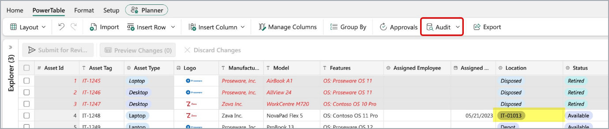

    The **Audit** page opens on the **Data** tab. It lists the data changes for **All Users** in the **Last 24 Hours**.

22. Review the first row in the audit log.

    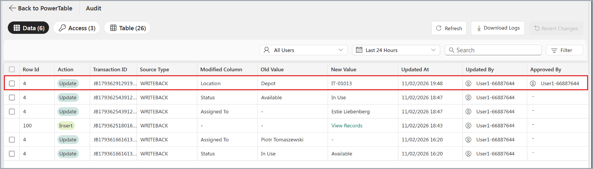

    The row shows the approved save with the following values:

    - **Row Id** - **4**
    - **Action** - **Update**
    - **Source Type** - **WRITEBACK**
    - **Modified Column** - **Location**
    - **Old Value** - **Depot**
    - **New Value** - **IT-01013**

    The **Updated By** column shows the user who made the change. The **Approved By** column shows the user who approved it.

## Task 3: Configure multi-level approvals (optional)

In this optional task, you configure multi-level approvals for the **assets** sheet. A multi-level approval routes each change request through several levels of review, with a different approver at each level. This process supports compliance, oversight, and better decision-making.

1. In the **assets** sheet, on the toolbar, select **PowerTable** > **Approvals**.

   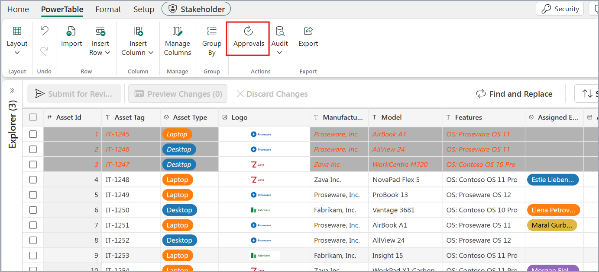

   The **Approvals** page opens on the **Pending Requests** tab.

2. Select **Manage Approvals**.

   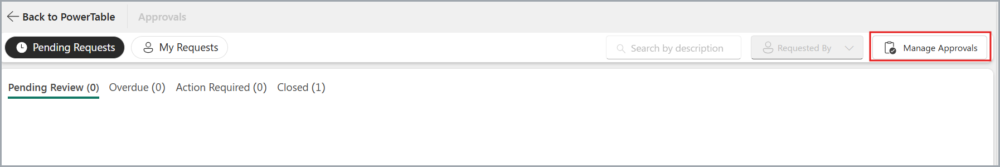

   The **Approvals Configuration** page opens.

   > **Note:** You can create up to three levels of approval in PowerTable sheets.

3. Set the **Enable Multi Level Approval** toggle to **On**.

   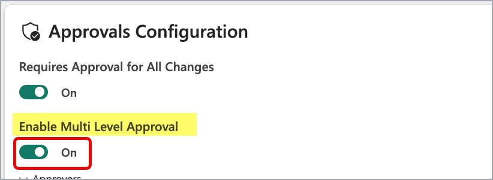

   The **Confirm your action** dialog opens. The dialog states that this action removes the selected profiles from the specific user selection.

4. In the **Confirm your action** dialog, select **Proceed**.

   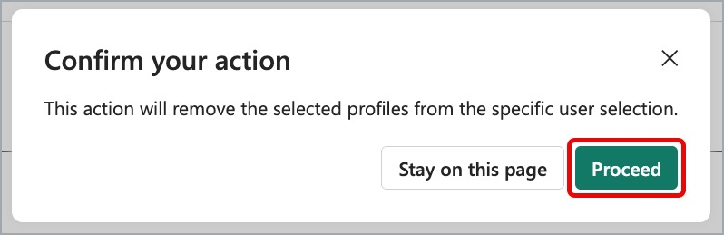

   The **Approvers** section opens with the **Number of approval levels** field.

5. In the **Number of approval levels** field, enter the following value:

   +++3+++

   The **Approval Levels** table shows the **Level 1**, **Level 2**, and **Level 3** rows.

6. In the **Approval Levels** table, in the **Who Can Approve** field for each level, select the following approvers:
   - **Level 1** - your **User1** account
   - **Level 2** - an **Accounting-User** account
   - **Level 3** - a second **Accounting-User** account

   > **Note:** The approver account names in your lab tenant end with a number that is specific to your lab, for example, **User1-12345678** or **Accounting-User-12345678**. Select the accounts whose names start with **User1** and **Accounting-User**.

7. Select **Save**.

   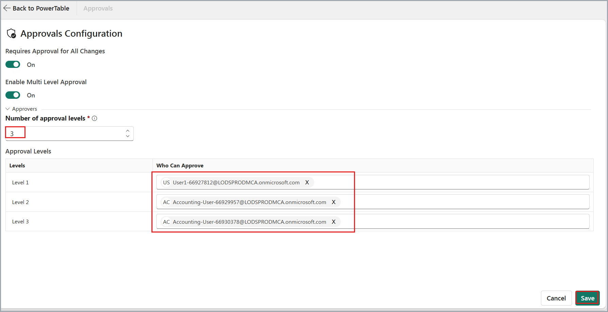

   PowerTable saves the multi-level approval settings. Each change request now routes through three levels of review.

## Task 4: Open the rule-based approval settings (optional)

In this optional task, you open the approval settings for the **assets** sheet so that you can set up rule-based approvals in the next task. Rule-based approvals route each request based on rules and criteria that you define. You can create as many rules as you need and assign approvers to each rule.

1. In the **assets** sheet, on the toolbar, select **PowerTable** > **Approvals**.

   The **Approvals** page opens on the **Pending Requests** tab.

2. Select **Manage Approvals**.

   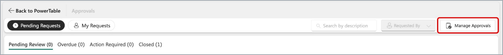

   The **Approvals Configuration** page opens.

## Task 5: Configure rule-based approvals (optional)

In this optional task, you create approval rules that send each change request to an approver based on the asset location. You also set a fallback approver so that requests that match no rule still reach someone who can approve them.

1. If the **Enable Multi Level Approval** toggle is **On**, select the toggle to turn it off.
2. If the **Confirm your action** dialog opens, select **Proceed**.

   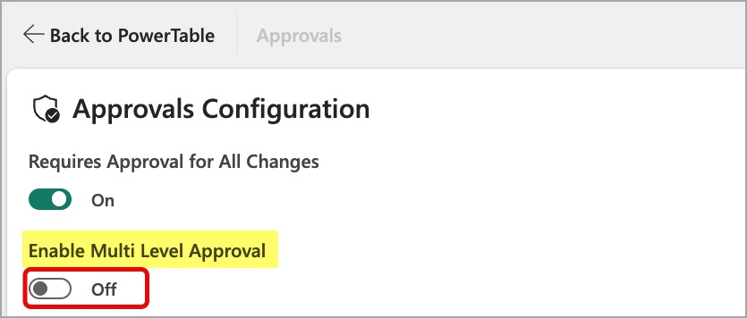

   The **Enable Multi Level Approval** toggle shows **Off**.

3. Under **Approvers**, for **Who can Approve changes?**, select **Users based on rules**.

   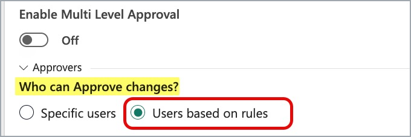

   The **Approval Rules** section appears.

4. In the **Approval Rules** section, select **+ Add Rule**.

   The **New Rule** dialog opens.

5. In the **Name** field, enter +++Home Laptops+++.
6. Next to **Conditions**, select **+ Add filter**.

   A new filter row appears.

7. In the new filter row, select the following values:
   - **Field** - **Location**
   - **Operator** - **is**
   - **Value** - **Employee**

   > **Note:** You can add more filters and combine them with a logical AND or a logical OR. AND means that all the conditions must be met. OR means that any one of the conditions must be met.

8. In the **Approvers** field, enter +++Elaheh Mansouri+++, and then select **Elaheh Mansouri**.

   > **Note:** If this user isn't available in your tenant, select another user who can approve changes.

9. Select **Create**.

   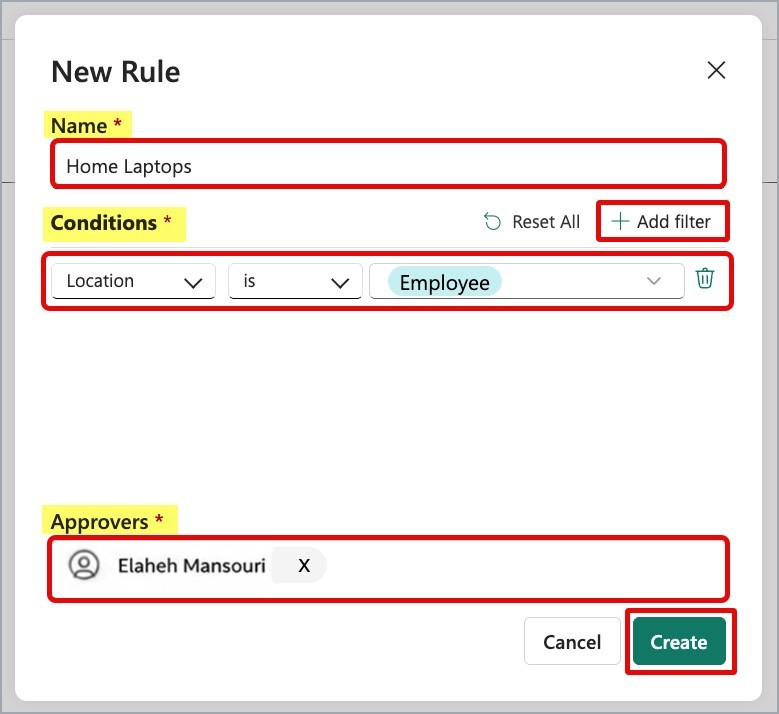

   The **Home Laptops** rule appears in the **Approval Rules** table with the condition **Location is Employee**.

10. In the **Approval Rules** section, select **+ Add Rule**.

    The **New Rule** dialog opens.

11. In the **Name** field, enter +++Inventory Assets+++.
12. Next to **Conditions**, select **+ Add filter**.

    A new filter row appears.

13. In the new filter row, select the following values:
    - **Field** - **Location**
    - **Operator** - **is**
    - **Value** - **Depot**

14. Next to **Conditions**, select **+ Add filter**.

    A second filter row appears.

15. In the second filter row, select the following values:
    - **Field** - **Location**
    - **Operator** - **is**
    - **Value** - **Disposed**

16. Between the two filters, select **OR** as the logical operator.
17. In the **Approvers** field, enter +++Cora Thomas+++, and then select **Cora Thomas**.

    > **Note:** If this user isn't available in your tenant, select another user who can approve changes.

18. Select **Create**.

    The **Inventory Assets** rule appears in the **Approval Rules** table with the conditions **Location is Depot OR Location is Disposed**.

19. In the **If changes do not meet any of the above rules, send to the following approvers** field, enter +++Andzelika Juskaite+++, and then select **Andzelika Juskaite**.

    > **Note:** If this user isn't available in your tenant, select another user who can approve changes.

    > **Important:** The fallback approver is required. You can't save the configuration without it. Requests that match no rule go to this approver.

20. Select **Save**.

    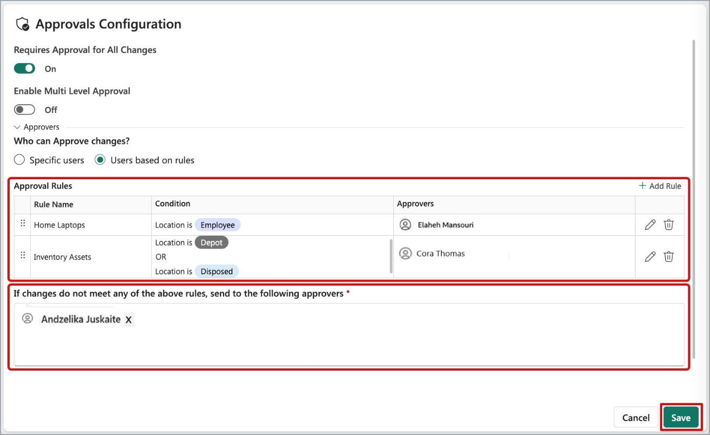

    PowerTable saves the rule-based approval settings. Each change request now goes to the approver of the matching rule or to the fallback approver.

# Exercise 2: Set up access controls

In this exercise, you configure access controls that define who can add, update, and delete rows in the **assets** sheet.

> **Note:** This exercise takes 5–10 minutes to complete.

## Task 1: Configure who can add new rows

In this task, you define who can insert new rows into the **assets** sheet. Add permissions control which users can create new records in the table.

1. If the **Approvals** page is open, select **Back to PowerTable**.

   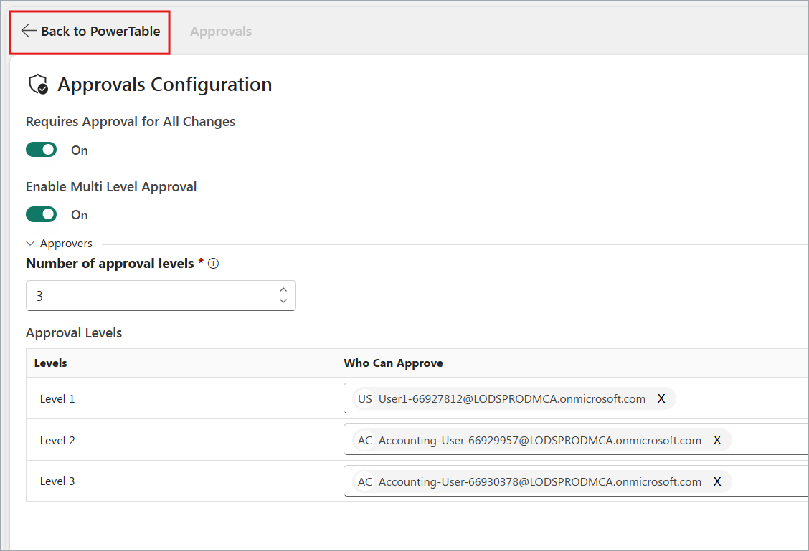

   The **assets** PowerTable sheet opens.

2. On the toolbar, select **Setup** > **Manage Access**.

   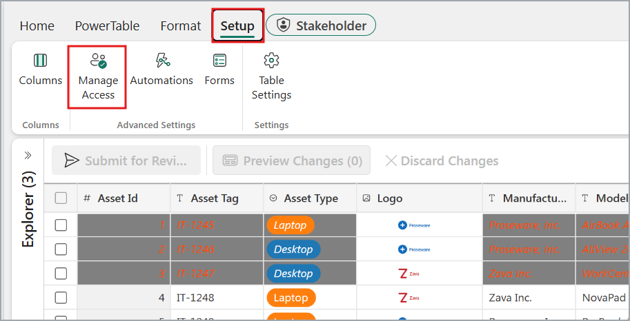

   The **Manage Access** page opens.

3. On the **Manage Access** page, select **Row Access**.

4. Under **Add**, review the options under **Who can add new rows?**. This setting defines who can insert new rows into the PowerTable sheet:

   - **No one** - Turns off the ability to add new rows for everyone who has access to this Fabric Plan item.
   - **All users in this domain** - Grants the ability to add new rows to everyone who has access to this Fabric Plan item.
   - **Specific users** - Grants the ability to add new rows to specific individuals or security groups.

5. In the **Who can add new rows?** section, select **All users in this domain**.

   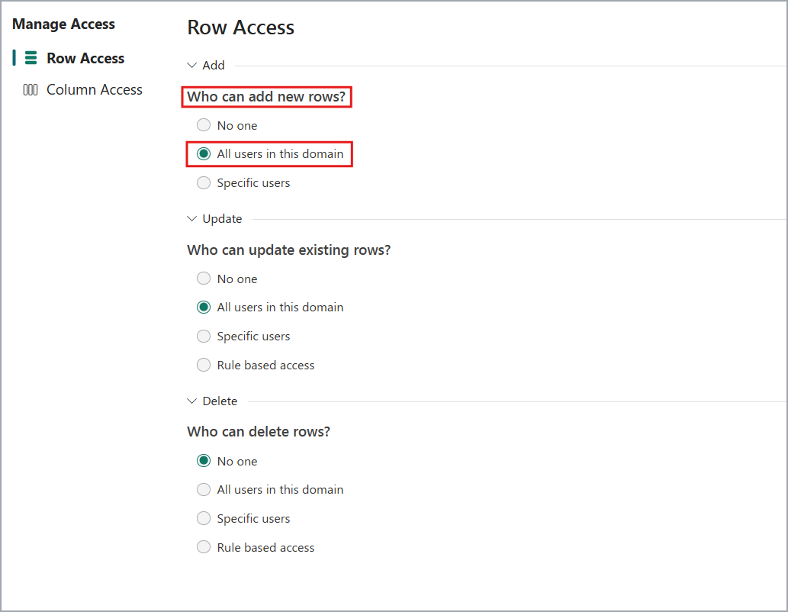

   After you save the access settings, everyone with access to this Fabric Plan item can insert new rows into the table.

## Task 2: Configure who can update existing rows

In this task, you define who can change existing data in the **assets** sheet. Update permissions protect existing records from unauthorized edits.

1. Scroll down to the **Update** section.

2. Review the options under **Who can update existing rows?**. This setting defines who can change existing data in the PowerTable sheet:

   - **No one** - Turns off the ability to update existing rows for everyone who has access to this Fabric Plan item.
   - **All users in this domain** - Grants the ability to update existing rows to everyone who has access to this Fabric Plan item.
   - **Specific users** - Grants the ability to update existing rows to specific individuals or security groups.
   - **Rule based access** - Grants the ability to update existing rows to specific individuals or security groups based on business rules and filters. You can set up multiple rules. Each rule defines the conditions to check in the sheet's data and the users who can edit rows that meet those conditions.

3. In the **Who can update existing rows?** section, select **All users in this domain**.

   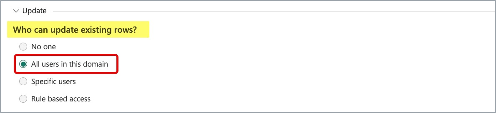

   After you save the access settings, everyone with access to this Fabric Plan item can update existing data in the PowerTable sheet.

## Task 3: Configure who can delete rows in the assets sheet

In this task, you limit row deletion in the **assets** sheet to specific users. Limiting deletes to named users reduces the risk of accidental data loss.

1. Scroll down to the **Delete** section.

2. Review the options under **Who can delete rows?**. This setting defines who can delete existing data in the PowerTable sheet:

   - **No one** - Turns off the ability to delete rows for everyone who has access to this Fabric Plan item.
   - **All users in this domain** - Grants the ability to delete rows to everyone who has access to this Fabric Plan item.
   - **Specific users** - Grants the ability to delete rows to specific individuals or security groups.
   - **Rule based access** - Grants the ability to delete rows to specific individuals or security groups based on business rules and filters. You can set up multiple rules. Each rule defines the conditions to check in the sheet's data and the users who can delete rows that meet those conditions.

3. Under **Who can delete rows?**, select **Specific users**.

   The **Search Name or Email** box appears.

4. In the **Search Name or Email** box, enter your name or email address.

5. Select your account from the search results.

   Your account appears in the **Search Name or Email** box.

6. Select **Save**.

   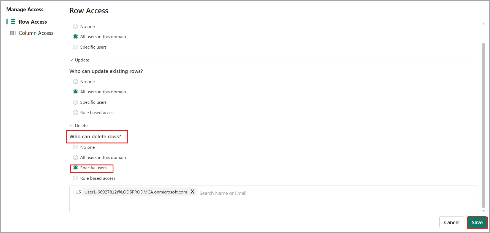

   Only the users who you added can now delete rows from the **assets** sheet.

7. Select **Back to Setup**.

   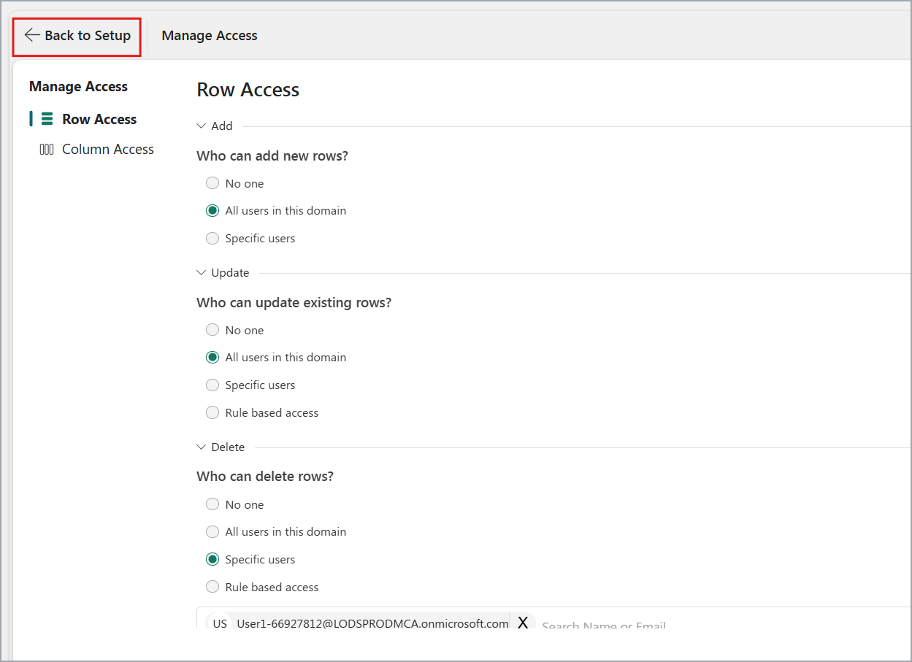

   The **assets** PowerTable sheet opens.

# Exercise 3: Set up automations

In this exercise, you set up an automation workflow that lets users retire an asset with a single button selection instead of updating each row manually.

## Task 1: Create the automation item and configure the trigger

In this task, you create the automation item and configure it to run when a user selects a button. The trigger defines the event that starts the workflow.

1. On the **assets** PowerTable sheet, select **Setup** > **Automations**.

   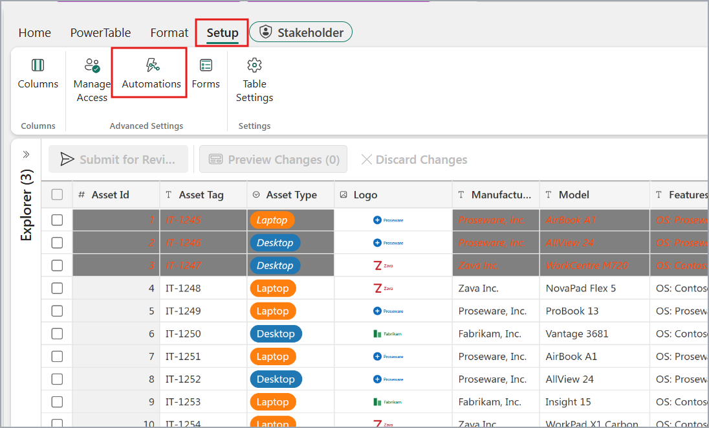

   The **Automations** page opens and displays **Get started with Automation**.

2. Select **Create Automation**.

   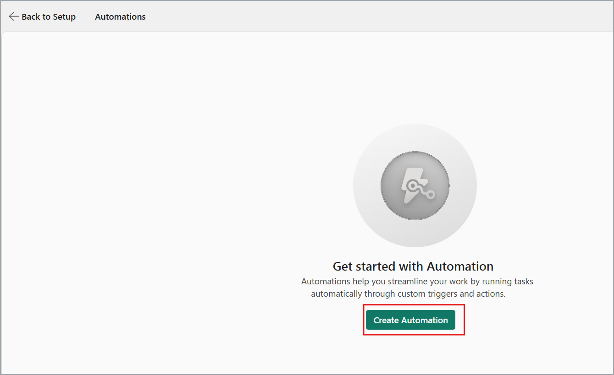

   A new automation opens so that you can configure its trigger and actions.

3. Select the pencil icon next to the automation name in the breadcrumb.

4. Enter +++Retire Asset+++ as the automation name.

   The breadcrumb displays **Automations** > **Retire Asset**.

5. Under **Suggested triggers for you**, select **When a button is clicked**.

   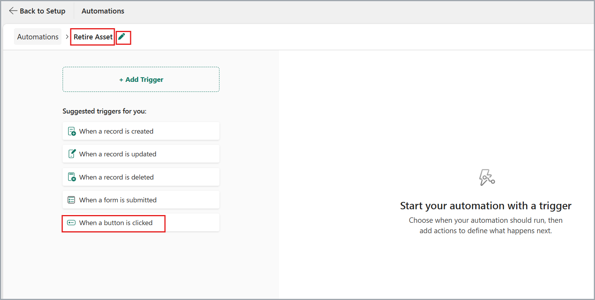

   The **When a button is clicked** trigger appears in the automation flow, and the **Properties** pane shows **When a button is clicked** as the **Trigger Type**.

   This trigger starts the automation when a user selects a button.

   > **Note:** You create the button that triggers this automation in a later task.

## Task 2: Configure the Find Record(s) and Update Record actions

In this task, you add a **Find Record(s)** action that retrieves the **Location Id** value for the **Depot** location. You then add an **Update Record** action that uses this value to retire the selected asset, so you don't need to hard-code the location.

1. Under the **When a button is clicked** trigger, select **Add Action**.

2. Under **PowerTable**, select **Find Record(s)**.

   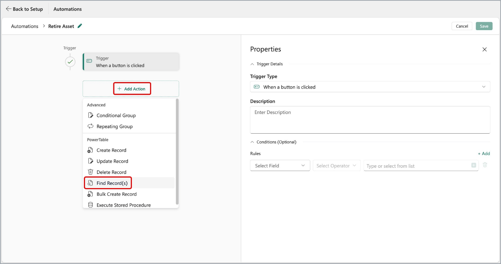

   The **Find Record(s)** action appears in the automation flow, and its **Properties** pane opens on the right side.

   The **Find Record(s)** action retrieves records that meet specific conditions. It reads from a table in the same SQL database in Microsoft Fabric that the PowerTable sheet connects to.

3. In the **Properties** pane, in the **Description** box, enter +++Lookup depot location+++.

   The action in the automation flow displays **Lookup depot location** under **Find Record(s)**.

4. Under **Configuration**, in the **Schema** list, select **dbo**.

5. In the **Table** list, select **locations**.

   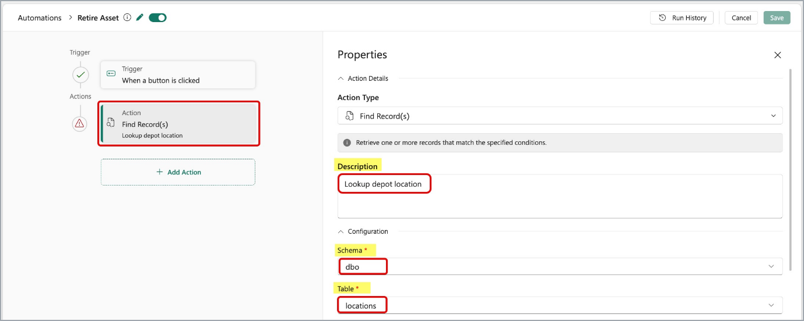

   The **Find Record(s)** action now connects to the **locations** table, and the **Find Configuration** section appears.

   > **Note:** Instead of using this lookup, you can hard-code the **Location Id** value in the update action.

6. Under **Find Configuration** > **Fetch type**, select **Single Record**.

   The **Select columns** box displays the **Location Id**, **Location**, **Description**, **Building**, and **Floor** columns.

7. Under **Conditions** > **Rules**, in the **Select Field** list, select **Location**.

8. In the **Select Operator** list, select **is**.

9. In the **Type or select from list** box, enter +++Depot+++.

   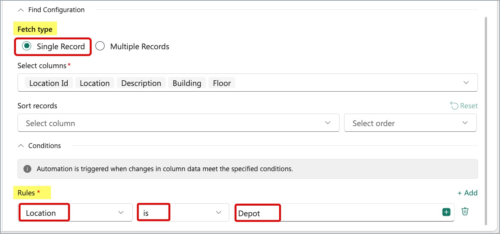

   The rule under **Rules** shows **Location**, **is**, and **Depot**. The action now retrieves the single record for the **Depot** location.

10. Below the **Find Record(s)** action in the automation flow, select **Add Action**.

11. In the action list, under **PowerTable**, select **Update Record**.

    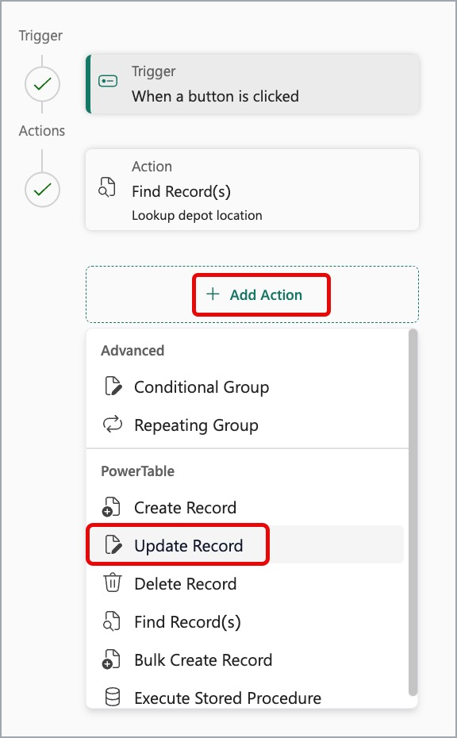

    The **Update Record** action appears in the automation flow, and the **Properties** pane shows **Update Record** as the **Action Type**. This action retires the asset, moves it to the depot, and clears its assignment.

12. In the **Properties** pane, in the **Description** box, enter the following text:

    +++Update asset record to retired, set location to depot, clear assigned to+++

13. Under **Configuration**, in the **Schema** list, select **dbo**.

14. In the **Table** list, select **assets**.

    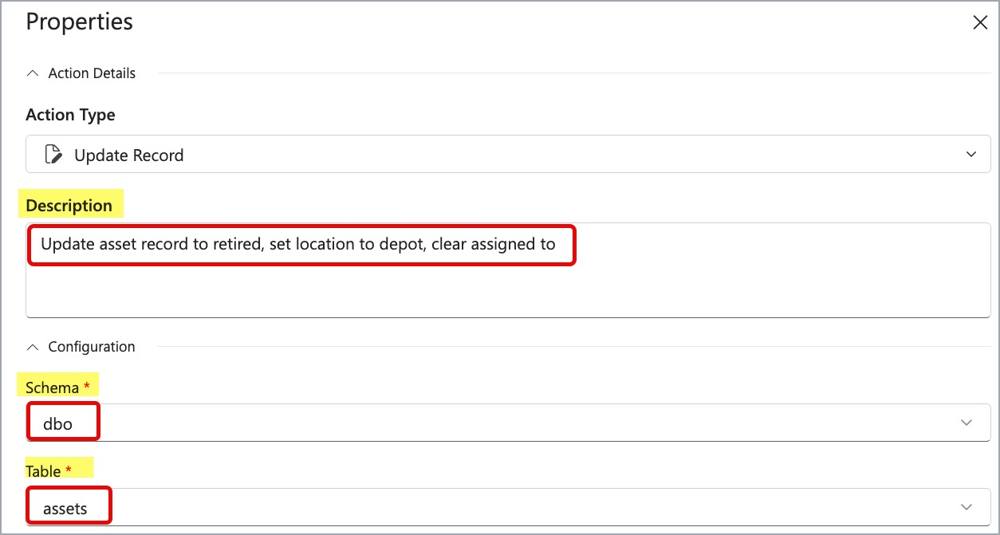

    The **Update Record** action now uses the **assets** table in the **dbo** schema.

15. Under **Update type**, select **Single Update**.

16. Under **Conditions** > **Rules**, in the **Select Field** list, select **Asset Id**.

17. In the **Select Operator** list, select **=**.

18. In the **Type or select from list** box, select the **+** button.

19. In the list that opens, under **Trigger**, select **When a button is clicked**.

20. In the list of trigger fields, select **Asset Id**.

    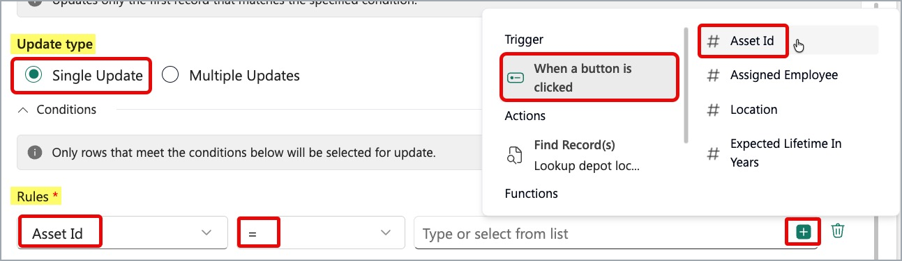

    The **Type or select from list** box displays **Asset Id**. This rule limits the update to the row whose button the user selects. You add that button later in this exercise.

21. Under **Fields**, select **Add Fields**.

    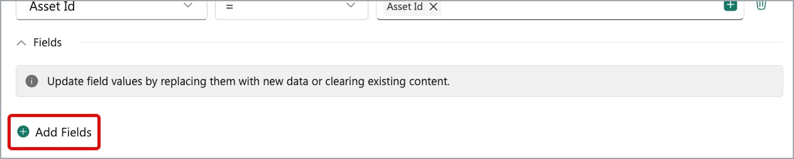

22. In the list of fields, select **Assigned To**, **Location**, and **Status**.

    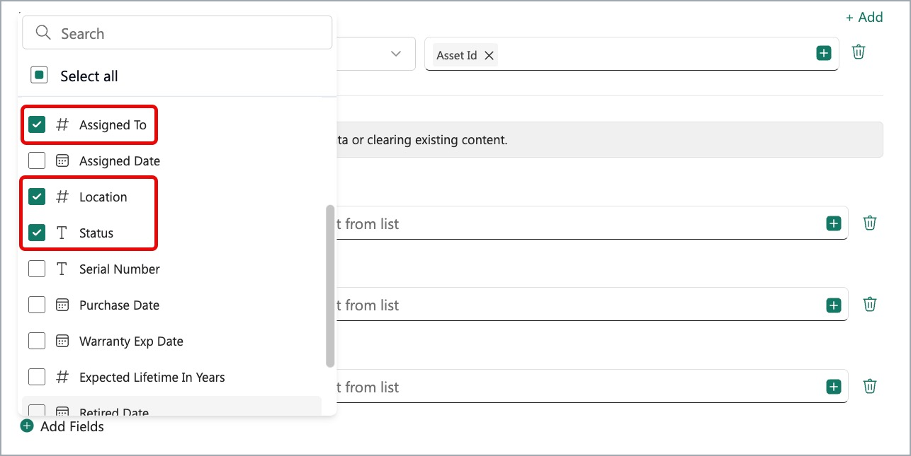

    The **Assigned To**, **Location**, and **Status** fields appear in the **Fields** section. The automation updates these fields when a user selects the button.

23. Under **Fields** > **Assigned To**, in the action list, select **Clear Value**.

    The box next to the action displays **Field value will be cleared**.

24. Under **Status**, in the action list, select **Replace Value**.

25. In the value box next to **Replace Value**, enter +++Retired+++.

26. Under **Location**, in the action list, select **Replace Value**.

27. In the **Type or select from list** box for **Location**, select the **+** button.

28. In the list that opens, under **Actions**, select **Find Record(s)**.

29. In the list of fields for the **Find Record(s)** action, select **Location Id**.

    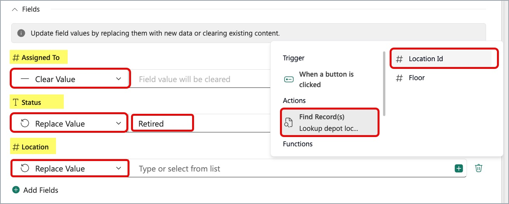

    The **Location** field now uses the **Location Id** value that the **Find Record(s)** action returns.

30. Select **Save**.

    The **Retire Asset** automation is saved, and the **Trigger**, **Find Record(s)**, and **Update Record** steps each display a green check mark.

31. Select **Back to Setup**.

    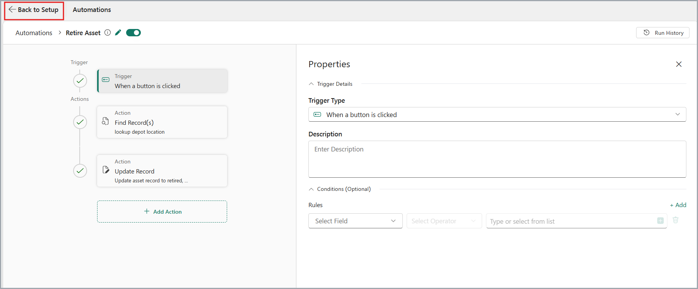

## Task 3: Configure the button column

In this task, you add a button column to the **assets** sheet. Users select this button on a row to run the **Retire Asset** automation for that asset.

1. If the **Explorer** pane is collapsed, expand it.

2. On the toolbar, select the **PowerTable** tab.

3. Select **Insert Column**.

4. In the list, select **Visual Column**.

5. Select **Add Button Column**.

   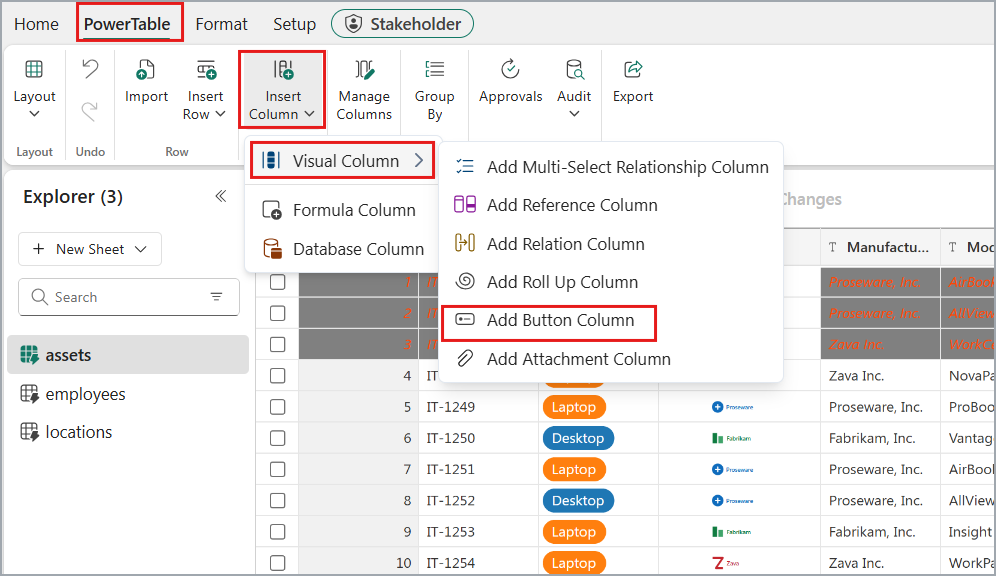

   The **Add Button Column** pane opens.

6. In the **Add Button Column** pane, on the **General** tab, enter the following details:
   - **Column Name** - +++Automation+++
   - **Label** - +++Retire Asset+++
   - **Action** - **Execute an Automation**
   - **Automation** - **Retire Asset**

   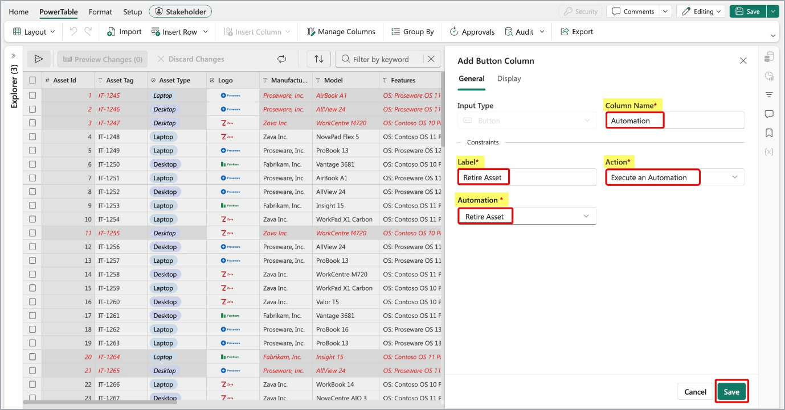

7. Select **<VALUE>** to save the button column.

   The **Automation** column appears in the **assets** sheet, and each row displays a **Retire Asset** button.

## Task 4: Test the automation

In this task, you run the **Retire Asset** automation from the button column and then review the automation in **Setup**. Testing the automation confirms that one button selection retires an asset in a single step.

1. In the **assets** sheet, scroll right until the **Automation** column is visible.

2. In the **Automation** column, select **Retire Asset** for one of the asset rows.

   

   PowerTable displays the message **Automation Retire Asset triggered successfully**. It displays a second message when the automation completes, and the row updates to show the asset as retired.

3. With the **assets** sheet still open, on the top toolbar, select **Setup** > **Automations**.

   

   The **Automations** page opens and lists the **Retire Asset** automation.

4. On the **Automations** page, select the **Retire Asset** automation that you created earlier.

   

   The **Retire Asset** automation opens. Its summary reads **When a button is clicked, Find Record(s), Update Record**.

5. On the **Retire Asset** automation page, select **Run History**.

   The **Run History** pane opens. It lists the job for the automation run with its **Job ID**, **Started At**, **Status**, **Duration**, and **Started By** values.

6. In the **Run History** pane, select **View Details** for the first job.

   

   The job details open. The pane shows **Run Successfully** and the start time of the run.

7. Under **Find Record(s)**, confirm that the action shows **Success**.

8. Expand **Record 1** to review the depot location that the **Find Record(s)** action found.

9. Under **Update Record** > **Input**, confirm that **Schema** is **dbo**, **Table name** is **assets**, **Assigned To** is **null**, **Location** is **1**, and **Status** is **Retired**.

   

10. Under **Conditions (AND)**, confirm that the condition matches the asset that you retired, for example **Asset Id = 11**.

11. Under **Output**, review the updated values for the asset, for example **Asset Id** **11** and **Asset Tag** **IT-1255**.

    The run history confirms that the trigger and each action ran as expected, and both actions show **Success**.

    > **Note:** If an automation fails, open its run history first. The action details show which step failed and the input values that the action used.

12. In the upper-left corner, select **Back to Setup**.

    

    PowerTable returns to the **assets** sheet with the **Setup** tab open.

13. In the upper-right corner, select **Save**.

    

    PowerTable saves your changes.

# Exercise 4: Clean up the lab resources

In this exercise, you delete the Microsoft Fabric workspace that you used in this lab.

## Task 1: Delete the workspace

In this task, you delete the workspace that contains the lab items, including the **FabricPlan-Day 2** folder and the **\_\_fabric_plan_sys** SQL database. Deleting the workspace removes the lab resources that you no longer need.

1. In the left navigation pane of Microsoft Fabric, select **Workspaces**.

2. Select your **FabricPlan-Day2-<ID>** workspace.

   The workspace opens and lists the **FabricPlan-Day 2** folder, the **\_\_fabric_plan_sys** SQL database, and its SQL analytics endpoint.

3. In the upper-right corner of the workspace, select **Workspace settings**.

   

   The **Workspace settings** pane opens.

4. In the **Workspace settings** pane, select **General**.

   The **General** settings appear.

5. Under **Manage** > **Delete workspace**, select **Remove this workspace**.

   

   The **Delete workspace?** dialog box opens.

   > **Important:** Fabric permanently deletes the workspace after a retention period of 90 days. During this period, contact your Fabric administrator if you need to restore the workspace and its items.

6. In the **Delete workspace?** dialog box, select **Delete**.

   

   Fabric deletes the workspace and removes it from the **Workspaces** list.

## Summary

In this lab, you added checks and balances to the asset management app to maintain data quality. You completed the following tasks:

- Set up an approval workflow that routes data changes through a review process.
- Set up access controls that restrict insert, update, and delete operations to authorized users.
- Set up an automation workflow that updates rows when a user selects a button.

## Summary

In this lab, you added checks and balances to the asset management app to maintain data quality. You completed the following tasks:

- You enabled an approval workflow on the **assets** sheet that routes every change through review.
- You submitted a change for review and approved it from the **Approvals** screen.
- You confirmed in the audit log who made the change and who approved it.
- You explored multi-level approvals that support up to three levels of review.
- You explored rule-based approvals that assign approvers by condition and use a fallback approver.
- You set up access controls so that all users in the domain can add and update rows.
- You restricted row deletion to specific users.
- You created the **Retire Asset** automation, which uses a button trigger.
- You added a **Find Record(s)** action that looks up the **Depot** location.
- You added an **Update Record** action that retires the selected asset.
- You added an **Automation** button column to run the automation.
- You reviewed the run history to verify the results.

