# Lab 09- Build an interactive enterprise dashboard with intelligence sheets in Microsoft Fabric

## Scenario

Contoso SaaS, a fictional mid-to-large software company, sells multiple products across several regions and customer segments. Its finance team struggles to compare Actuals, Plan, and Forecast figures because the data is spread across many reports. The team needs one interactive dashboard that shows variances and trends without leaving their planning environment.

The company chooses to build the dashboard with an intelligence sheet in Planning in Microsoft Fabric. The sheet is a canvas-based analysis layer that sits on top of the Enterprise Dataset semantic model. The key components are:

- **Enterprise Dataset semantic model**: Provides the SaaS Enterprise star-schema data (eight dimensions, three facts, and a Measure table) that every visual uses.
- **Financial-Plan plan**: Hosts the connected semantic model and the intelligence sheet.
- **Intelligence sheet**: Provides the canvas, visualization library, filters, bookmarks, and parameters that you use to build the dashboard.
- **Super Filter**: Lets users select a date range that updates all visuals.
- **Comments**: Let colleagues discuss specific data points.

In this lab, you act as a financial analyst at Contoso SaaS. You build an interactive enterprise dashboard that compares Actuals, Plan, and Forecast.

## Introduction

In this lab, you import the Enterprise Dataset semantic model into a Microsoft Fabric workspace. You create a plan named Financial-Plan and connect the model to it.

You then use an intelligence sheet to build a variance chart, a grouped line chart, a KPI card, and a matrix. Finally, you add a date filter, a dashboard header, and a comment to complete an interactive dashboard.

## Objectives

After completing this lab, you will be able to:

- Import the Enterprise Dataset PBIX file into a Fabric workspace.
- Create a plan and connect the Enterprise Dataset semantic model to it.
- Create an intelligence sheet and explore its canvas, filter, bookmark, parameter, and visualization controls.
- Build a variance chart, a grouped line chart, a KPI card, and a matrix by mapping semantic model fields.
- Add a Super Filter date filter that updates all visuals on the canvas.
- Add a dashboard header and a comment that tags a colleague.

## Prerequisites

- Access to a Microsoft Fabric workspace where you can create a plan and upload a semantic model.
- Permission to create and edit an intelligence sheet.
- The Enterprise Dataset sample PBIX file. Download it from the [Fabric samples GitHub repository](https://github.com/jagan0506/fabric-samples/blob/add-plan-enterprise-dataset/docs-samples/iq/plan/Enterprise%20Dataset.pbix).

# Lab 09- Build an interactive enterprise dashboard with intelligence sheets in Microsoft Fabric

## Scenario

Contoso SaaS, a fictional mid-to-large software company, sells multiple products across several regions and customer segments. Its finance team struggles to compare Actuals, Plan, and Forecast figures because the data is spread across many reports. The team needs one interactive dashboard that shows variances and trends without leaving their planning environment.

The company chooses to build the dashboard with an intelligence sheet in Planning in Microsoft Fabric. The sheet is a canvas-based analysis layer that sits on top of the Enterprise Dataset semantic model. The key components are:

- **Enterprise Dataset semantic model**: Provides the SaaS Enterprise star-schema data (eight dimensions, three facts, and a Measure table) that every visual uses.
- **Financial-Plan plan**: Hosts the connected semantic model and the intelligence sheet.
- **Intelligence sheet**: Provides the canvas, visualization library, filters, bookmarks, and parameters that you use to build the dashboard.
- **Super Filter**: Lets users select a date range that updates all visuals.
- **Comments**: Let colleagues discuss specific data points.

In this lab, you act as a financial analyst at Contoso SaaS. You build an interactive enterprise dashboard that compares Actuals, Plan, and Forecast.

## Introduction

In this lab, you use a live SaaS Enterprise semantic model to build an interactive enterprise dashboard in a planning environment in Microsoft Fabric.

An intelligence sheet is a canvas-based analysis layer that sits on top of a semantic model, a planning sheet, or PowerTable. It provides access to a visualization library that includes charts, matrices, KPI cards, Gantt charts, and filters. You use these visuals without leaving the planning environment.

### Business context

In this task, you review the scenario and the order of the lab before you build the dashboard. You use the Enterprise Dataset semantic model to build an interactive enterprise dashboard, and the overview helps you understand how each part fits together.

1. Review the following sections in the order shown:

   1. **Set up and plan**: Connect the Enterprise Dataset semantic model and create a plan.
   2. **Overview of the intelligence sheet**: Tour the tabs and features to understand what is available and the purpose of each.
   3. **Build a variance chart**: Use the Integrated Variance Bar Chart to compare Actuals versus Plan.
   4. **Build a grouped line chart**: Use Actuals and Forecast with **Dim Date** > **Month-Name**.
   5. **Build a KPI card**: Use **ProductName** as the trellis to compare Actuals versus Plan.
   6. **Build a matrix**: Compare Actuals and Plan by product category and subcategory.
   7. **Add interactivity and governance**: Build a date filter that is connected to all visuals, add a text header, and add a comment to complete the dashboard.

### Sample dataset

The SaaS Enterprise dataset models a mid-to-large software business across multiple products, regions, and customer segments. It contains 1.8 million rows of transactional data structured as a star schema. Fact tables link to dimension tables through a shared semantic model.

All figures are synthetic but calibrated to produce meaningful variance analysis, realistic trend lines, and visible Actuals, Plan, and Forecast differences.

The dataset includes the following tables:

- Eight dimensions: [Dim] Account, [Dim] Business Unit, [Dim] Customer Segment, [Dim] Date, [Dim] Department, [Dim] Geography, [Dim] Product, [Dim] Scenario
- Three facts: [Fact] Financial, [Fact] Invoice Line, [Fact] Operational
- A Measure table, from which most measures are used

## Objectives

After you complete this lab, you can:

- Create a Fabric workspace and import the Enterprise Dataset semantic model.
- Create a Financial-Plan plan and connect it to the semantic model.
- Build a variance chart, a grouped line chart, and a KPI card in an intelligence sheet.
- Add a Super Filter, a text header, and a comment to make the dashboard interactive.

## Architecture

The learner imports the Enterprise Dataset PBIX file into a Microsoft Fabric workspace, which creates a semantic model. The model is connected to a Financial-Plan plan, where an intelligence sheet is created on top of it. The sheet hosts a variance chart, grouped line chart, KPI card and matrix, a Super Filter date filter that updates all visuals, and comments for collaboration with colleagues.

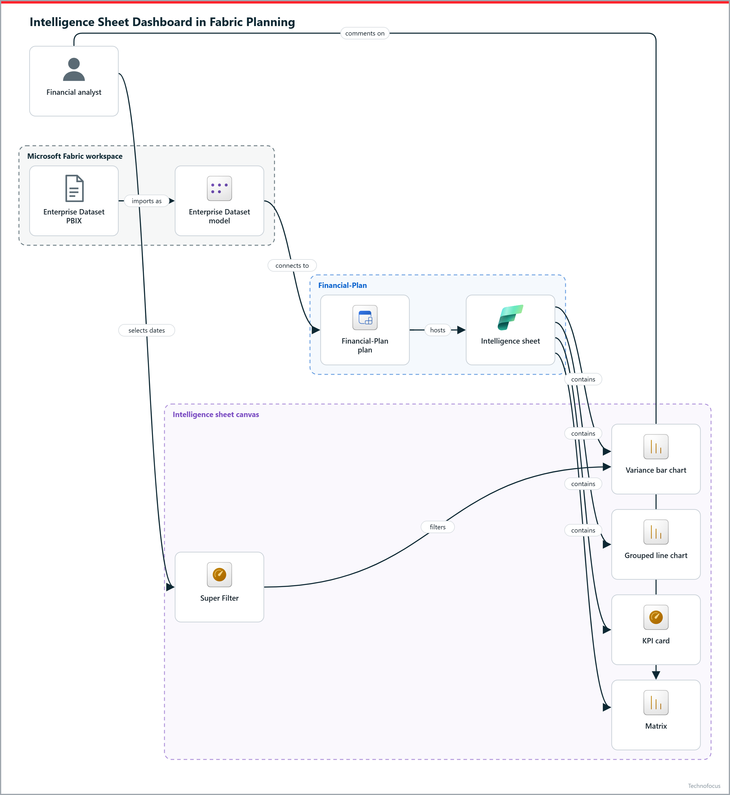

## Prerequisites

Before you begin, make sure that you have:

- Access to a Microsoft Fabric workspace where you can create a plan and upload a semantic model.
- Permission to create and edit an intelligence sheet.
- The Enterprise Dataset sample PBIX file (**Enterprise Dataset.pbix**). Download it from the [Fabric samples GitHub repository](https://github.com/jagan0506/fabric-samples/blob/add-plan-enterprise-dataset/docs-samples/iq/plan/Enterprise%20Dataset.pbix).

# Exercise 1: Set up the workspace and import the semantic model

In this exercise, you create a Fabric workspace and import the Enterprise Dataset semantic model that the dashboard uses.

## Task 1: Create a Fabric workspace

In this task, you create a workspace that stores the semantic model, the plan, and the intelligence sheet. A dedicated workspace keeps all items for this lab in one place.

1. In Microsoft Fabric, on the **Home** page, select **New workspace**.

   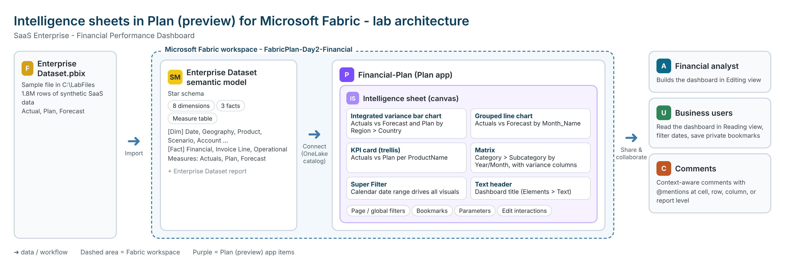

2. In the **Create a workspace** pane, in the **Name** box, enter the following value:

   +++FabricPlan-Day2-Financial-875789+++

   The message **This name is available** appears under the box.

   > **Note:** If the name is already taken, change the trailing digits.

3. Expand the **Advanced** section.

   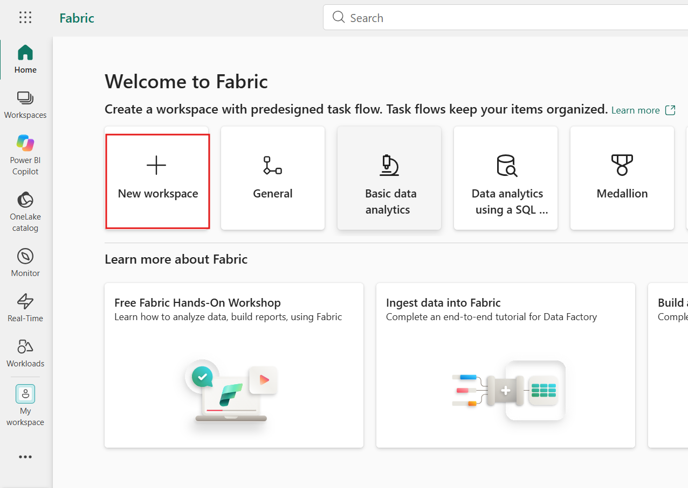

4. Under **Fabric and Power BI workspace types**, select **Fabric**.
5. Select **Apply**.

   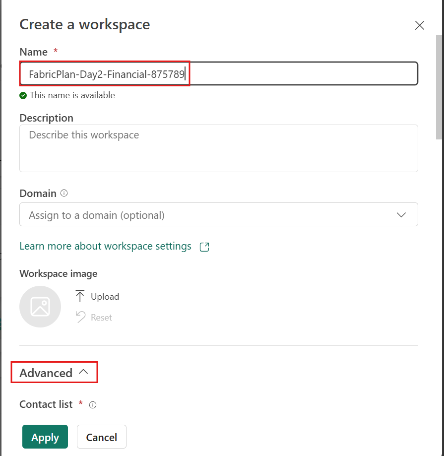

   The workspace is created and opens.

## Task 2: Import the sample semantic model

In this task, you import the Enterprise Dataset PBIX file into your Fabric workspace. The file provides the semantic model that the plan connects to in later exercises.

1. In your workspace, select **Import** > **Report, Paginated Report or Workbook** > **From this computer**.

   

   > **Note:** The **Import** menu accepts .pbix, .rdl, and .xlsx files from your local drive, OneDrive, or SharePoint.

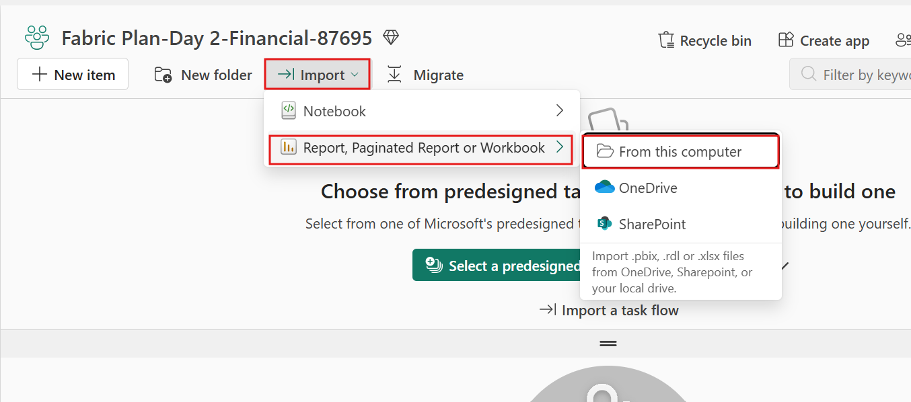

1. In the **Open** dialog, select **Enterprise Dataset** in the **Labfiles** folder, and then select **Open**.

   

2. Select **Open**.

   The file name **Enterprise Dataset** appears in the **File name** box, and the import starts.

   

3. In the workspace, verify that the **Enterprise Dataset** report and the **Enterprise Dataset** semantic model appear in the item list.

   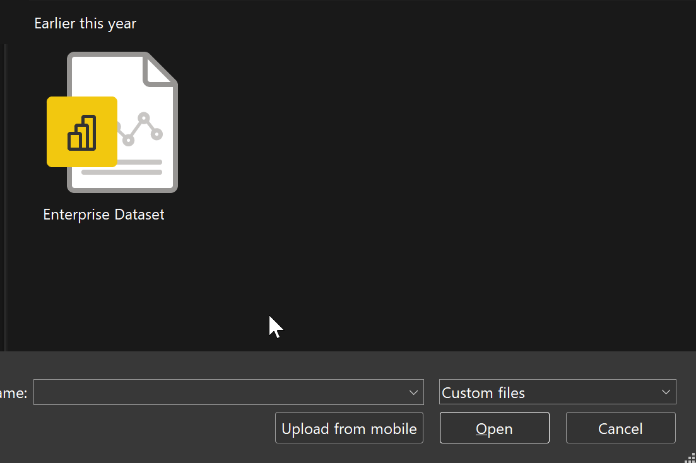

   > **Important:** Wait until the **Enterprise Dataset** report and semantic model appear before you continue. The next task uses the semantic model.

## Task 3: Create a plan

In this task, you create a plan item in the workspace. The plan hosts the connected semantic model and the intelligence sheet that you build in later tasks.

1. In your workspace, select **New item**.
2. In the **New item** pane, in the search box, enter the following value:

   +++Plan+++

3. In the results, select **Plan (preview)**.

   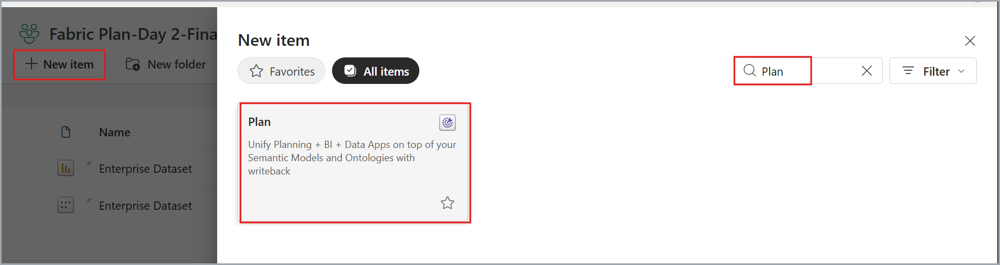

   The plan item is selected and the creation dialog opens.

4. In the **Open** dialog, select **Enterprise Dataset**.

   

5. Select **Open**.

   The **Enterprise Dataset** file name appears in the **File name** box, and the import starts.

   

6. In the workspace item list, verify that the **Enterprise Dataset** report appears.

   

7. In the workspace item list, verify that the **Enterprise Dataset** semantic model appears.

   

   > **Important:** Make sure the **Enterprise Dataset** report and semantic model are available before you continue.

## Task 4: Create a plan

In this task, you create a plan item in the workspace. The plan hosts the connected semantic model and the intelligence sheet that you build in later tasks.

1. In your workspace, select **New item**.
2. In the **New item** pane, in the search box, enter +++Plan+++.
3. In the results, select **Plan (preview)**.

   

1. In the **New Plan** dialog, enter +++Financial-Plan+++ in the **Name** box.

   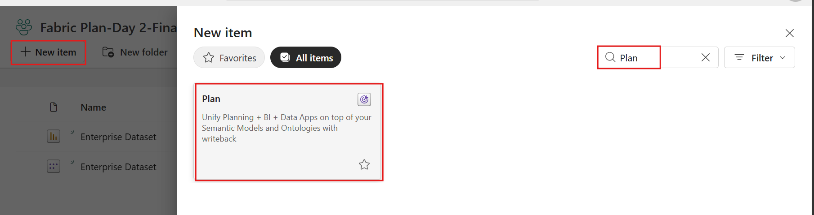

2. Verify that **Location** shows the workspace that you created, <VALUE>, and then select **Create**.

   The plan opens to a launch screen where you can connect a semantic model or create a sheet. Under **Create new sheet**, the launch screen also provides **PowerTable**, **Planning**, and **Intelligence** options.

## Task 5: Connect the semantic model

In this task, you connect the Enterprise Dataset semantic model to the Financial-Plan plan. The intelligence sheet uses this model as the data source for every visual.

1. On the launch screen, under **Get data**, select **Semantic Model**.

   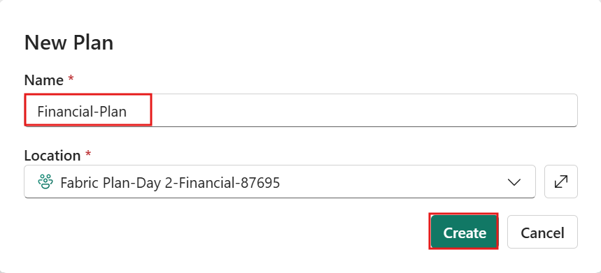

2. In the **Select Semantic Model** dialog, verify that **Semantic Model Item** is selected under **Select Semantic model From**.
3. Select the **Semantic Model** box.
4. In the list, select **Enterprise Dataset**.

   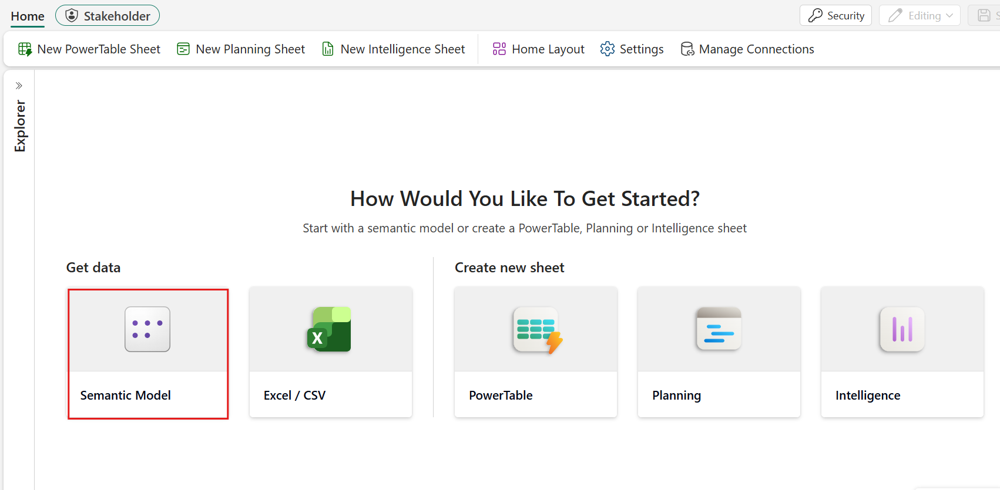

   The **Semantic Model** box shows **Enterprise Dataset**, and the **Connect** button becomes available.

5. In the **Select Semantic Model** dialog, select **Connect**.

   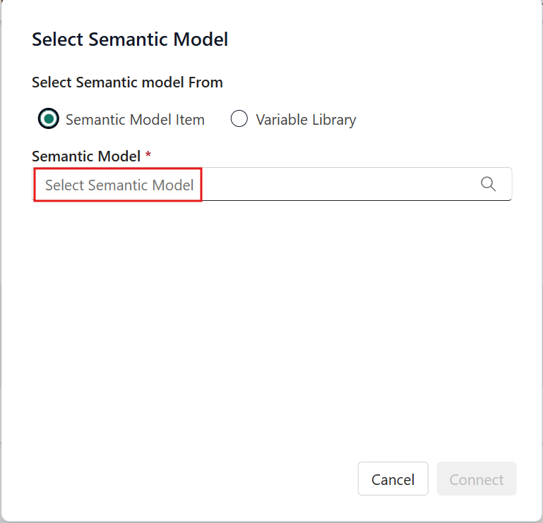

   The **Select Semantic Model Connection** dialog opens.

6. In the **Select Semantic Model Connection** dialog, select the shared cloud connection that you want to use.

   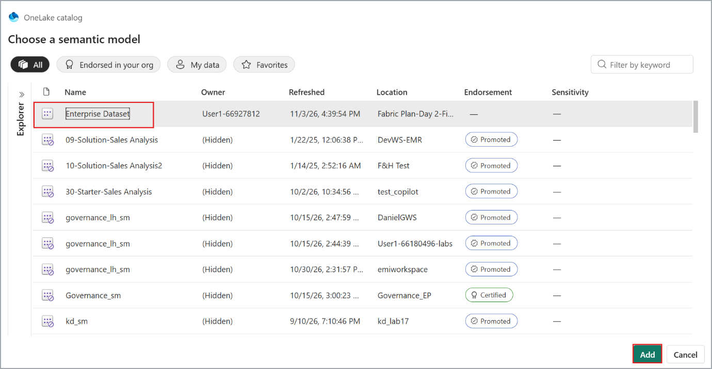

7. Under **Semantic Model**, verify that **Enterprise Dataset** is selected.
8. In the **Select Semantic Model Connection** dialog, select **Connect**.

   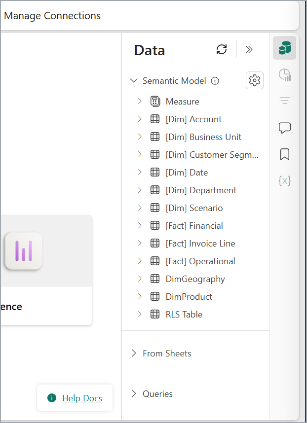

   The connection is established, the semantic model is added, and its tables appear in the **Data** pane.

## Task 6: Create an intelligence sheet

In this task, you create the intelligence sheet that hosts the dashboard. The sheet provides the canvas on which you build the visuals in the later tasks.

1. In the **Financial-Plan** plan, on the **Home** tab, select **New Intelligence Sheet**.

   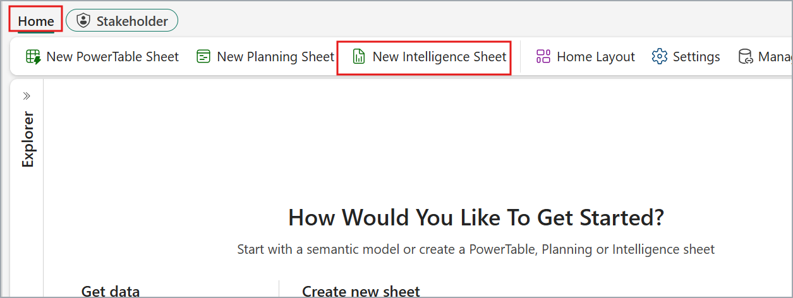

2. In the **New Intelligence Sheet** dialog, in **Name**, enter +++Intelligence 1+++.
3. Select **Create**.

   The intelligence sheet is created and opens with a blank canvas.

   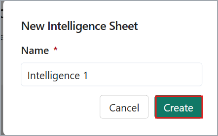

   > **Note:** You can use a different name for the sheet. Use the same name when later steps refer to the sheet.

The new intelligence sheet opens with the canvas and the visualization controls.

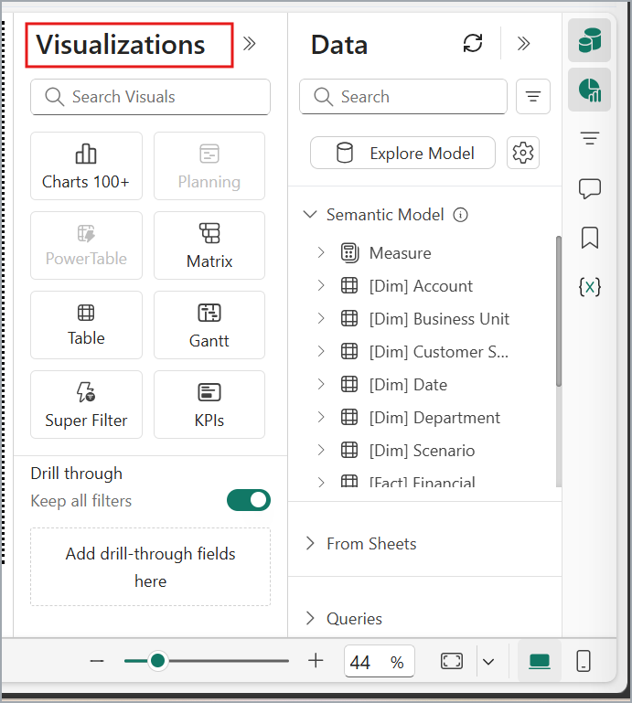

# Exercise 2: Explore the intelligence sheet interface

In this exercise, you explore the intelligence sheet interface and build the dashboard visuals, filter, header, and comment.

## Task 1: Review the intelligence sheet interface

In this task, you open the intelligence sheet and review its main areas. Knowing where each area is helps you build the dashboard in the later tasks.

1. In the Microsoft Fabric portal, open the intelligence sheet you created in Exercise 1.

   The intelligence sheet opens in the editing view.

2. Review the areas of the interface: <VALUE>.

## Task 2: Review parameters

In this task, you review the parameters available in the intelligence sheet. Parameters control the values that the visuals and calculations use, so you need to know how they work before you build a chart.

1. In the intelligence sheet, select <VALUE>.
2. Review the available parameters: <VALUE>.

## Task 3: Review visualization types

In this task, you review the visualization types that the intelligence sheet offers. Choosing the right type helps you present plan data clearly.

1. In the intelligence sheet, select <VALUE>.
2. Review the available visualization types: <VALUE>.

## Task 4: Build a variance chart

In this task, you build a variance chart, and then add a filter, a header, and a comment to the dashboard. These elements help viewers compare values and understand the results.

1. In the intelligence sheet, select <VALUE> to add a chart.
2. Select the variance chart type: <VALUE>.
3. Configure the chart fields: <VALUE>.
4. Add a filter to the dashboard: <VALUE>.
5. Add a header to the dashboard: <VALUE>.
6. Add a comment to the dashboard: <VALUE>.

> **Note:** The original content for this exercise contained only the heading and the introduction sentence. The steps above use <VALUE> placeholders. Replace each placeholder with the exact UI element, name, or value from the source lab, and place each screenshot token (image5.png, image6.png, image7.png, image8.png) exactly once, on its own line, indented under the step it belongs to.

## Task 5: Review the canvas controls

In this task, you review the toolbar controls that apply to the entire canvas. Knowing where these controls are helps you set up the dashboard layout in later exercises.

1. On the **Intelligence** tab, locate the toolbar above the canvas.
2. Select **Canvas** to open the **Canvas** pane.

   The **Canvas** pane opens with the **General**, **Layers**, and **Themes** tabs.

3. On the **General** tab, review the **Page Settings** options: **Type**, **Scaling unit**, and **Vertical Alignment**.

   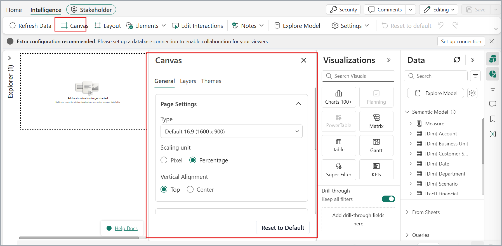

   > **Note:** Use **Canvas** to adjust grid snapping, canvas size, and zoom level. Select **Reset to Default** to restore the default canvas settings.

4. Select **Layout** to review the options that manage the canvas layout.
5. Select **Elements** to review the options that add text, shapes, buttons, and other elements.
6. Select **Edit Interactions** to review the options that define how filtering one visual affects the other visuals on the canvas.
7. Select **Notes** to review the options that add notes to the canvas.
8. Select **Settings** to review the sheet settings.

## Task 6: Review the filter pane

In this task, you open the filter pane and review the filter levels. Filters control which data the dashboard visuals display.

1. On the right side of the canvas, select the **Filter** icon.

   The **Filter** pane opens next to the **Data** pane.

2. Review the **Page level** section, which holds filters that apply to the visuals on the sheet.
3. Review the **Global level** section, which holds filters that apply across the workbook.

   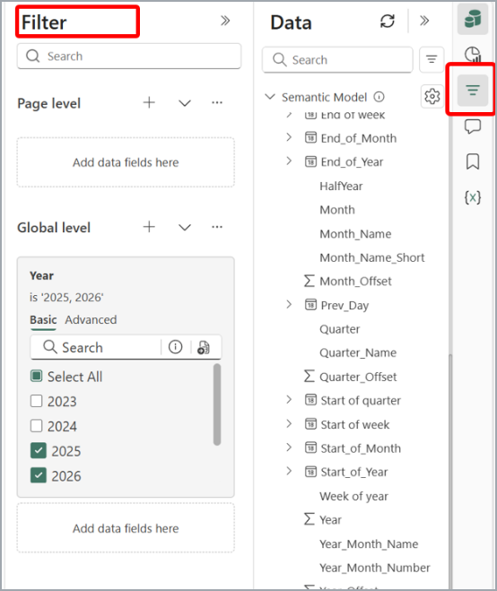

   > **Note:** You can add a field, such as **Year**, to the **Global level** section to filter the whole workbook. You do not add a filter in this lab.

## Task 7: Review bookmarks

In this task, you open the **Bookmark** pane and review how bookmarks work. Bookmarks let users return to a saved analytical view and share it with colleagues.

1. On the right side of the canvas, select the **Bookmarks** icon.

   The **Bookmark** pane opens with the **Public** and **Private** tabs.

2. Review the **Public** and **Private** tabs.
3. Review the **Add New** and **View** buttons.

   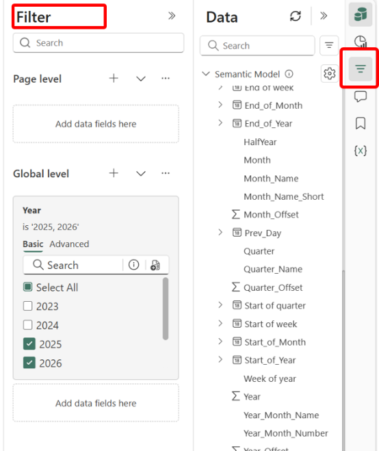

   > **Note:** Bookmarks capture the current analytical view, including the filter state and scroll position. In reading mode, users can save private bookmarks and share specific views with colleagues.

## Task 8: Review parameters

In this task, you review the parameter controls in the intelligence sheet. Parameters store reusable values and support conditional display logic, so you need to know where to find them before you build visuals.

1. On the right side of the canvas toolbar, select the **Parameters** icon (**{x}**).

   The **Parameter** pane opens and shows the **Page (0)** and **Global (0)** tabs, the message **No Parameters Found**, and the **+ Add new** button.

   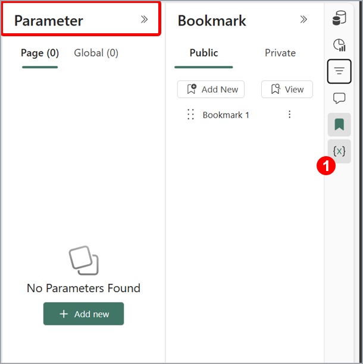

   > **Note:** Parameters store reusable values, such as a target margin percentage, or support conditional display logic based on a user selection. You do not create a parameter in this lab.

## Task 9: Review visualization types

In this task, you review the visualization types in the **Visualizations** pane. Knowing what each type does helps you choose the right visual for the dashboard.

1. In the **Visualizations** pane, review the following visualization types:

   - **Charts 100+** - Access a library of charts organized by chart family.
   - **Planning** - Embed a planning sheet on the canvas.
   - **PowerTable** - Embed a PowerTable sheet on the canvas.
   - **Matrix** - Display hierarchical row and column data.
   - **Table** - Display tabular data without a hierarchy.
   - **Gantt** - Display Gantt and resource Gantt charts.
   - **Super Filter** - Add interactive filters.
   - **KPIs** - Display key measures with KPI and trellis capabilities.

## Task 10: Build a variance chart

In this task, you add an Integrated Variance Bar Chart that compares Actuals, Plan, and Forecast by geography. This chart is the first visual of the dashboard and shows variances by region and country.

1. In the **Visualizations** pane, select **Charts 100+**.

   The chart library opens.

   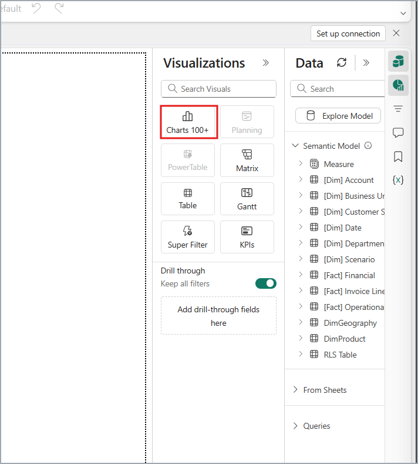

2. In the search box, enter +++variance+++.

   The results show the chart families that contain variance charts, such as **Bar/ Column**, **Line**, **Area**, and **Waterfall**.

3. In the **Bar/ Column** family, select **Integrated Variance Bar Chart**.

   The **Bar/ Column** pane opens and shows the **Assign Data** and **Advanced** tabs.

   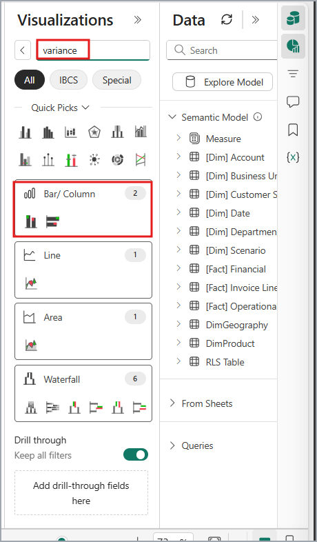

4. On the **Assign Data** tab, in the **Data** pane, expand **Semantic Model** > **DimGeography**.
5. Select the **RegionName** field and add it to **Category**.
6. Select the **CountryName** field and add it to **Category**, below **RegionName**.

   Both fields appear in the **Category** well.

7. Map the following fields in the field well:

   - **Actual(s)** - **Measures** > **Financial** > **Base Measures** > **Actuals**
   - **Comparison 1 (vs Actuals)** - **Measures** > **Financial** > **Base Measures** > **Forecast**
   - **Comparison 2 (vs Actuals)** - **Measures** > **Financial** > **Base Measures** > **Plan**

   The chart displays Actuals compared with Forecast and Plan, grouped by region and country.

   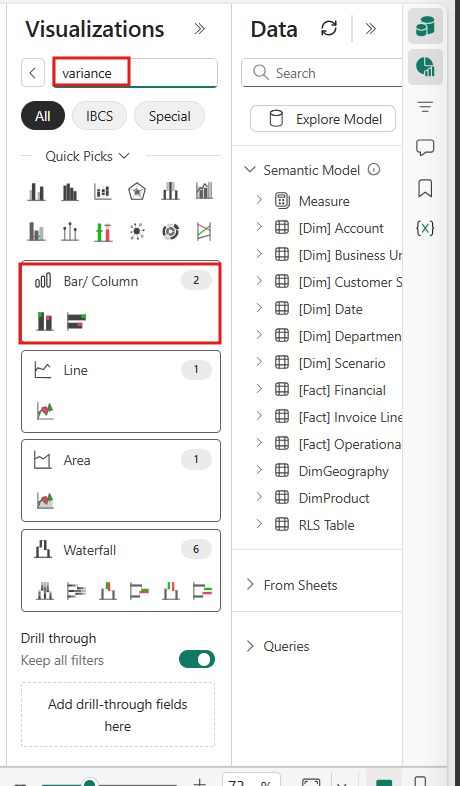

   > **Note:** Use the well labeled **Actual(s)** on the **Assign Data** tab.

8. In the **Data** pane, expand **Semantic Model** > **Measure** > **Financial** > **Base Measures**.
9. Select the **Actuals** check box.

   The **Actuals** measure appears under **Actual(s)** in the **Assign Data** tab of the **Visualizations** pane.

   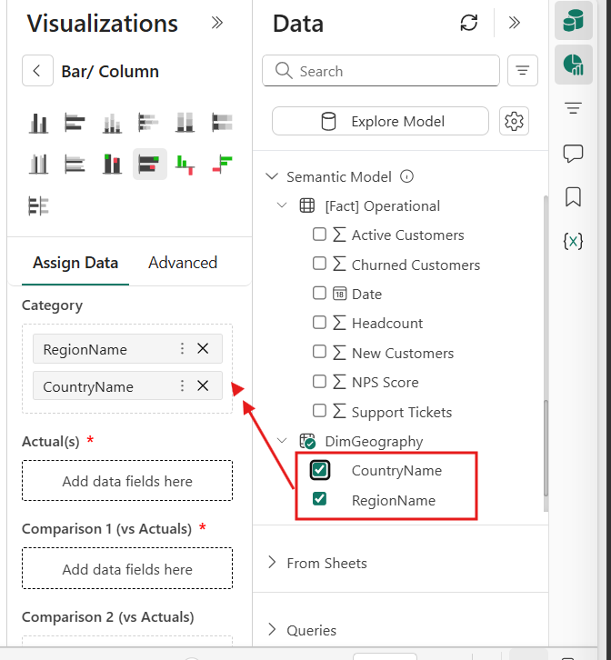

10. In the **Data** pane, select the **Forecast** check box.
11. In the **Data** pane, select the **Plan** check box.

    The **Forecast** measure appears under **Comparison 1 (vs Actuals)**, and the **Plan** measure appears under **Comparison 2 (vs Actuals)**.

    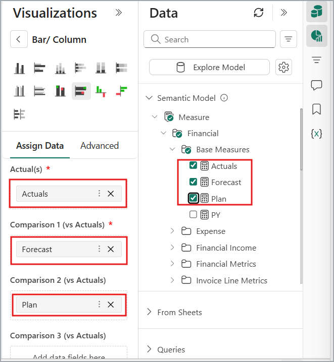

12. Verify that the **Category** well contains **RegionName** and **CountryName**, in that order.

    The chart displays Actuals, Forecast, and Plan by **RegionName**. The regions listed are **APAC**, **EMEA**, **LATAM**, and **North America**.

    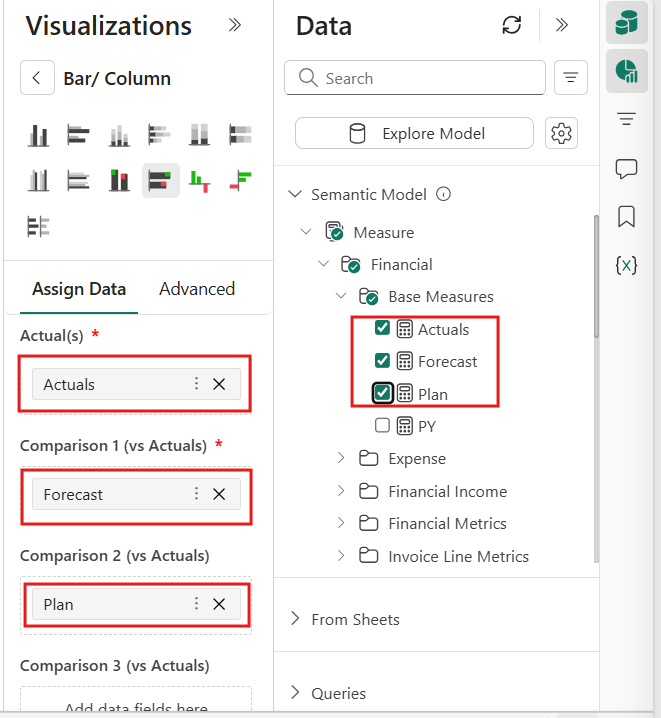

13. With the chart selected, in the visual header, select the drill-down icon to go from **RegionName** to **CountryName**.

    The chart title changes to **Actuals, Forecast, Plan by RegionName and CountryName**, and the region rows show an expand (**+**) icon. When you expand **LATAM**, the **Brazil** row appears.

14. Select the variance label next to the **EMEA** bar to open the label formatting toolbar.
15. On the toolbar, select the ruler icon.
16. In the list, select **Thousands**.

    The variance labels display values in thousands. The default setting is **Flexible**.

    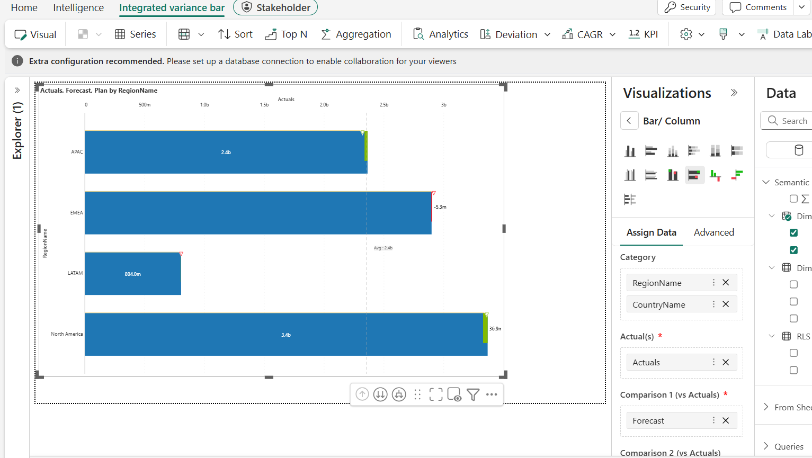

17. Select **Expand all** to display all hierarchy levels at the same time.
18. Select a data label on the chart.
19. In the on-object options, set **Scaling** to **Thousands**.
20. Select a bar on the chart.
21. In the on-object options, select the series color box.
22. In the hex color field, enter +++#3f7aab+++.

    The bars change to the new blue color.

    

## Task 11: Build a grouped line chart

In this task, you add a grouped line chart to the dashboard canvas. The chart compares Actuals and Forecast over time, so you can see where the two figures diverge.

1. In the **Visualizations** pane, select **Charts 100+**.
2. Expand **Line**.
3. Select **Grouped line**.

   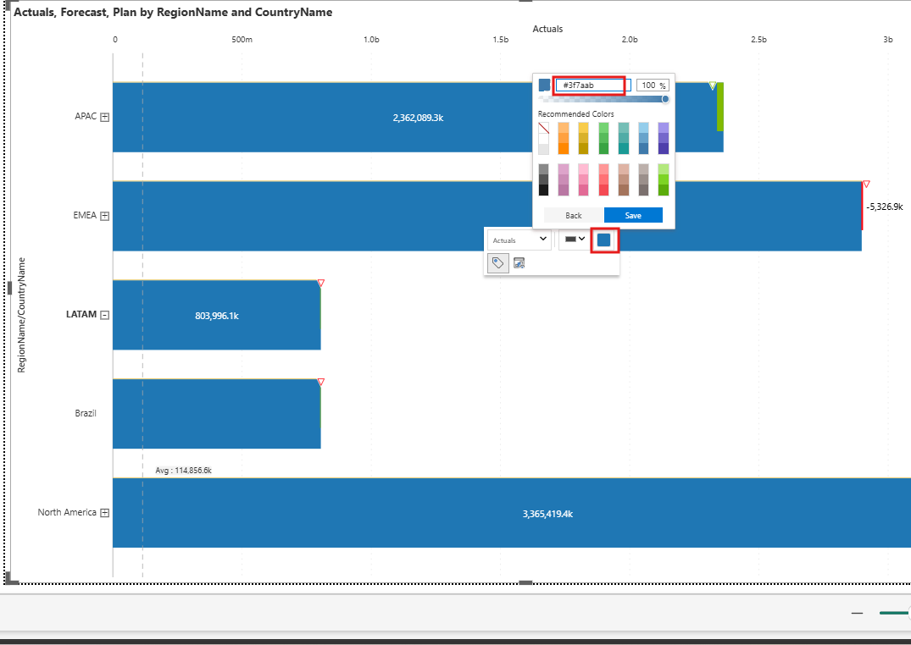

   The **Grouped/Clustered line** chart is added to the canvas, and the **Assign Data** tab opens.

4. On the **Assign Data** tab, under **Actual(s)**, add the **Actuals** measure from **Measures** > **Financial** > **Base Measures** > **Actuals**.
5. Under **Forecast**, add the **Forecast** measure from **Measures** > **Financial** > **Base Measures** > **Forecast**.
6. Under **Category**, add the **Month-Name** field from **Dim Date** > **Month-Name**.

   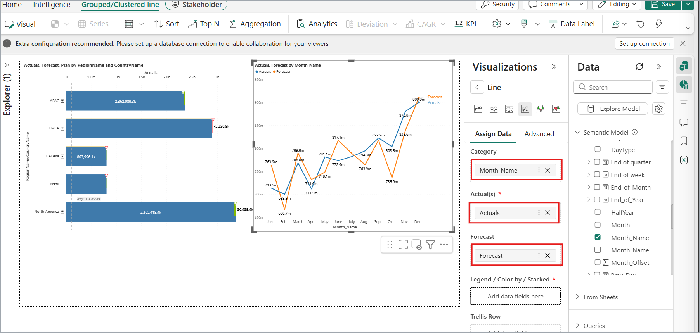

   > **Note:** The **Category** field appears as **Month_Name** in the field well.

   The chart shows how Actuals and Forecast change over the selected time range.

   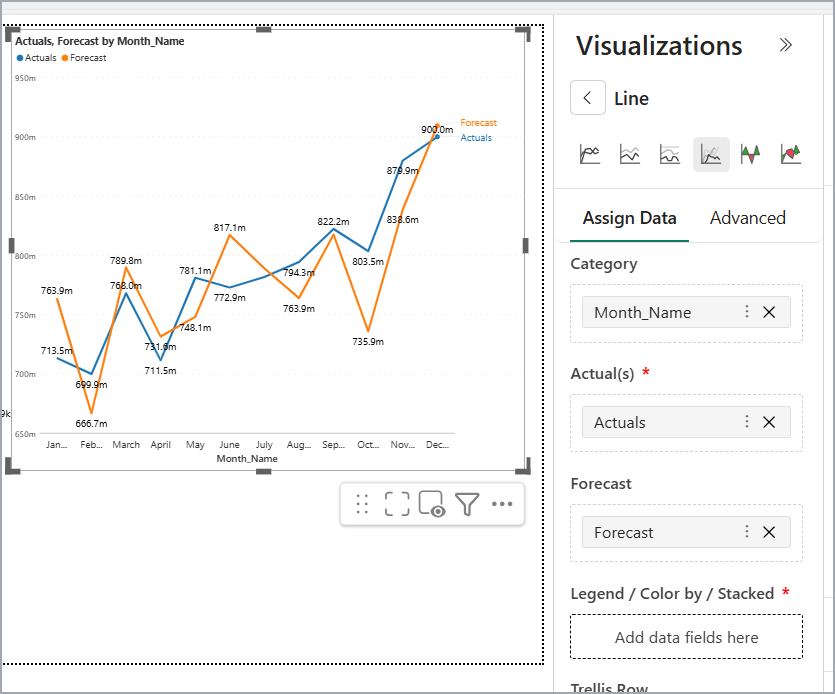

## Task 12: Add a KPI card

In this task, you add a KPI card that compares Actuals and Plan for each product. The card gives you an at-a-glance view of the product portfolio.

1. In the **Visualizations** pane, select **KPIs**.

   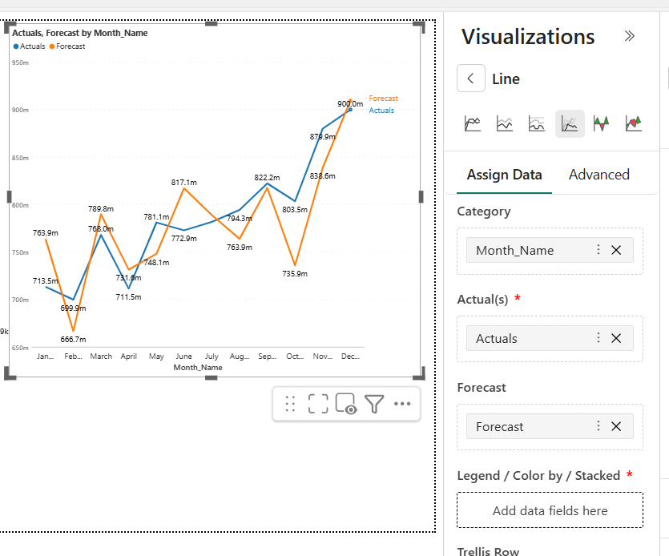

   The **KPIs** field well opens with the **Assign Data** and **Advanced** tabs.

2. On the **Assign Data** tab, in the **Actual(s)** box, add the **Actuals** measure from **Measures** > **Financial** > **Base Measures** > **Actuals**.
3. In the **Comparison 2 (vs Actuals)** box, add the **Plan** measure from **Measures** > **Financial** > **Base Measures** > **Plan**.
4. In the **Trellis Row** box, add the **ProductName** field from **Dim Product** > **ProductName**.

   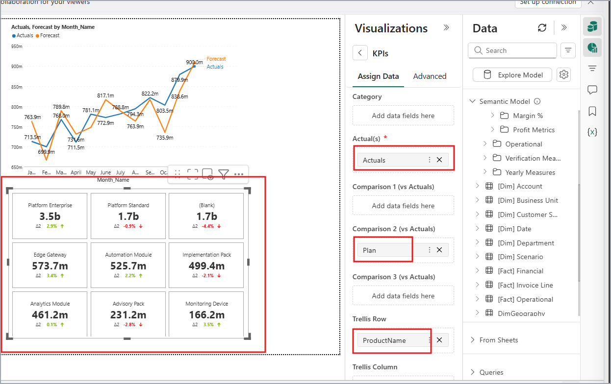

   The KPI card tiles into one panel per product. Each tile shows the Actuals value and its variance against Plan, which gives you an at-a-glance comparison across the product portfolio.

   > **Note:** Select the data fields in the **Data** pane and drag them to the field well boxes if they do not add automatically.

## Task 13: Add a matrix

In this task, you add a matrix that compares Actuals and Plan by product category and subcategory over time. The matrix lets you review the figures at several levels of detail.

1. In the **Visualizations** pane, select **Matrix**.
2. In the **Rows** box, add the following fields from **[Dim] Product**:
   - **ProductCategory**
   - **ProductSubCategory**
3. In the **Columns** box, add the following fields from **[Dim] Date** > **Date** > **Date**:
   - **Year**
   - **Month**
4. In the **Values (AC)** box, add the **Actuals** measure.
5. In the **Compare to Prior Period (PY)** box, add the **Plan** measure.

   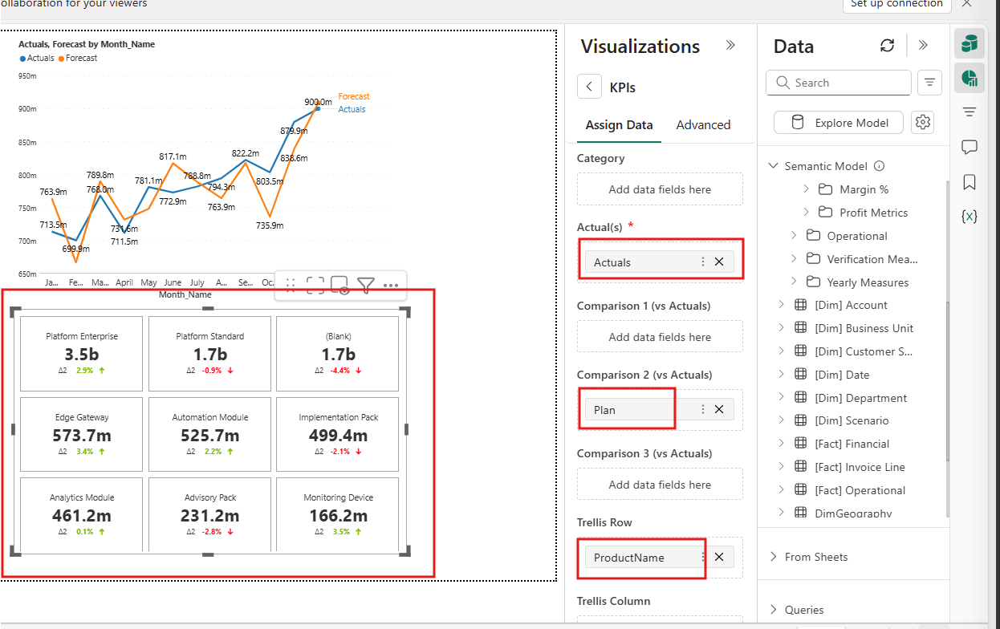

   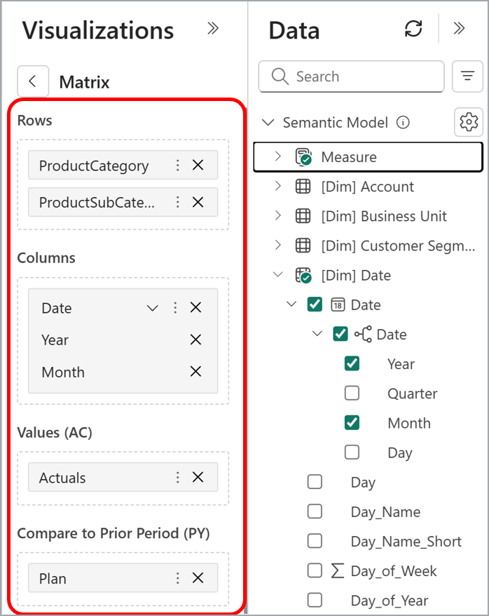

   The matrix shows Actuals and Plan by product category and subcategory, grouped by year and month.

1. On the **Matrix** tab, select **Show Columns**.
2. In the column list, select the **Actuals - Plan** and **(Actuals - Plan)%** check boxes.

   

   The variance and variance percentage columns are added to the matrix automatically.

   > **Note:** In the column list, the **Actuals - Plan** column is the variance and the **(Actuals - Plan)%** column is the variance percentage.

## Task 14: Add a date filter

In this task, you add a Super Filter visual that lets users select a date range. The filter updates the other visuals on the dashboard, so users can focus on the period they want to analyze.

1. In the **Visualizations** pane, select **Super Filter**.

   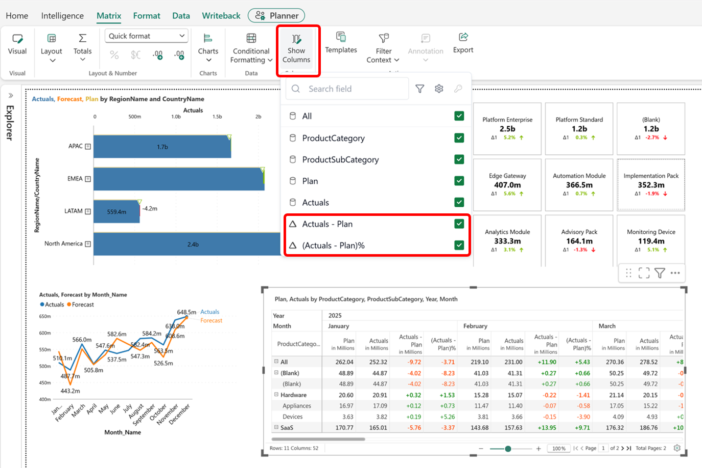

2. In the **Filter** pane, go to the **Category** field well.
3. Add the **Date** field from **[Dim] Date** > **Date** to the **Category** field well.
4. On the Super Filter visual toolbar, select the pencil icon to open the properties.

   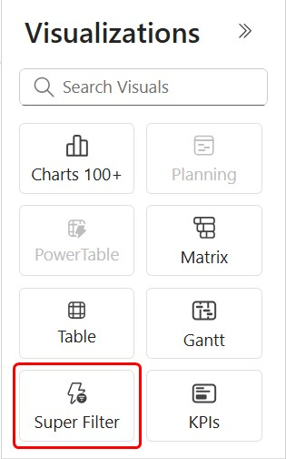

   The **Properties** pane opens.

5. In the **Properties** pane, on the **General** tab, expand **Global**.
6. In the **Filter by type** list, select **Date**.
7. In the **Type** list, select **Calendar**.

   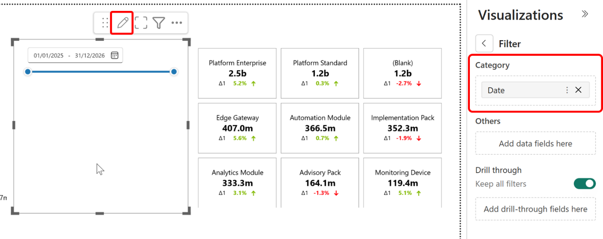

   The Super Filter shows a date range selector with a calendar.

1. In the **Super Filter** visual, select a start date in the **Start Date** field.

   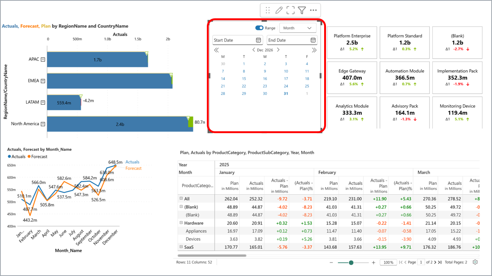

   The variance chart, grouped line chart, KPI cards, and matrix update to reflect the selected period.

## Task 15: Add a dashboard header

In this task, you add a text element that titles the dashboard. A clear title helps viewers identify the purpose of the dashboard.

1. On the **Intelligence** tab, select **Elements** > **Text**.

   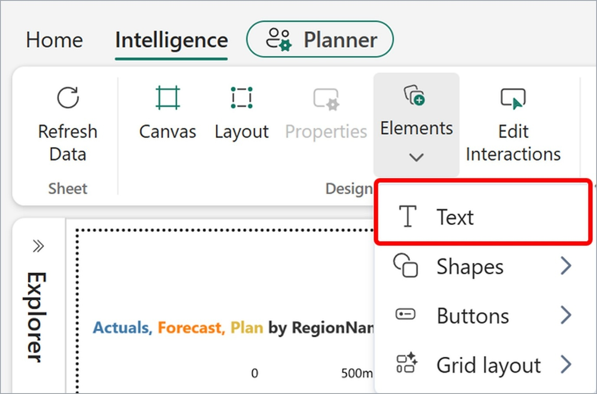

   A text box appears on the canvas.

2. In the text box, enter +++SaaS Enterprise - Financial Performance Dashboard+++.
3. Select the text that you entered.
4. In the formatting toolbar, in the font size list, select **18**.
5. In the formatting toolbar, select **Bold**.
6. In the formatting toolbar, select the horizontal align list, and then select **Align center**.
7. Drag the text box to the top of the canvas.

   

   The header appears at the top of the dashboard, above the visuals.

## Task 16: Add a comment

In this task, you add a comment to a data point in the matrix and tag a colleague. Comments let your team discuss specific values without leaving the dashboard.

1. In the matrix, select the cell that you want to comment on.
2. On the top ribbon, select **Comments**, and then select **Add new comment**.
3. In the comment box, enter +++Actuals are below Plan for this period. Please review.+++
4. In the comment box, enter @ followed by a colleague's name <VALUE>.
5. Select the **Send** icon to post the comment.

   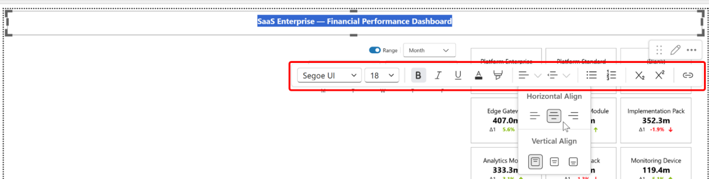

   The comment is posted and linked to the selected cell.

   > **Note:** The **Comments** ribbon displays a message that recommends setting up a database connection to enable collaboration for your viewers. You can post comments without this connection, but viewers cannot collaborate until you set it up.

> **Note:** Commentary in intelligence sheets is context-aware and respects the current filter state. You can add comments at the cell, row, column, or report level.

### Review the completed dashboard

In this task, you switch the intelligence sheet to reading mode to view the finished dashboard as other users see it. This confirms that all visuals and filters display correctly.

1. In the upper-right corner of the intelligence sheet, select the mode list.

2. Select **Reading**.

   The dashboard displays the **SaaS Enterprise - Financial Performance Dashboard** header, the variance chart, the date filter, the KPI cards, the grouped line chart, and the matrix.

   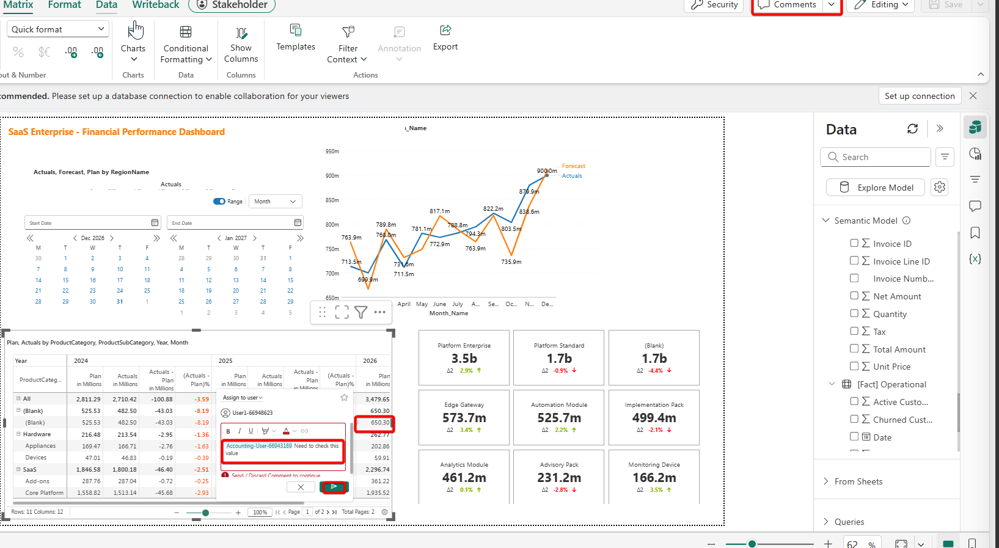

You now have an interactive enterprise dashboard that:

- Connects an intelligence sheet to the SaaS Enterprise semantic model.
- Uses the **Intelligence** tab and visual-level controls to configure the canvas and visuals.
- Includes a variance chart with drill-down and formatting.
- Includes a grouped line chart, KPI card, and matrix.
- Uses a date filter to update the dashboard visuals.
- Includes a dashboard header.
- Uses comments to collaborate with colleagues.

## Summary

In this lab, you imported the Enterprise Dataset PBIX file into a Fabric workspace, created the Financial-Plan plan, and connected the semantic model to it. You created an intelligence sheet, explored its interface, and built a variance chart with drill-down and formatting, a grouped line chart, a KPI card, and a matrix. You also added a Super Filter date filter, a dashboard header, and a comment, which produced an interactive enterprise dashboard.
