# Lab 10: Build an integrated planning canvas with what-if simulation, PowerTable, and intelligence sheets in Plan for Microsoft Fabric

**Introduction**

Plan (preview) for Microsoft Fabric offers three sheet types that work together in one app:

- **Planning sheets** - enter, distribute, and simulate plan values on top of a semantic model.

- **PowerTable sheets** - no-code data apps with editable tables, approvals, and audit, stored in a Fabric SQL database.

- **Intelligence sheets** - a canvas for visuals, which can also embed planning and PowerTable sheets.

In this lab, you create a **Financial Plan** planning sheet and add a what-if simulation based on the **Plan** measure. You then embed the planning sheet in an intelligence sheet and add a KPI that updates as you change the simulation. Finally, you create a **Sales Detail** PowerTable that imports product data from the **Enterprise Dataset** semantic model into a Fabric SQL database, and embed it on the same canvas.

**Scenario**

The finance team of the SaaS company from Labs 08 and 09 wants to test budget scenarios before the next planning cycle. For example: what happens to total income if hardware revenue grows 5%, subscription revenue drops 2%, advertising is cut 6%, and digital marketing is set to \$120M?

At the same time, the sales operations team needs an editable product-level table of actuals and plan that they can maintain without spreadsheets. Leadership wants to see the scenario, its impact on key accounts, and the product detail on a single screen.

In this lab, you are a financial planning analyst who builds this integrated planning canvas.

**Objectives**

After completing this lab, you will be able to:

- Create a planning sheet on the account hierarchy and format it with a ragged hierarchy

- Add a **Simulate** column and apply what-if adjustments with percentages, sliders, and values

- Embed a planning sheet in an intelligence sheet

- Build a KPI that combines semantic model measures with a simulated series from a planning sheet

- Create a PowerTable app on a Fabric SQL database and import data from a semantic model

- Set a primary key, filter imported data, and configure PowerTable columns

- Embed a PowerTable next to the planning sheet on the same canvas

**Architecture**

The **Financial-Plan** app reads the **Enterprise Dataset** semantic model. The **Financial Plan** planning sheet uses the account hierarchy and the Actuals, Plan, and Forecast measures, and adds a **Plan (Simulation)** column. The **Sales Detail** PowerTable imports product data from the semantic model and stores its table and metadata in a Fabric SQL database. The intelligence sheet embeds both sheets and shows a KPI that combines semantic model measures with the simulated values.

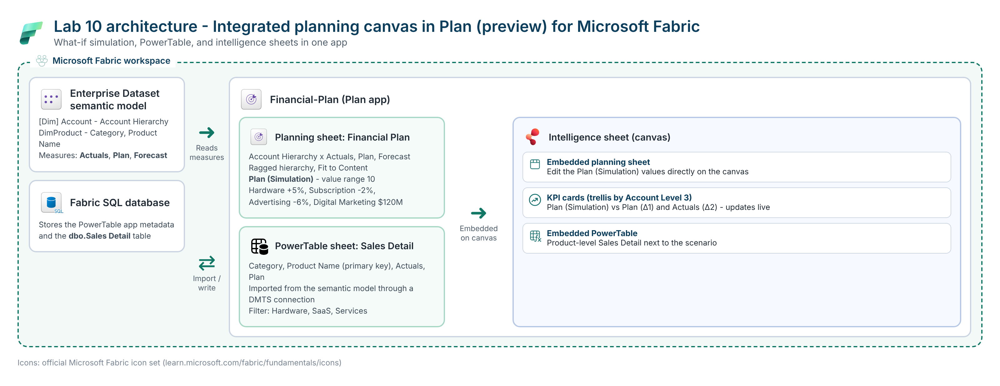

| **Component**                     | **Role in the lab**                                                                                 |
|-----------------------------------|-----------------------------------------------------------------------------------------------------|
| Enterprise Dataset semantic model | Source of the account hierarchy, products, and the **Actuals**, **Plan**, and **Forecast** measures |
| Financial Plan (planning sheet)   | Plan by account, with the **Plan (Simulation)** what-if column                                      |
| Sales Detail (PowerTable sheet)   | Editable product table (Category, Product Name, Actuals, Plan)                                      |
| Fabric SQL database               | Stores the PowerTable app metadata and the **Sales Detail** table                                   |
| Intelligence sheet                | Canvas that embeds the planning sheet, the PowerTable, and a KPI visual                             |
| KPI visual                        | Compares **Plan (Simulation)** with **Plan** and **Actuals** by account                             |

**Prerequisites**

- Completion of Lab 08 and Lab 09 - the **Enterprise Dataset** semantic model is imported and the **Financial-Plan** app has an intelligence sheet

- A **Fabric SQL database** in your workspace, used to store PowerTable data. To create one, select **+ New item \> SQL database** in your workspace.

- A workspace on **Fabric capacity** (PowerTable semantic model integration isn't supported on Pro license capacity)

- Permission to create planning, PowerTable, and intelligence sheets

## Exercise 1: Create the Financial Plan planning sheet

In this exercise, you create a planning sheet on the account hierarchy and add a what-if simulation.

### Task 1: Create the planning sheet

1.  In your workspace, open the **Financial-Plan** app. On the **Home** tab, select **New Planning Sheet**.

    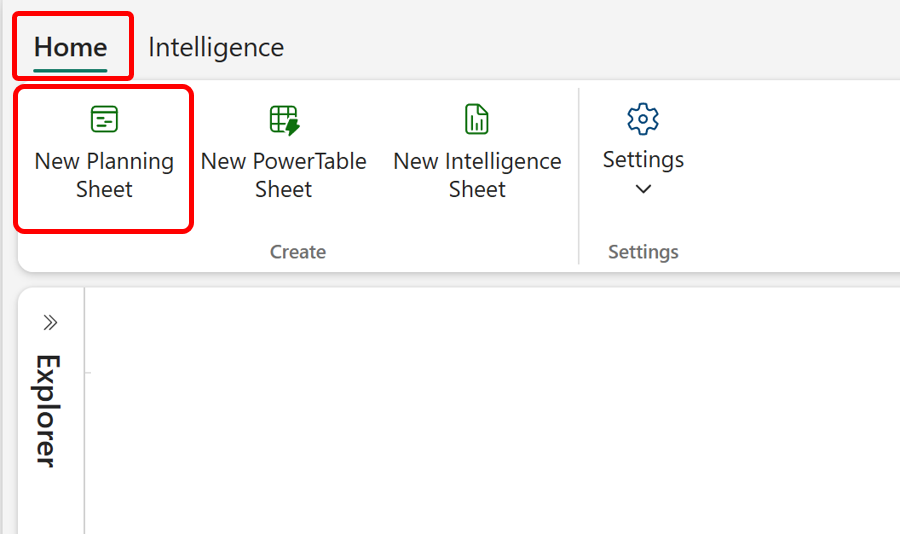

2.  In the **New Planning Sheet** dialog box, enter +++Financial Plan+++ as the **Name**, and then select **Create**.

3.  In the **Data** pane, expand **\[Dim\] Account**, and select the **Account Hierarchy** check box. The hierarchy levels appear under **Rows** in the **Fields** pane.

4.  Expand **Measure \> Financial \> Base Measures**, and select **Actuals**, **Plan**, and **Forecast**. The measures appear under **Values**.

    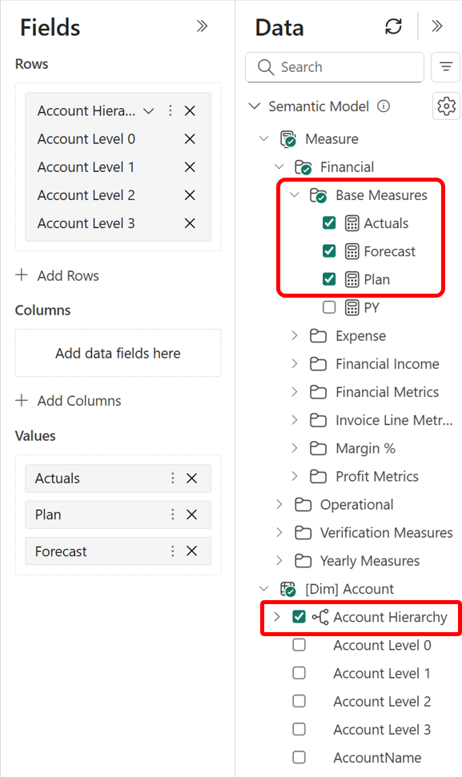

5.  On the **Format** tab, select **Appearance**. In the **Appearance** pane, search for +++Ragged+++, and turn on **Ragged Hierarchy**.

    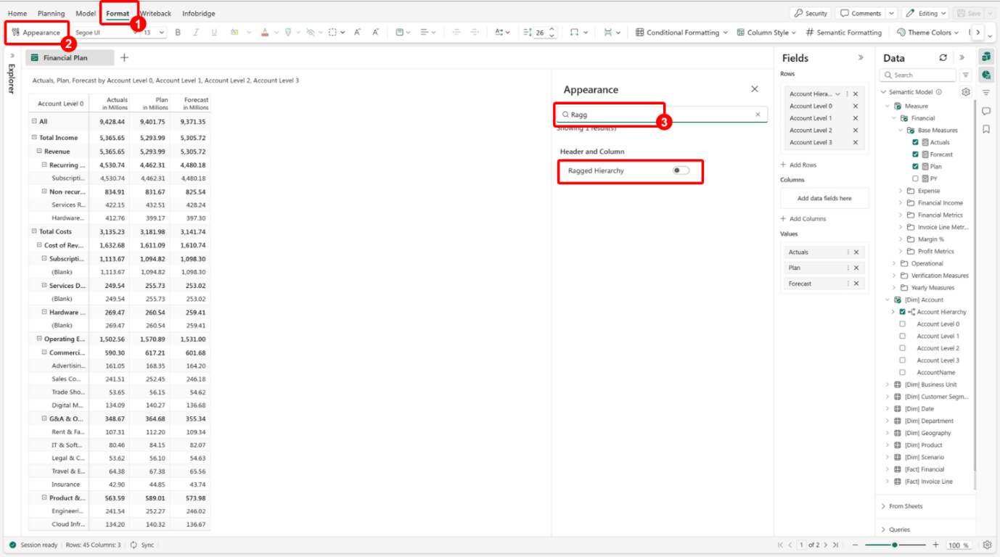

    **Note:** A ragged hierarchy hides the blank levels for accounts that don't use every level of the hierarchy, so the statement reads cleanly.

6.  On the **Format** tab, select **Auto Fit \> Fit to Content** to widen the columns to fit their content.

    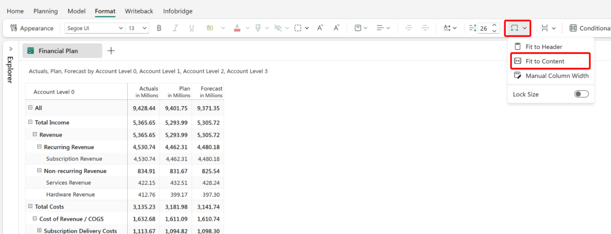

### Task 2: Add a what-if simulation

1.  Select the **Plan** column header.

2.  On the **Planning** tab, select **Insert Column \> Simulate**. If you're prompted to save the sheet, select **Save and continue**.

    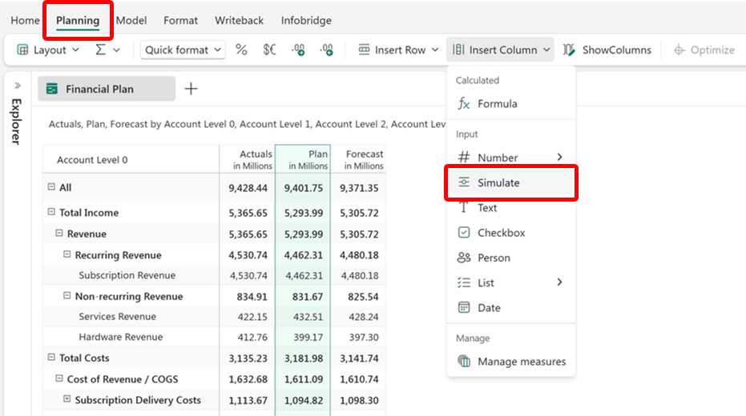

3.  In the **Simulation** pane, enter the following details, and then select **Create**:

    | **Setting**         | **Value**                       |
    |---------------------|---------------------------------|
    | Title               | **Plan (Simulation)** (default) |
    | Simulation based on | **Plan**                        |
    | Show Slider         | Selected                        |
    | Value Range         | +++10+++                        |

    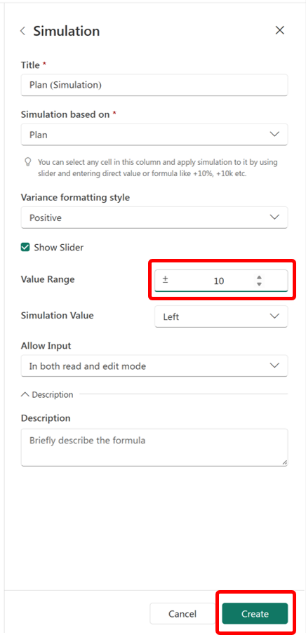

    The **Plan (Simulation)** column appears next to **Forecast**. It starts with the **Plan** values, and you can change any cell with the slider or by entering a value.

    **Note:** **Value Range** sets the slider limits, here -10% to +10%.

4.  In the **Plan (Simulation)** column, apply the following adjustments. Select the cell, type the value, and press **Enter**, or drag the slider that appears in the cell:

    | **Account**              | **Adjustment** | **What to type** |
    |--------------------------|----------------|------------------|
    | Hardware Revenue         | +5%            | +++5%+++         |
    | Subscription Revenue     | -2%            | +++-2%+++        |
    | Advertising & Promotions | -6%            | +++-6%+++        |
    | Digital Marketing        | Set to \$120M  | +++120m+++       |

    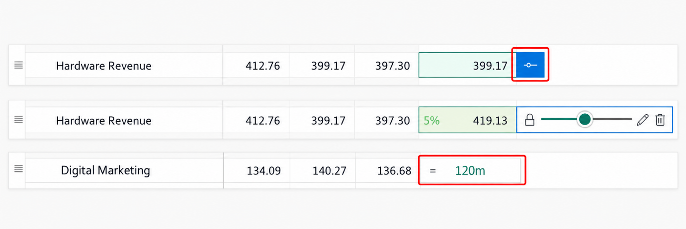

    For example, **Hardware Revenue** changes from **399.17** to **419.13**, and the cell shows the **5%** change.

5.  Verify that the **Plan (Simulation)** column and its parent totals reflect the scenario, and then select **Save**.

    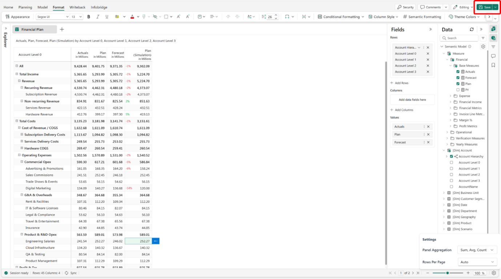

## Exercise 2: Embed the planning sheet and add a live KPI

In this exercise, you embed the **Financial Plan** sheet in an intelligence sheet and add a KPI that compares the simulation with Plan and Actuals.

### Task 1: Embed the planning sheet

1.  In the **Explorer** pane, select your intelligence sheet (for example, **Intelligence**).

    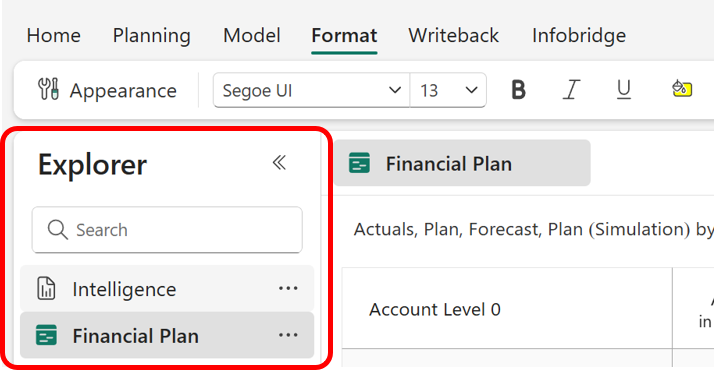

    **Tip:** To keep the dashboards from Labs 08 and 09 unchanged, you can create a new intelligence sheet instead: on the **Home** tab, select **New Intelligence Sheet**.

2.  In the **Visualizations** pane, select **Planning**.

    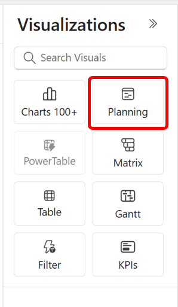

3.  In the **Select an Existing Planning Sheet** dialog box, select **Financial Plan**, and then select **Add**.

    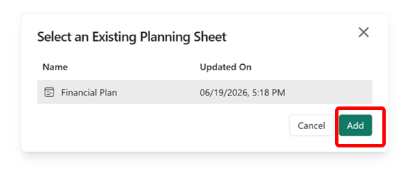

4.  Resize the embedded planning sheet and position it on the left side of the canvas.

### Task 2: Add a KPI that uses the simulation

1.  Select an empty area of the canvas, and in the **Visualizations** pane, select **KPIs**.

2.  Map the following fields:

    | **Field well**            | **Field**                                              |
    |---------------------------|--------------------------------------------------------|
    | Actual(s)                 | **From Sheets \> Financial Plan \> Plan (Simulation)** |
    | Comparison 1 (vs Actuals) | **Measure \> Financial \> Base Measures \> Plan**      |
    | Comparison 2 (vs Actuals) | **Measure \> Financial \> Base Measures \> Actuals**   |
    | Trellis Row               | **\[Dim\] Account \> Account Level 3**                 |

    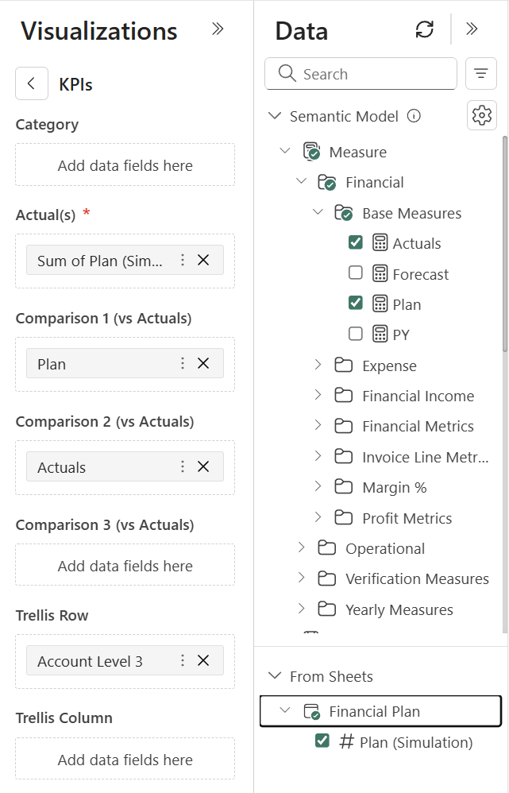

    **Note:** **Plan (Simulation)** appears in the field well as **Sum of Plan (Simulation)**.

3.  Verify that the KPI shows one card per account, with **Plan (Simulation)** and its variance to **Plan** (Δ1) and **Actuals** (Δ2).

4.  In the embedded planning sheet, change a **Plan (Simulation)** value, for example for **Services Revenue**, and verify that the matching KPI card updates.

    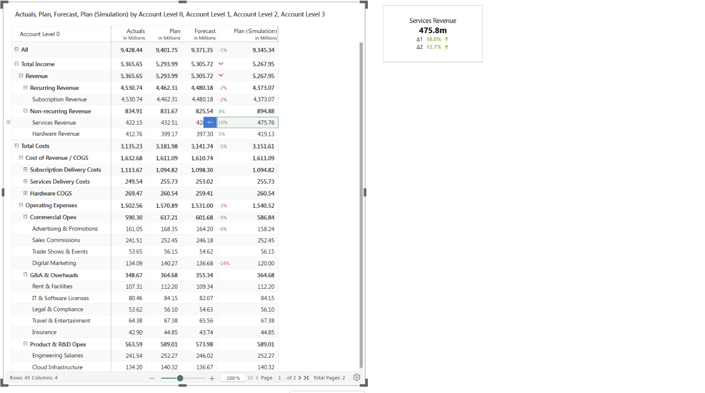

    Changes to the simulation flow to the KPI immediately, without recreating the visual.

## Exercise 3: Create the Sales Detail PowerTable

In this exercise, you create a PowerTable app on a Fabric SQL database and import product data from the semantic model.

### Task 1: Create the PowerTable sheet and app

1.  On the **Home** tab, select **New PowerTable Sheet**.

    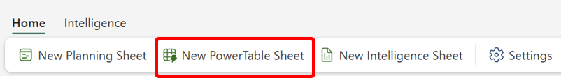

2.  Enter +++Sales Detail+++ as the name, and then select **Create**.

3.  On the **Welcome to PowerTable** page, select **Create a New App**.

    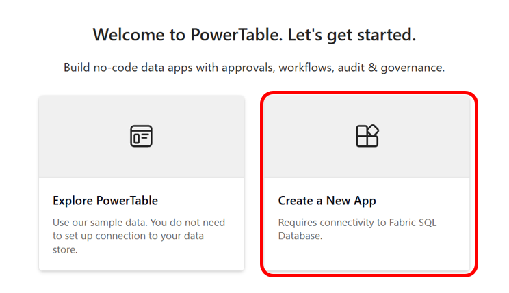

    **Note:** **Create a New App** requires a connection to a Fabric SQL database. **Explore PowerTable** opens sample data and doesn't need a connection.

### Task 2: Connect to the Fabric SQL database

1.  If prompted, under **Select a Connection**, select your Fabric SQL connection. If you don't have one, select **Create Connection** and sign in with your organizational account.

2.  In the **Select destination database** dialog box (OneLake catalog), search for your Fabric SQL database, select it, and then select **Add**.

3.  Select **Connect**.

### Task 3: Create the Sales Detail table

1.  On the **Select Table** page, select **New Table** (Import data and create a new table).

2.  Enter the following details, and then select **Next**:

    | **Setting**         | **Value**                             |
    |---------------------|---------------------------------------|
    | Schema              | **dbo**                               |
    | Table Name          | +++Sales Detail+++                    |
    | Import Data         | **Connect To Semantic Model**         |
    | Select a Connection | Your semantic model (DMTS) connection |
    | Semantic Model      | **Enterprise Dataset**                |

    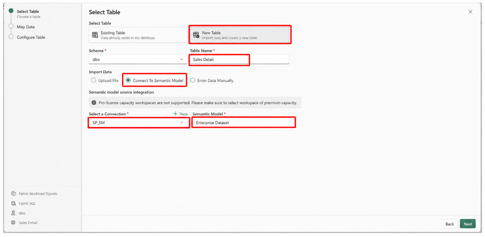

    **Note:** Semantic model integration isn't supported in Pro license capacity workspaces. Use a workspace on Fabric capacity.

### Task 4: Map the fields and set the primary key

1.  On the **Map Data** page, on the **Assign** tab, use the **Semantic Model** tree to add the following fields:

    | **Field well** | **Field**                                                      |
    |----------------|----------------------------------------------------------------|
    | Fields         | **DimProduct \> Category**, **DimProduct \> Product Name**     |
    | Values         | **Measure \> Financial \> Base Measures \> Actuals**, **Plan** |

    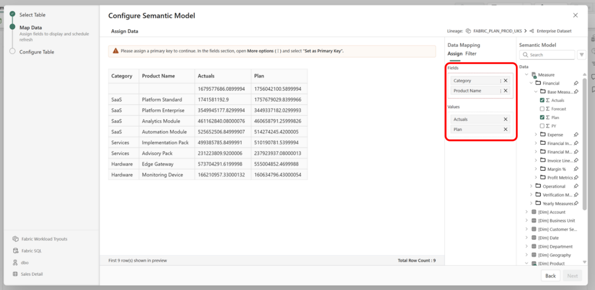

2.  In the **Fields** list, select the three dots next to **Product Name**, and then select **Set as Primary Key**.

    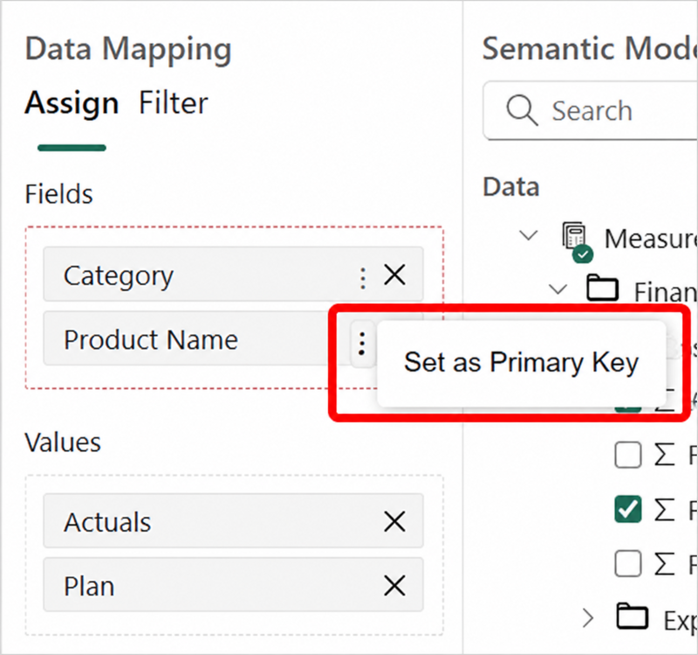

    **Important:** A PowerTable needs a primary key that uniquely identifies each row. You can't continue until you set one.

3.  Optionally, select the **Filter** tab to limit the imported rows, for example **Category** is **Hardware**, **SaaS**, or **Services**.

    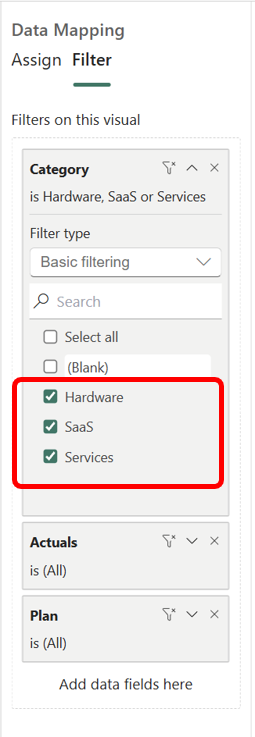

4.  Select **Next**.

### Task 5: Configure the table columns

1.  On the **Configure Table** page, review the detected settings for each column:

    | **Column**   | **Data Type** | **Input Type** | **Primary Key** |
    |--------------|---------------|----------------|-----------------|
    | Product Name | VARCHAR       | Text           | Yes             |
    | Category     | VARCHAR       | Text           | No              |
    | Actuals      | FLOAT         | Decimal        | No              |
    | Plan         | FLOAT         | Decimal        | No              |

    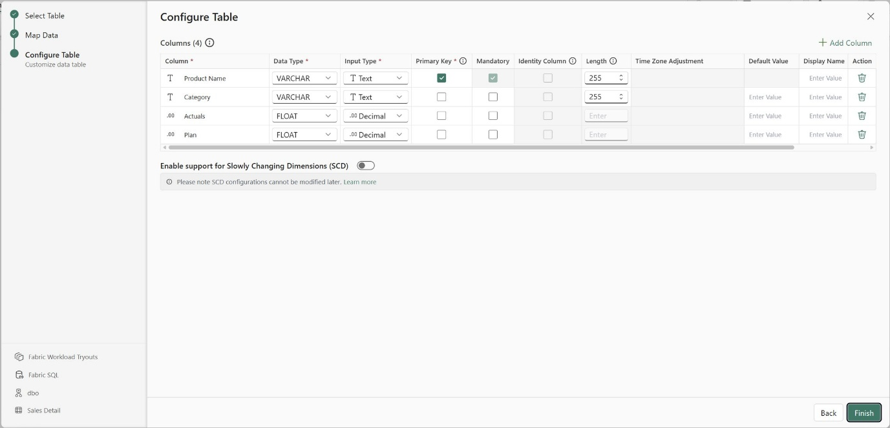

2.  Update the **Display Name** or enter default values if needed, and then select **Finish**.

3.  Select **Save** to save the PowerTable sheet.

## Exercise 4: Embed the PowerTable on the canvas

In this exercise, you add the **Sales Detail** PowerTable next to the planning sheet and KPI.

### Task 1: Embed the PowerTable

1.  In the **Explorer** pane, select the intelligence sheet that you used in Exercise 2.

2.  In the **Visualizations** pane, select **PowerTable**.

    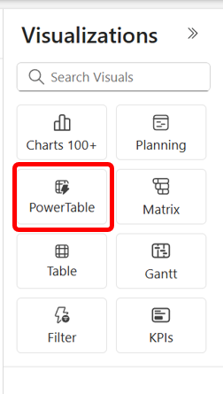

3.  In the **Select an Existing PowerTable** dialog box, select your **Sales Detail** sheet, and then select **Add**.

    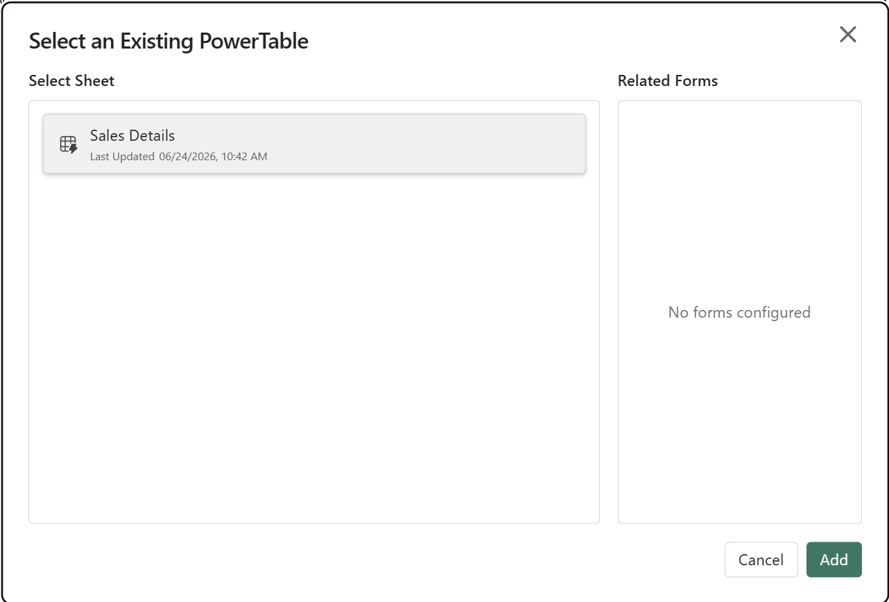

    **Note:** The screenshot shows the sheet name **Sales Details**. Select the PowerTable sheet that you created in Exercise 3.

4.  Resize and position the PowerTable below the KPI cards, so that the simulation, its impact, and the product detail are visible on one canvas.

    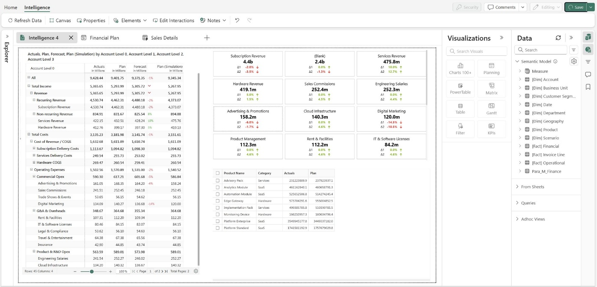

5.  Select **Save**.

**Outcomes**

You now have an intelligence sheet that:

- Embeds the **Financial Plan** planning sheet with **Actuals**, **Plan**, and **Forecast** on the account hierarchy, in a ragged hierarchy layout

- Includes a **Plan (Simulation)** column with a value range of 10 and four what-if adjustments

- Shows a KPI that combines semantic model measures with the simulated values from the planning sheet

- Embeds the **Sales Detail** PowerTable, stored in a Fabric SQL database and imported from the **Enterprise Dataset** semantic model, with **Product Name** as the primary key

**Summary**

In this lab, you built an integrated planning canvas in Plan for Microsoft Fabric. You created the **Financial Plan** planning sheet on the account hierarchy, formatted it as a ragged hierarchy, and added a **Plan (Simulation)** column to test a budget scenario with percentage and value adjustments. You embedded the planning sheet in an intelligence sheet and added a KPI that compares the simulation with Plan and Actuals and updates as you change the scenario. You then created the **Sales Detail** PowerTable app on a Fabric SQL database, imported product data from the semantic model, set **Product Name** as the primary key, and embedded the PowerTable on the same canvas, so that leadership can see the scenario, its impact, and the product detail in one place.
